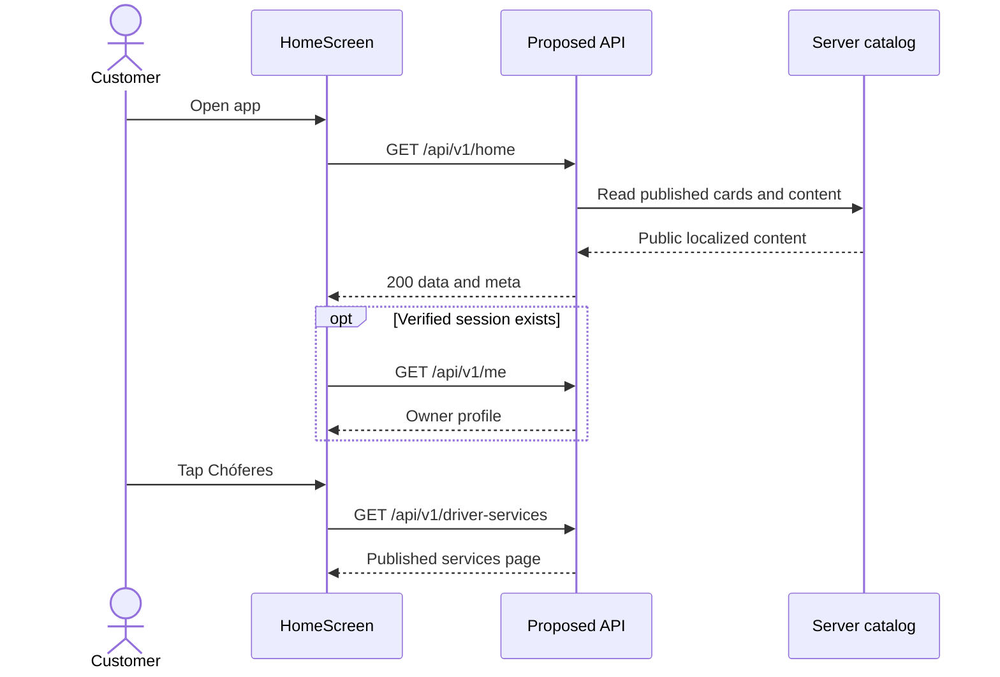
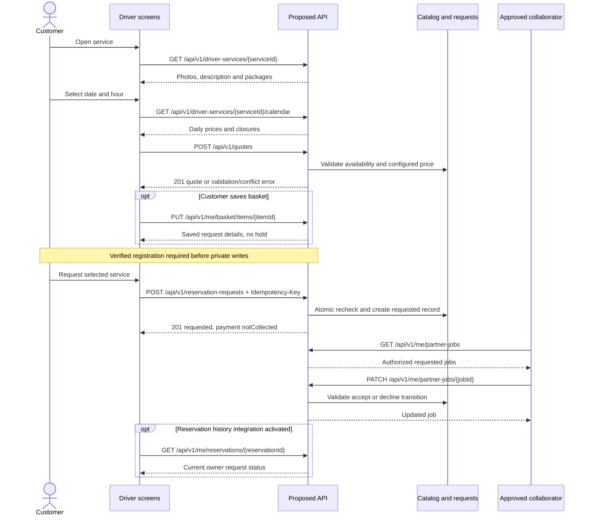

# Backend API Requirements — ASKUS TOURS / Hala Spain

**Inspection date:** 2026-11-15 (Europe/Madrid). **Deliverable scope:** specification only; no mobile source, networking, backend, package, or configuration changes.

**Evidence policy.** Requirements below come from the actual `lib/*.dart` sources, their serialization/validation logic, asset fixtures, and relevant `test/*.dart` scenarios. Repository-relative paths are used throughout. Existing design/operations documents were secondary context, not proof of implemented features. All HTTP routes, server IDs, tokens, response envelopes, quote objects and reservation records are **proposed contracts**, not endpoints found in the project. Current app calls none of them.

## 1. App overview

Flutter app for Spanish tourism: browse private-driver services and guided visits, keep favorites and a mixed basket, prepare a personalized itinerary or request a published travel package, and prepare professional provider profiles and service drafts. Source branding is ASKUS TOURS (`main.dart`); Hala Spain is the workspace name. Android/iOS and a Flutter web preview exist. Spanish, English and Arabic localization and Arabic RTL are supported.

**Users:** guest (browse), locally registered customer, locally selected partner, and a future administrator/reviewer acting outside the mobile app. `AccountRole.customer/partner` is a local navigation choice, not verification or permission. Approval/session/photo conditions in `partner_operations.dart::canPartnerOperate` are preparatory vocabulary. No real administrator session, authentication provider, API client, payment gateway or shared database is implemented.

**Navigation:** Home, Mis reservas, Favoritos, Mi cesta, Más; profile via header photo. Home shortcuts: Vuelos, Hoteles, Chóferes, Trenes, Monumentos, Guías, Actividades, Crea tu viaje. Only drivers, guides and travel planning have substantive flows. Flights show a coming-soon dialog; hotels, standalone trains/monuments/activities and destination/experience taps show provisional messages.

### 1.1 Critical scope boundaries

- **No hotel browsing or hotel reservation flow exists.** There is no Hotel/Room/HotelReservation model. Hotel references are trip-planning preferences, offer marketing, or pickup/drop-off hotel names. Do not build hotel inventory/booking APIs on the strength of a shortcut or an offer image.
- Driver and guide booking-like forms exist, but **no real reservation or payment is created**. Driver `_pay` opens explicit test-payment text; legacy `DriverRequestScreen` only flips a bool. Guide “booking” is an editable basket record, not a confirmed supplier booking.
- Mis reservas is an empty placeholder; there is no implemented history/detail/cancellation/modification UI. Reservation contracts below are the minimum proposed server bridge for the existing request forms and this tab; their statuses must not be misreported as app-defined customer reservation statuses.
- No notification inbox, push-token registration, review writing/reporting, discount-code entry, customer wallet recharge, payout request, hotel-owner registration, transport ticket issuance, route optimization, map directions or real-time vehicle tracking is implemented.
- Partner requests are an explicitly disposable example; partner earnings are empty/zero. Professional services remain local drafts; no mobile “publish” or “delete service” action exists.
- Trip requests can be saved; remote send is rendered but disabled by `TripPlanStore.canSubmit=false`. Privacy acknowledgement is needed for submission, not for local saving. No €20 charge is made.
- Support/contact is informational only, not an in-app messaging form. Native sharing has no backend action.
- No passport field exists in current account/traveler models, despite earlier product ideas. No payment-card or bank-account field exists.
- Public fixture photos, ratings, review counts, fares and availability are examples, not verified listings or customers. They must not be seeded as real business records.

### 1.2 Interpreting “required endpoint”

The **45 endpoints** in sections 4–5 form the proposed backend contract set for replacing the current mocks/local repositories and activating the already represented registration/request paths. They are not a claim that 45 network calls or fully implemented live flows exist. Evidence is explicitly labeled: **data replacement**, **local-action replacement**, or **activation bridge**. Activation bridges (verified auth, actual request submission/history and partner acceptance) require later mobile integration work and approved operational rules. Disabled payments/recharge/payout and absent hotel booking are not counted. Do not implement any backend as part of this document task.

## 2. Screen and data inventory

A “feature analyzed” is one distinct row below, including important sheets/dialogs and cross-cutting local persistence. Pure paint/layout classes are not counted as extra product screens.

| # | Screen or feature | User action | Static/mock data currently used | Model/source file | Backend operation needed |
|---|---|---|---|---|---|
| 1 | Home / tabs | Open Home, Mis reservas, Favoritos, Mi cesta, Más | Five tabs; eight service shortcuts; es/en/ar | `lib/home_screen.dart::_tabs, _shortcuts`; `lib/main.dart::AskusToursApp` | E01; tab-specific reads below |
| 2 | Header / profile entry | Tap avatar; see Hola / visitor or name | LocalProfile and local registered flag | `lib/home_screen.dart::_openProfile`; `lib/app_state.dart::LocalProfile` | E17; E13–E16 when signed out |
| 3 | Language sheet | Select Spanish, English or Arabic | Local _locale; not persisted in main.dart | `lib/home_screen.dart::_selectLanguage`; `lib/main.dart` | No mandatory API; localization headers |
| 4 | Night mode | Switch theme | AppState.nightMode in preferences | `lib/more_screen.dart`; `lib/app_state.dart::setNightMode` | E18 preferences if account sync is enabled; keep offline fallback |
| 5 | Main offer carousel | Swipe/auto-scroll/click whole frame | Five Offer records; local photo files | `lib/home_screen.dart::_OfferCarousel`; `lib/offers.dart::offers` | E01 supplies full offer objects |
| 6 | Offer detail | Read image, title, body and sections; driver CTA | Offer.highlights/sections/opensDrivers | `lib/offer_detail_screen.dart::OfferDetailScreen` | E01 data reused; no redundant detail request |
| 7 | Featured offers | Open small title/image card | Same offers as hero carousel | `lib/home_screen.dart::_FeaturedOfferCard` | E01 |
| 8 | Trip-idea carousel | Select nature/honeymoon/family/friends/shopping/sports | Six styles; initialStyle prefill | `lib/home_screen.dart::_tripIdeas`; `lib/trip_plan.dart::TripStyle` | E01 card configuration; E29/E30 |
| 9 | Destination carousel / see all | Tap Madrid/Barcelona/Málaga/Granada | Photos + labels; placeholder snackbar | `lib/home_screen.dart::_destinations, _showDemo` | E01 display data only; no destination booking API |
| 10 | Experience carousel / see more | Tap kayak/tapas/old-town/Seville | Photos + labels; placeholder snackbar | `lib/home_screen.dart::_experiences, _showDemo` | E01 display data only; no experience checkout |
| 11 | Flights shortcut | Tap disabled-looking icon | Coming-soon modal | `lib/home_screen.dart::_showDemo` | No flight booking API |
| 12 | Hotels shortcut | Tap Hoteles | Placeholder snackbar; no hotel screen/model | `lib/home_screen.dart::_buildShortcuts, _showDemo` | No hotel search, room availability or reservation endpoints |
| 13 | Trains / monuments / activities shortcuts | Tap icons | Placeholder snackbar | `lib/home_screen.dart::_shortcuts, _showDemo` | No standalone inventory/booking endpoints |
| 14 | Notifications icon | Tap bell | Placeholder snackbar, no inbox/device token | `lib/home_screen.dart::_buildHeader` | No notification endpoint in required set |
| 15 | Accepted-payment footer | View payment brands | One static payment-methods.png image | `lib/payment_methods_footer.dart::PaymentMethodsFooter` | Optional display configuration in E01; no payment-provider integration implied |
| 16 | Mis reservas tab | Open reservation area | Empty confirmed-bookings message; no history model | `lib/home_screen.dart::_buildMenuPage` | E11/E12 proposed activation contracts; currently no history caller |
| 17 | Favorites tab | See saved driver cards | city:category preference keys | `lib/home_screen.dart`; `lib/driver_browse_screen.dart(favoritesOnly)`; `lib/app_state.dart` | E21–E23; canonical service IDs |
| 18 | Driver browse | Browse six city/category entries | demoVehiclesForCity; three DriverCity values | `lib/driver_browse_screen.dart::DriverBrowseScreen`; `lib/driver_catalog.dart` | E03 |
| 19 | Driver city/sort menus | Choose city, recommended/popular/rating/low/high price | Local filtering/sorting and missing-sort-data message | `lib/driver_browse_screen.dart::_sort` | E03 query parameters |
| 20 | Driver filters sheet | Free cancellation, instant confirmation, language, category | DriverFilters | `lib/driver_filters.dart::showDriverFilters` | E03 query parameters |
| 21 | Custom driver search | Set airport/intercity/international/hourly, date/time, route, capacity | DriverSearch; 12h lead; hours 4/8/12 | `lib/driver_search_screen.dart::DriverSearchScreen` | E03 filters; E09 authoritative quote |
| 22 | Driver results / refine | Change city, seats, category, language, max price | demoVehiclesForCity and examplePrice | `lib/driver_results_screen.dart::DriverResultsScreen` | E03 with route/search context |
| 23 | Vehicle card gallery / share / favorite | Swipe up to four images, share native text, toggle heart | Local assets; SharePlus; favorites | `lib/driver_widgets.dart::DriverVehicleGallery`; `lib/driver_results_screen.dart::DriverVehicleCard` | E03/E04 media; E22/E23; sharing is device-local |
| 24 | Driver service detail | Read service/driver description, rating, features and packages | DriverVehicle; generated default description; local price | `lib/driver_results_screen.dart::DriverDetailScreen` | E04 |
| 25 | Driver reviews / star filter | Open reviews, filter 1–5 stars | DriverReviews, sampleDriverComments | `lib/driver_reviews_screen.dart::DriverReviewsScreen` | E06; no review submission/report API |
| 26 | Driver package cards | Select airportHotel/hotelAirport/intercity/fourHours/eightHours | DriverPackageOption + shared vehicle pricing | `lib/driver_package_widgets.dart::DriverPackageCard` | E04 package array; E09 |
| 27 | Package details sheet | Read description/conditions, choose package for basket | Vehicle inclusions/waiting/capacity, local sample terms | `lib/driver_package_widgets.dart::_PackageDetailsSheet` | E04 reused; E25 |
| 28 | Driver priced calendar | Browse month, select day; date-only return or legacy continue | dailyPrices, unavailableWeekdays, Saturday supplement | `lib/driver_calendar_screen.dart::DriverCalendarScreen` | E05 |
| 29 | Booking time dialog | Scroll hours/minutes wheels | TimeOfDay; local 24h values | `lib/driver_booking_screen.dart::_TripTimeDialog` | No separate endpoint; E09 validates selected timestamp |
| 30 | Driver booking form | Check date/time, unlock fields, name/route/reference/capacity/notes | Local vehicle availability; selected package immutable | `lib/driver_booking_screen.dart::DriverBookingScreen` | E09 then E25 or E10 when activated |
| 31 | Driver pay-preview sheet | Tap Pagar | Explicit no-charge/no-confirmation text | `lib/driver_booking_screen.dart::_pay` | No live payment endpoint now; E10 is request-only, not a debit |
| 32 | Legacy driver request confirmation | Submit name/contact with selected service | _submitted bool only, no persistent reservation | `lib/driver_request_screen.dart::DriverRequestScreen` | E10 proposed request-only contract |
| 33 | Basket / driver items | Add selected or incomplete package, remove, resume booking | BasketEntry, JSON-content-derived identity | `lib/basket_screen.dart`; `lib/app_state.dart::addToBasket/removeFromBasket` | E24–E26; null search allowed; no multi-item checkout |
| 34 | Guide catalog / filters | Browse by city/language; recommended/price | Three demoGuides | `lib/guide_screens.dart::GuideCatalogScreen`; `lib/guide_models.dart` | E07 |
| 35 | Guide detail | Read visit description, languages, duration, cancellation; book | GuideService; generated title/description; no real reviews | `lib/guide_screens.dart::GuideDetailScreen` | E08 |
| 36 | Guide booking / date dialog | Choose date, hour 9/11/16, 2/4h, people, language, name, meeting, notes | GuideBooking; 12h lead; price * hours / 2 | `lib/guide_screens.dart::GuideBookingScreen` | E09/E25; E10 on live submission |
| 37 | Basket / guide items | Edit saved request or remove | guideBasket; addGuideBooking upsert by ID | `lib/guide_screens.dart::GuideBasketCard`; `lib/app_state.dart` | E24–E26 |
| 38 | Welcome / registration choice | Mobile/email and Soy colaborador; name and surname | AuthScreen two local stages, no OTP | `lib/auth_screen.dart::_continue, _partnerChoice` | E13/E14 recommended verified-auth bridge |
| 39 | Country-prefix/search sheet | Search country/calling code/city aliases, select flag | country_picker package, dialCityAliases | `lib/dial_country_picker.dart::showDialCountryPicker` | Client reference data; no geocoding/country endpoint |
| 40 | Authentication legal links | Open privacy or terms | Provisional locally translated text | `lib/account_legal.dart::showAccountLegal` | E02 |
| 41 | Profile / avatar / own photo / sign out | Edit name; customer avatar or own photo; partner own photo only | LocalProfile; gallery/private file/data URI | `lib/profile_screen.dart::ProfileScreen`; `lib/app_state.dart::saveProfile/signOut` | E17/E18/E19/E20/E16 |
| 42 | Traveler-details form | Edit surname, contact and billing address | TravelerDetails, optional fields | `lib/account_screens.dart::TravelerDetailsScreen` | E17/E18 |
| 43 | Customer wallet | Read zero balance and empty movements; top-up disabled | Literal 0,00 €; no wallet model | `lib/account_screens.dart::WalletScreen` | E45 read-only; top-up/refund endpoints deferred |
| 44 | More / contact / privacy / terms / FAQ | Read informational screens; expand FAQ | Static localized text; contact channels not configured | `lib/more_screen.dart::MoreScreen, _FaqScreen` | E02; no support-message submission |
| 45 | Native share app | Open OS sharing | ASKUS TOURS text only | `lib/more_screen.dart::SharePlus` | No API |
| 46 | Partner professional dashboard | Open professional modules and pending-activation label | PartnerApplication, LocalProfile.role | `lib/partner_dashboard.dart::PartnerDashboard` | E35/E43/E44; no approval from client role |
| 47 | Partner application form / prepare submission | Save six fields; require photo to prepare full application | PartnerApplication.submitted is local-only | `lib/account_screens.dart::PartnerAccountScreen` | E35–E37 |
| 48 | Partner professional-photo picker | Upload own photo; no avatars | ImagePicker; current profile photo | `lib/partner_dashboard.dart::_photo`; `lib/profile_screen.dart` | E19 then E18 |
| 49 | Partner service hub | Choose driver drafts or guide drafts | Navigation to existing separate editors | `lib/account_screens.dart::PartnerServiceHub` | E38 with type filter |
| 50 | Partner driver draft list / create | Resume or create draft | PartnerDraftStore | `lib/partner_services_screen.dart::PartnerServicesScreen` | E38/E39/E40 |
| 51 | Driver draft step 1 / photos | Title, description, model, city, language, seats/bags, up to 4 photos | PartnerServiceDraft; gallery/file/data URIs | `lib/partner_services_screen.dart::PartnerServiceEditor` | E19/E20/E40 |
| 52 | Driver draft pricing step | Enable packages, enter prices | Map<DriverPackageOption,int> in whole EUR | `lib/partner_services_screen.dart`; `lib/partner_service_draft.dart` | E40 prices normalized to cents |
| 53 | Driver draft conditions step | Water/tolls, waiting, km, cancellation, instant confirmation | PartnerServiceDraft fields | `lib/partner_services_screen.dart` | E40; admin review before public use |
| 54 | Driver draft languages/weekly availability | Choose language set and closed weekdays | closedWeekdays 1–7 | `lib/partner_services_screen.dart` | E40 |
| 55 | Driver draft review / unsaved-changes dialog | See missing fields; save incomplete draft; save/leave/cancel | missing getter; no publish action/delete service action | `lib/partner_services_screen.dart::_leave`; `lib/PartnerServiceDraft.missing` | E40; no required publication/delete-service endpoint |
| 56 | Partner guide draft list/editor | Create/edit guide title/route/price/hours/capacity/languages/photo | GuideDraftStore, GuideDraft permissive strings | `lib/guide_screens.dart::GuidePartnerScreen, GuideEditorScreen` | E38/E39/E40; media E19/E20 |
| 57 | Partner service-request example | See example; accept or decline once | Ephemeral _example PartnerJobStatus | `lib/partner_dashboard.dart::PartnerRequestsScreen` | E41/E42 proposed live replacement; simulation never creates money |
| 58 | Partner earnings | Read pending/available/paid, payout button disabled | Empty PartnerWalletSummary | `lib/partner_dashboard.dart::PartnerEarningsScreen`; `lib/partner_operations.dart` | E43; no payout-creation endpoint in current active UI |
| 59 | Partner economic rules | Read 25%, adjustments and pending payout rules | initialPartnerCommissionPolicy; localized text | `lib/partner_dashboard.dart::PartnerRulesScreen`; `lib/partner_operations.dart` | E44 |
| 60 | Create-your-trip entry | Choose design or published packages; see own requests | Two artwork cards; local routes | `lib/trip_entry_screen.dart::TripEntryScreen` | E27/E31; local entry assets need no API |
| 61 | Important planning-information sheet | Read services/advice/before booking/€20 fee, continue | tripPlanningFeeEur = 20; fee credited against booked package | `lib/trip_planning_info.dart::TripPlanningInfoScreen` | E02 planning-info; fee config in E01; no planning-payment action |
| 62 | Published travel-package list / retry | Load only active, non-example packages; see empty state | TravelPackageRepository.readPublished; empty by default | `lib/travel_package.dart`; `lib/trip_entry_screen.dart::TravelPackagesScreen` | E27 |
| 63 | Travel-package detail / request / customize | Read includes/excludes/terms/availability; prefill plan | TravelPackage.toPlan, immutable package version | `lib/trip_entry_screen.dart::TravelPackageDetailScreen` | E28 then E29/E30/E33/E34 |
| 64 | Trip planner dates / calendars / month sheet | Exact arrival/departure or unknown/flexible months; confirm day immediately | dateMode, months, arrival/departure; no booking inventory | `lib/trip_route_questions.dart`; `lib/trip_month_picker.dart` | E29/E30 only |
| 65 | Trip cities / transport / route / reset | Choose ordered cities, route modes, car preference; reorder; clear with confirmation | destinations, routeTransport, static Spain map/coordinates | `lib/trip_route_designer.dart`; `lib/trip_route_bar.dart`; `lib/trip_spain_map.dart` | E29/E30; no routing or transport ticket endpoint |
| 66 | Trip accommodation questions | Nights then hotel/apartment; stars→breakfast→bed→area→notes | TripCityStay; no preselected hotel; capped sheet | `lib/trip_route_questions.dart::_accommodation` | E29/E30; preferences only, not room stock |
| 67 | Trip traveler questions | Adults/children/infants/age arrays and rooms | TripPlan; incomplete ages represented by null | `lib/trip_form_steps.dart`; `lib/trip_plan.dart::validationIssues` | E29/E30 |
| 68 | Trip desired services / budget / contact | Hotel/driver/rail/flight/activities/guide prefs, interests, budget and communication | serviceDetails string map; currencies; contact channels | `lib/trip_form_steps.dart`; `lib/trip_question_copy.dart` | E29/E30; no actual flight/train booking |
| 69 | Trip summary / save / consent / send | Edit previous answers; save locally; disabled remote send | TripRequest, localOnly; canSubmit=false | `lib/trip_planner_screen.dart::_saveRequest`; `lib/trip_form_steps.dart` | E33/E34; submission activation requires decisions |
| 70 | My trip requests / saved detail / edit | List local requests newest first, open and revise | TripPlanStore.readRequests; TripRequestStatus | `lib/trip_entry_screen.dart::TripRequestsScreen, TripSavedRequestScreen`; `lib/trip_request_summary.dart` | E31/E32/E33 |
| 71 | Persistence and media cleanup | Read/save account, basket, favorites, drafts, photo replacement | SharedPreferences + private files/data URIs; separate stores | `lib/app_state.dart`; `lib/partner_service_draft.dart`; `lib/guide_models.dart`; `lib/trip_plan.dart` | Owner-scoped APIs; never bulk-upload all local data silently |
| 72 | Credits / fixed visual assets | Read map/photo credits; show icons/avatars/artwork | Bundled Natural Earth geometry and artwork | `lib/trip_route_designer.dart::_credits`; `lib/soft_artwork.dart`; `lib/travel_shortcut_icon.dart` | Keep bundled credits/assets; signed media URLs only for uploaded photographs |
| 73 | Legacy driver/transport-company enquiry form | Enter contact name, phone/email, professional/company and cities; submit simulation | Unbound DriverField values; _submitted bool; no stored payload | `lib/driver_request_screen.dart::DriverPartnerScreen (reachable from browse/search)` | Reuse E36/E37 after authenticated profile normalization; no parallel collaborator model |


## 3. Data models

### Reading the tables

Every serialized backend-relevant source field is documented or explicitly mapped. Proposed API-only fields are identified. **Required on read** means presence of the response key, not a requirement to complete an in-progress form. Nullability is independent. Requests follow the operation-specific requirements in section5. Incomplete drafts preserve unanswered values; publication/readiness validation is different from autosave validation. No server IDs, approval, totals or verification flags are trusted from client writes. Large nested examples are fully expanded in section5 and their child models are documented here.

### LocalizedText / OfferText

**Evidence:** `lib/offers.dart::OfferText, OfferLocalization; lib/travel_package.dart::localized`.

Map, not JSON-encoded text. OfferText requires es/en/ar; TravelPackage dictionaries tolerate missing translations and fall back to es, then the first value. Return all three for OfferText adapters.

| App field / source | Recommended JSON key | Type | Presence | Nullable | Example | Allowed values / validation / formatting | Value owner |
|---|---|---|---|---|---|---|---|
| es | es | string | Required on read | No | "Traslado privado" | Spanish required as fallback. | Admin/authentic content |
| en | en | string | Required on read | No | "Private transfer" | English content. | Admin/authentic content |
| ar | ar | string | Required on read | No | "نقل خاص" | Arabic Unicode; app handles RTL. | Admin/authentic content |

### Account / LocalProfile plus TravelerDetails projection

**Evidence:** `lib/app_state.dart::LocalProfile, AppState._persist; lib/account_models.dart::TravelerDetails; lib/auth_screen.dart`.

This normalized projection combines the two existing account models without dropping fields. App role is a local navigation preference. User ID and verified flags are proposed server additions. No passport/card/bank fields exist.

| App field / source | Recommended JSON key | Type | Presence | Nullable | Example | Allowed values / validation / formatting | Value owner |
|---|---|---|---|---|---|---|---|
| — server ID | id | string | Required on read | No | "usr_001" | Preserve the documented type; validate server-side. | Client editable except id, verification flags and authoritative role |
| LocalProfile.name | firstName | string | Required on read | No | "Nora" | Trim; nonempty for registration/profile save. Profile save has no explicit model maximum. | Client editable except id, verification flags and authoritative role |
| TravelerDetails.surname | lastName | string | Required on read | No | "García" | Registration requires nonempty; traveler editor max80 but otherwise optional. | Client editable except id, verification flags and authoritative role |
| LocalProfile.role / stored accountRole | accountRole | string | Required on read | No | "customer" | customer \| partner. A request cannot grant admin rights or partner approval. | Client editable except id, verification flags and authoritative role |
| email | email | string | Required on read | No | "nora@example.com" | Email pattern ^[^\s@]+@[^\s@]+\.[^\s@]+$. Contact edit optional if empty. | Client editable except id, verification flags and authoritative role |
| phone | phone | string | Required on read | No | "+34612345678" | Normalize prefix+national number into E.164, 7–15 digits after +. Current login accepts6–14 national digits; phone edits lack a regex. | Client editable except id, verification flags and authoritative role |
| emailVerified | emailVerified | boolean | Required on read | No | true | Server challenge/provider result only. | Client editable except id, verification flags and authoritative role |
| phoneVerified | phoneVerified | boolean | Required on read | No | false | Server challenge/provider result only. | Client editable except id, verification flags and authoritative role |
| photoPath (read) | photoUrl | string | Required on read | Yes | null | HTTPS media URL only, no device paths. | Client editable except id, verification flags and authoritative role |
| photoPath (write reference) | photoUploadId | string | Optional on write | Yes | null | Owner-authorized upload reference; null if absent. | Client editable except id, verification flags and authoritative role |
| avatar | avatar | string | Optional on write | No | "womanClassic" | classic \| glasses \| arab \| cap \| womanClassic \| womanGlasses \| womanScarf \| womanHat. Partners use real photo only. | Client editable except id, verification flags and authoritative role |
| address | address | string | Optional on write | No | "Calle Mayor 10" | Optional billing address max180. | Client editable except id, verification flags and authoritative role |
| city | city | string | Optional on write | No | "Madrid" | Optional free-text billing city max80, not DriverCity enum. | Client editable except id, verification flags and authoritative role |
| postalCode | postalCode | string | Optional on write | No | "28013" | Optional max80, preserve leading zeros. | Client editable except id, verification flags and authoritative role |
| country | country | string | Optional on write | No | "ES" | App free text max80; recommend ISO country code; resolve existing names on migration. | Client editable except id, verification flags and authoritative role |
| _nightMode / main._locale | preferences | object | Optional on write | No | {"nightMode":false,"language":"es"} | See Preferences model. | Client editable except id, verification flags and authoritative role |

### TravelerDetails legacy persistence object

**Evidence:** `lib/account_models.dart::TravelerDetails`.

Fields map into /me above. Strings are non-null in Dart and default empty. All are optional in the details editor; surname is required during registration.

| App field / source | Recommended JSON key | Type | Presence | Nullable | Example | Allowed values / validation / formatting | Value owner |
|---|---|---|---|---|---|---|---|
| lastName (API projection) | surname | string | Optional on write | No | "García" | Max80. | Client |
| phone | phone | string | Optional on write | No | "+34612345678" | Max80; normalize on API boundary. | Client |
| email | email | string | Optional on write | No | "nora@example.com" | Max80; validate if nonempty. | Client |
| address | address | string | Optional on write | No | "Calle Mayor 10" | Max180. | Client |
| city | city | string | Optional on write | No | "Madrid" | Max80. | Client |
| postalCode | postalCode | string | Optional on write | No | "28013" | Max80. | Client |
| country | country | string | Optional on write | No | "ES" | Max80. | Client |

### Preferences

**Evidence:** `lib/app_state.dart::setNightMode; lib/main.dart::_locale`.

Night mode currently persists locally; language is memory-only. Account sync is a recommendation, not existing remote behavior.

| App field / source | Recommended JSON key | Type | Presence | Nullable | Example | Allowed values / validation / formatting | Value owner |
|---|---|---|---|---|---|---|---|
| nightMode | nightMode | boolean | Optional on write | No | false | Boolean; offline preference can remain usable when signed out. | Client |
| language | language | string | Optional on write | No | "es" | es \| en \| ar; not the same field as DriverLanguage enum. | Client |

### PartnerApplication / professional profile

**Evidence:** `lib/account_models.dart::PartnerApplication; lib/account_screens.dart::PartnerAccountScreen; lib/partner_dashboard.dart`.

App fields are six strings plus submitted bool. submitted means locally prepared, NOT server-approved/sent. Legacy DriverPartnerScreen fields are unbound and only flip _submitted; normalize them into this same profile. New status/timestamps/IDs are server-owned.

| App field / source | Recommended JSON key | Type | Presence | Nullable | Example | Allowed values / validation / formatting | Value owner |
|---|---|---|---|---|---|---|---|
| — | id | string | Required on read | No | "ptn_001" | Preserve the documented type; validate server-side. | Partner draft inputs; server approval/ownership/timestamps |
| — | userId | string | Required on read | No | "usr_002" | Preserve the documented type; validate server-side. | Partner draft inputs; server approval/ownership/timestamps |
| businessName | businessName | string | Required on read | No | "Movilidad Madrid" | App max160; required for submission, empty draft allowed. | Partner draft inputs; server approval/ownership/timestamps |
| contactName | contactName | string | Required on read | No | "Nora García" | Max160; required for submission. | Partner draft inputs; server approval/ownership/timestamps |
| phone | phone | string | Required on read | No | "+34612345678" | Max160 local form; E.164 on API; required for submission. | Partner draft inputs; server approval/ownership/timestamps |
| email | email | string | Required on read | No | "nora@example.com" | Max160, valid email; required for submission. | Partner draft inputs; server approval/ownership/timestamps |
| activity | activity | string | Required on read | No | "driver" | Max160, current free text; driver/guide examples, not an existing hotel-owner enum. | Partner draft inputs; server approval/ownership/timestamps |
| cities (free text in app) | cities | array | Required on read | No | ["madrid"] | Array of recognized city IDs; retain unresolved text for review, do not discard it silently. | Partner draft inputs; server approval/ownership/timestamps |
| LocalProfile.photoPath reference | professionalPhotoUploadId | string | Required on read | Yes | "upl_001" | Own professional photo required for submission; null allowed in draft. | Partner draft inputs; server approval/ownership/timestamps |
| LocalProfile.photoPath display | professionalPhotoUrl | string | Required on read | Yes | "https://cdn.askustours.example/media/upl_001.jpg" | Server-media URL; null in draft. | Partner draft inputs; server approval/ownership/timestamps |
| submitted (bool, local) → reviewed status | status | string | Required on read | No | "pending" | draft \| pending \| approved \| suspended \| rejected; only server/admin changes approval. | Partner draft inputs; server approval/ownership/timestamps |
| — | submittedAt | string | Required on read | Yes | "2027-05-01T10:00:00Z" | RFC3339 UTC or null. | Partner draft inputs; server approval/ownership/timestamps |
| — | reviewedAt | string | Required on read | Yes | null | RFC3339 UTC or null. | Partner draft inputs; server approval/ownership/timestamps |
| cities (original text) | citiesText | string | Optional on write | No | "Madrid" | Retain original service-area text for review when IDs cannot be normalized. | Client |

### DriverSearch

**Evidence:** `lib/driver_catalog.dart::DriverSearch.toJson/fromJson; lib/driver_booking_screen.dart; lib/driver_search_screen.dart`.

Current DateTime.toIso8601String can be offsetless. API MUST add timezone and an explicit timestamp offset. Current driver minimum notice >=12h; guide guard differs (>12h).

| App field / source | Recommended JSON key | Type | Presence | Nullable | Example | Allowed values / validation / formatting | Value owner |
|---|---|---|---|---|---|---|---|
| city | city | string | Required on read | No | "madrid" | madrid \| barcelona \| malaga. | Client |
| type | type | string | Required on read | No | "transfer" | transfer \| hourly \| custom; airport→transfer, hourly→hourly, intercity/international→custom. | Client |
| departure | departure | string | Required on read | No | "2027-06-14T10:30:00+02:00" | RFC3339 offset; minimum12h; validate against service calendar and hours. | Client |
| — timezone clarification | timezone | string | Required on read | No | "Europe/Madrid" | IANA zone, e.g. Europe/Madrid; offset must agree with date/DST. | Client |
| pickup | pickup | string | Required on read | No | "Hotel Plaza Mayor, Madrid" | Trim/nonempty. | Client |
| destination | destination | string | Required on read | Yes | "Aeropuerto Adolfo Suárez Madrid-Barajas, T4" | Required transfer/custom; nullable hourly legacy search. | Client |
| reference | reference | string | Optional on write | Yes | null | Flight number for airportHotel; otherwise null. | Client |
| customerName | customerName | string | Required on read | Yes | "Nora García" | Profile prefill, editable nonempty booking name. | Client |
| hotelName | hotelName | string | Optional on write | Yes | "Hotel Plaza Mayor" | Required by hotelAirport booking reference field; not a hotel reservation. | Client |
| hours | hours | integer | Optional on write | Yes | null | 4 \| 8 \| 12 when type=hourly; null otherwise. | Client |
| notes | notes | string | Optional on write | Yes | "Dos maletas medianas." | Optional; booking observations max1000. | Client |
| passengers | passengers | integer | Required on read | No | 2 | 1..7 and <= vehicle.seats. | Client |
| bags | bags | integer | Required on read | No | 2 | 0..6 and <= vehicle.bags. | Client |
| journeyKind | journeyKind | string | Optional on write | Yes | "airport" | airport \| intercity \| international \| hourly; nullable in legacy local data. | Client |
| airportDirection | airportDirection | string | Optional on write | Yes | "departure" | arrival \| departure for airport, null otherwise. | Client |

### DriverVehicle / public driver service

**Evidence:** `lib/driver_catalog.dart::DriverVehicle, demoVehiclesForCity; lib/driver_results_screen.dart`.

No service or partner ID exists in DriverVehicle today: source identity is city/category. Replace it with stable serviceId, while keeping compatibility projection. Photos use asset filenames now; changing to URL requires a later client media adapter. Six listings across three cities; five illustrative models. Constructor defaults are not promised commercial terms.

| App field / source | Recommended JSON key | Type | Presence | Nullable | Example | Allowed values / validation / formatting | Value owner |
|---|---|---|---|---|---|---|---|
| — service identity | id | string | Required on read | No | "drv_mad_e" | Preserve the documented type; validate server-side. | Server read; partner/admin source where applicable |
| — owner identity | partnerId | string | Required on read | No | "ptn_001" | Preserve the documented type; validate server-side. | Server read; partner/admin source where applicable |
| browse context city | city | string | Required on read | No | "madrid" | madrid \| barcelona \| malaga. | Server read; partner/admin source where applicable |
| category | category | string | Required on read | No | "executive" | executive \| van \| standard. | Server read; partner/admin source where applicable |
| model | model | string | Required on read | No | "Mercedes-Benz Clase E" | Exact model; do not append “or similar”. | Server read; partner/admin source where applicable |
| photos | photoUrls | array | Required on read | No | Complete nested value in §5; see named child model | Ordered1..4 HTTPS URLs; gallery takes first4. | Server read; partner/admin source where applicable |
| seats | seats | integer | Required on read | No | 3 | 1..7. | Server read; partner/admin source where applicable |
| bags | bags | integer | Required on read | No | 2 | 0..6. | Server read; partner/admin source where applicable |
| DriverLanguage enum names | languages | array | Required on read | No | ["es","en"] | Nonempty es/en/ar array; map spanish→es, english→en, arabic→ar. | Server read; partner/admin source where applicable |
| transferFrom (whole EUR) | transferFromCents | integer | Required on read | No | 8500 | Positive indicative integer cents; app EUR ints ×100. | Server read; partner/admin source where applicable |
| hourlyRate (whole EUR) | hourlyRateCents | integer | Required on read | No | 5500 | Positive cents/hour; source hourly total=rate*hours. | Server read; partner/admin source where applicable |
| literal € | currency | string | Required on read | No | "EUR" | EUR in current UI. | Server read; partner/admin source where applicable |
| freeCancellation | freeCancellation | boolean | Required on read | No | true | Boolean; cancellationHours needed when true. | Server read; partner/admin source where applicable |
| instantBooking | instantBooking | boolean | Required on read | No | false | Published confirmation policy, not payment success. | Server read; partner/admin source where applicable |
| completedBookings | completedBookings | integer | Required on read | No | 36 | Nonnegative authoritative count; used for popular sort. | Server read; partner/admin source where applicable |
| cancellationHours | cancellationHours | integer | Required on read | No | 26 | Positive or null; editor offers12/24/26/48. | Server read; partner/admin source where applicable |
| payLater | payLater | boolean | Required on read | No | true | Boolean; displayed only, no payment schedule implementation. | Server read; partner/admin source where applicable |
| unavailableWeekdays | unavailableWeekdays | array | Required on read | No | [7] | Unique integer1(Monday)..7(Sunday). | Server read; partner/admin source where applicable |
| weekendSupplement (whole EUR) | weekendSupplementCents | integer | Required on read | No | 1000 | Source adds on Saturday only, not every weekend day. | Server read; partner/admin source where applicable |
| dailyPrices | dailyPricesCents | object | Required on read | No | {"2027-06-18":9500,"2027-06-20":null} | Map YYYY-MM-DD→integer cents or null. Explicit null closes date; explicit amount overrides weekly rule. | Server read; partner/admin source where applicable |
| serviceTitle | serviceTitle | LocalizedText | Required on read | Yes | {"es":"Traslado desde el hotel al aeropuerto","en":"Hotel to airport transfer","ar":"نقل من الفندق إلى المطار"} | LocalizedText or null; current fallback generic hotel-airport title. | Server read; partner/admin source where applicable |
| serviceDescription | serviceDescription | LocalizedText | Required on read | Yes | Complete nested value in §5; see named child model | LocalizedText or null; source fallback city prose. | Server read; partner/admin source where applicable |
| waterIncluded | waterIncluded | boolean | Required on read | No | true | Boolean. | Server read; partner/admin source where applicable |
| tollsIncluded | tollsIncluded | boolean | Required on read | No | true | Boolean. | Server read; partner/admin source where applicable |
| airportWaitMinutes | airportWaitMinutes | integer | Required on read | No | 90 | Default90; editor30/60/90/120 plus existing. | Server read; partner/admin source where applicable |
| cityWaitMinutes | cityWaitMinutes | integer | Required on read | No | 15 | Default15; editor15/30/45/60 plus existing. | Server read; partner/admin source where applicable |
| maxKilometers | maxKilometers | integer | Required on read | No | 300 | Positive integer or null, not 0. | Server read; partner/admin source where applicable |
| availableFromHour | availableFromHour | integer | Required on read | No | 6 | Integer0..23; default6, inclusive. | Server read; partner/admin source where applicable |
| availableUntilHour | availableUntilHour | integer | Required on read | No | 23 | Integer1..24; default23, EXCLUSIVE. | Server read; partner/admin source where applicable |
| reviews | reviews | DriverReviews\|null | Required on read | Yes | {"rating":4.8,"count":120,"isDemo":false,"starCounts":[1,1,3,12,103],"recommendedPercent":95} | DriverReviews or null when no reviews; do not fake empty ratings. | Server read; partner/admin source where applicable |
| DriverPackageOption-derived UI | packages | array<DriverPackage> | Required on read | No | Complete nested value in §5; see named child model | Ordered array of DriverPackage. Source transfer package fares are not independently configured yet. | Server read; partner/admin source where applicable |

### DriverPackage

**Evidence:** `lib/driver_catalog.dart::DriverPackageOption; lib/driver_package_widgets.dart; lib/driver_booking_screen.dart::driverPrimaryPackage`.

Enum options: airportHotel, hotelAirport, intercity, fourHours, eightHours. Source 12h custom search incorrectly projects to fourHours for package identity; preserve hours=12 in quoting rather than charging for4. Public package detail has description/conditions tabs; model/inclusions/waits come from the parent service.

| App field / source | Recommended JSON key | Type | Presence | Nullable | Example | Allowed values / validation / formatting | Value owner |
|---|---|---|---|---|---|---|---|
| — | id | string | Required on read | No | "pkg_hotel_airport" | Preserve the documented type; validate server-side. | Partner/admin configuration; server projection |
| option | option | string | Required on read | No | "hotelAirport" | Exact option enum above. | Partner/admin configuration; server projection |
| title(context,city) | title | object | Required on read | No | {"es":"Traslado del hotel al aeropuerto","en":"Hotel to airport transfer","ar":"نقل من الفندق إلى المطار"} | LocalizedText. | Partner/admin configuration; server projection |
| parent transferFrom/hourlyRate-derived | priceCents | integer | Required on read | No | 8500 | Positive indicative cents, authoritative total via quote. | Partner/admin configuration; server projection |
| hours | hours | integer | Required on read | Yes | null | 4 or8 for hourly options; null otherwise. | Partner/admin configuration; server projection |
| journey | journeyKind | string | Required on read | No | "airport" | airport \| intercity \| hourly. | Partner/admin configuration; server projection |

### DriverReviews

**Evidence:** `lib/driver_catalog.dart::DriverReviews; lib/driver_reviews_screen.dart`.

Source embeds all sample comments; API pages them via E06, with this aggregate and items. App constructor asserts count>0; use reviews=null for zero until integration adjusts parser.

| App field / source | Recommended JSON key | Type | Presence | Nullable | Example | Allowed values / validation / formatting | Value owner |
|---|---|---|---|---|---|---|---|
| rating | rating | number | Required on read | No | 4.8 | Number0..5, display1decimal; computed. | Server |
| count | count | integer | Required on read | No | 120 | Nonnegative count; actual Dart asserts>0. | Server |
| isDemo | isDemo | boolean | Required on read | No | false | Must be false for real verified feedback; source examples true. | Server |
| starCounts | starCounts | array | Required on read | No | [1,1,3,12,103] | Exactly5 nonnegative ints indexed rating1..5; sum=count. | Server |
| recommendedPercent | recommendedPercent | integer | Required on read | Yes | 95 | Integer0..100 or null; do not derive from absent recommendation data. | Server |
| comments | comments | array<DriverComment> | Required on read | No | [] | array<DriverComment>; source embedded; API endpoint items carries page. | Server |

### DriverComment

**Evidence:** `lib/driver_catalog.dart::DriverComment; lib/driver_reviews_screen.dart`.

Read-only. No write-review, flag/report or verification-badge operation exists in the mobile app.

| App field / source | Recommended JSON key | Type | Presence | Nullable | Example | Allowed values / validation / formatting | Value owner |
|---|---|---|---|---|---|---|---|
| — server ID | id | string | Required on read | No | "rev_001" | Preserve the documented type; validate server-side. | Server-authentic review source |
| author | author | string | Required on read | No | "Viajero A" | Public display name only; no email/contact. | Server-authentic review source |
| rating | rating | integer | Required on read | No | 5 | Integer1..5. | Server-authentic review source |
| year | year | integer | Required on read | No | 2027 | Calendar year. | Server-authentic review source |
| month | month | integer | Required on read | No | 5 | 1..12; app stores no day. | Server-authentic review source |
| title | title | object | Required on read | No | {"es":"Recogida sencilla","en":"Easy pickup","ar":"استقبال سهل"} | LocalizedText; preserve authentic content. | Server-authentic review source |
| body | body | object | Required on read | No | {"es":"Punto de encuentro claro.","en":"Clear meeting point.","ar":"نقطة لقاء واضحة."} | LocalizedText. | Server-authentic review source |

### DriverFilters / query-only state

**Evidence:** `lib/driver_filters.dart::DriverFilters; lib/driver_browse_screen.dart; lib/driver_results_screen.dart`.

No separate database model. OR within selected languages/categories, AND across filter groups. Source does all filtering locally and has no pagination.

| App field / source | Recommended JSON key | Type | Presence | Nullable | Example | Allowed values / validation / formatting | Value owner |
|---|---|---|---|---|---|---|---|
| freeCancellation | freeCancellation | boolean | Optional on write | No | true | Preserve the documented type; validate server-side. | Client query |
| instantBooking | instantBooking | boolean | Optional on write | No | false | Preserve the documented type; validate server-side. | Client query |
| languages | languages | array | Optional on write | No | ["es","ar"] | ANY requested language matches. | Client query |
| categories | categories | array | Optional on write | No | ["executive","van"] | ANY selected category matches. | Client query |
| _sort 0..4 | sort | string | Optional on write | No | "priceAsc" | recommended \| popular \| rating \| priceAsc \| priceDesc; stable ID tie-breaker. | Client query |
| _seats | passengers | integer | Optional on write | No | 2 | Preserve the documented type; validate server-side. | Client query |
| bags | bags | integer | Optional on write | No | 2 | Preserve the documented type; validate server-side. | Client query |
| _price (whole EUR) | maxTotalCents | integer | Optional on write | No | 10000 | Compare requested-date/hours fare when search context exists; source _price options expressed EUR. | Client query |

### BasketEntry / mixed basket

**Evidence:** `lib/app_state.dart::BasketEntry, addToBasket/addGuideBooking; lib/basket_screen.dart; lib/guide_screens.dart::GuideBasketCard`.

Driver id is currently jsonEncode(toJson()), so editing any field changes identity. GuideBooking uses timestamp id and upserts. API uses a stable owner-scoped basket item ID and explicit type. A selected package with null search is valid and must not reserve inventory.

| App field / source | Recommended JSON key | Type | Presence | Nullable | Example | Allowed values / validation / formatting | Value owner |
|---|---|---|---|---|---|---|---|
| BasketEntry.id derived getter | id | string | Required on read | No | "bsk_001" | Preserve the documented type; validate server-side. | Client item selections; server identity/updatedAt |
| two separate lists become tagged union | type | string | Required on read | No | "driver" | driver \| guide. Exactly the matching payload and service ID are non-null. | Client item selections; server identity/updatedAt |
| city+category compatibility resolution | driverServiceId | string | Required on read | Yes | "drv_mad_e" | Preserve the documented type; validate server-side. | Client item selections; server identity/updatedAt |
| GuideBooking.guideId | guideServiceId | string | Required on read | Yes | null | Preserve the documented type; validate server-side. | Client item selections; server identity/updatedAt |
| city | city | string | Required on read | No | "madrid" | DriverCity code. | Client item selections; server identity/updatedAt |
| category | category | string | Required on read | No | "executive" | executive \| van \| standard for driver, null for guide. | Client item selections; server identity/updatedAt |
| packageOption | packageOption | string | Required on read | No | "hotelAirport" | Exact package option or null. | Client item selections; server identity/updatedAt |
| search | search | DriverSearch\|null | Required on read | No | Complete nested value in §5; see named child model | DriverSearch or null for not-yet-configured package. | Client item selections; server identity/updatedAt |
| guideBasket item | guideBooking | GuideBooking\|null | Required on read | Yes | null | GuideBooking or null for driver. | Client item selections; server identity/updatedAt |
| — | updatedAt | string | Required on read | No | "2027-06-01T10:00:00Z" | Server timestamp. | Client item selections; server identity/updatedAt |

### GuideService

**Evidence:** `lib/guide_models.dart::GuideService, demoGuides; lib/guide_screens.dart`.

App current public fields: id,city,image,price,languages,maxPeople,hours,cancellationHours. Title/description are generated in methods; API returns guide-authored localized content. freeCancellation is added for consistency: current public model/UI always says free cancellation even though draft can set false.

| App field / source | Recommended JSON key | Type | Presence | Nullable | Example | Allowed values / validation / formatting | Value owner |
|---|---|---|---|---|---|---|---|
| id | id | string | Required on read | No | "gde_mad_001" | Preserve the documented type; validate server-side. | Server read; partner/admin source where applicable |
| — | partnerId | string | Required on read | No | "ptn_002" | Preserve the documented type; validate server-side. | Server read; partner/admin source where applicable |
| city | city | string | Required on read | No | "madrid" | madrid \| barcelona \| malaga. | Server read; partner/admin source where applicable |
| image (asset basename) | imageUrl | string | Required on read | No | "https://cdn.askustours.example/guides/madrid-group.jpg" | Preserve the documented type; validate server-side. | Server read; partner/admin source where applicable |
| title(context) | title | object | Required on read | No | {"es":"Visita privada por Madrid","en":"Private tour of Madrid","ar":"جولة خاصة في مدريد"} | Preserve the documented type; validate server-side. | Server read; partner/admin source where applicable |
| description(context) | description | object | Required on read | No | Complete nested value in §5; see named child model | Preserve the documented type; validate server-side. | Server read; partner/admin source where applicable |
| price (whole EUR for base2h) | basePriceCents | integer | Required on read | No | 9500 | Positive integer; source 4h fare=basePrice*4~/2 (whole EUR). | Server read; partner/admin source where applicable |
| literal € | currency | string | Required on read | No | "EUR" | EUR. | Server read; partner/admin source where applicable |
| languages | languages | array | Required on read | No | ["es","en","ar"] | Nonempty es/en/ar. | Server read; partner/admin source where applicable |
| maxPeople | maxPeople | integer | Required on read | No | 8 | Positive integer; default8; no explicit editor cap. | Server read; partner/admin source where applicable |
| hours | hours | integer | Required on read | No | 2 | Base2h; booking choices2 or4. | Server read; partner/admin source where applicable |
| cancellationHours | cancellationHours | integer | Required on read | No | 24 | Default24. | Server read; partner/admin source where applicable |
| GuideDraft flag / UI literal | freeCancellation | boolean | Required on read | No | true | Do not publish false until current UI can display it correctly. | Server read; partner/admin source where applicable |

### GuideBooking / guideSearch

**Evidence:** `lib/guide_models.dart::GuideBooking; lib/guide_screens.dart::GuideBookingScreen`.

Despite its name this is currently a basket draft, not an accepted booking. API references guide-service ID. Source read deserializer is weaker than form validation.

| App field / source | Recommended JSON key | Type | Presence | Nullable | Example | Allowed values / validation / formatting | Value owner |
|---|---|---|---|---|---|---|---|
| id | id | string | Required on read | No | "gbk_001" | Preserve the documented type; validate server-side. | Client |
| guideId | guideId | string | Required on read | No | "gde_mad_001" | Preserve the documented type; validate server-side. | Client |
| departure | departure | string | Required on read | No | "2027-06-14T09:00:00+02:00" | Explicit offset plus timezone; source guard strictly >now+12h. | Client |
| — | timezone | string | Required on read | No | "Europe/Madrid" | Preserve the documented type; validate server-side. | Client |
| hours | hours | integer | Required on read | No | 2 | 2 \| 4. | Client |
| people | people | integer | Required on read | No | 2 | 1..guide.maxPeople. | Client |
| language | language | string | Required on read | No | "es" | One offered language (es/en/ar). | Client |
| customerName | customerName | string | Required on read | No | "Nora García" | Nonempty, profile prefill editable. | Client |
| meeting | meeting | string | Optional on write | No | "Plaza Mayor, junto a la estatua" | Optional max160. | Client |
| notes | notes | string | Optional on write | No | "Paseo tranquilo." | Optional max600. | Client |

### PartnerServiceDraft / driver

**Evidence:** `lib/partner_service_draft.dart::PartnerServiceDraft.toJson, missing; lib/partner_services_screen.dart`.

Incomplete drafts MUST save, including empty texts/photos/prices. Completeness is checked on readiness/review, not while autosaving. No mobile publication or service-delete action exists. API type/version/status are proposed server fields.

| App field / source | Recommended JSON key | Type | Presence | Nullable | Example | Allowed values / validation / formatting | Value owner |
|---|---|---|---|---|---|---|---|
| id | id | string | Required on read | No | "psv_001" | Preserve the documented type; validate server-side. | Client draft; server revision/status |
| — tagged union | type | string | Required on read | No | "driver" | Preserve the documented type; validate server-side. | Client draft; server revision/status |
| — | version | integer | Required on read | No | 1 | Preserve the documented type; validate server-side. | Client draft; server revision/status |
| — | status | string | Required on read | No | "draft" | Server owns moderation status; PUT accepts only draft edits. | Client draft; server revision/status |
| contentLanguage | contentLanguage | string | Required on read | No | "es" | es \| en \| ar. | Client draft; server revision/status |
| title | title | string | Required on read | No | "Traslado de hotel a aeropuerto" | Empty draft allowed; meaningful nonempty title before review. | Client draft; server revision/status |
| description | description | string | Required on read | No | "Recogida acordada y ayuda con el equipaje." | Empty draft allowed; meaningful nonempty description before review. | Client draft; server revision/status |
| model | model | string | Required on read | No | "Mercedes-Benz Clase E" | Exact model before review. | Client draft; server revision/status |
| city | city | string | Required on read | No | "madrid" | DriverCity enum. | Client draft; server revision/status |
| seats | seats | integer | Required on read | No | 3 | 1..7. | Client draft; server revision/status |
| bags | bags | integer | Required on read | No | 2 | 0..6. | Client draft; server revision/status |
| photos | photoUploadIds | array | Required on read | No | ["upl_002"] | Owner-uploaded IDs; max4, at least1 before publication. | Client draft; server revision/status |
| languages | languages | array | Required on read | No | ["es","en"] | Array codes; source enum strings; at least1 before publication. | Client draft; server revision/status |
| prices (whole EUR ints) | pricesCents | object | Required on read | No | {"airportHotel":8500,"hotelAirport":8500,"intercity":15000,"fourHours":22000,"eightHours":44000} | Map airportHotel/hotelAirport/intercity/fourHours/eightHours→positive cents when selected; empty map valid draft. | Client draft; server revision/status |
| — | currency | string | Required on read | No | "EUR" | Preserve the documented type; validate server-side. | Client draft; server revision/status |
| closedWeekdays | closedWeekdays | array | Required on read | No | [7] | Unique1..7; cannot close all7 for live publication. | Client draft; server revision/status |
| freeCancellation | freeCancellation | boolean | Required on read | No | true | Boolean. | Client draft; server revision/status |
| cancellationHours | cancellationHours | integer | Required on read | No | 24 | Positive when freeCancellation; current selector12/24/26/48. | Client draft; server revision/status |
| instantConfirmation | instantConfirmation | boolean | Required on read | No | false | Maps public DriverVehicle.instantBooking, not a client permission. | Client draft; server revision/status |
| waterIncluded | waterIncluded | boolean | Required on read | No | true | Preserve the documented type; validate server-side. | Client draft; server revision/status |
| tollsIncluded | tollsIncluded | boolean | Required on read | No | true | Preserve the documented type; validate server-side. | Client draft; server revision/status |
| airportWaitMinutes | airportWaitMinutes | integer | Required on read | No | 90 | Nonnegative; source options30/60/90/120. | Client draft; server revision/status |
| cityWaitMinutes | cityWaitMinutes | integer | Required on read | No | 15 | Nonnegative; source options15/30/45/60. | Client draft; server revision/status |
| maxKilometers | maxKilometers | integer | Required on read | Yes | 300 | Positive or null; UI0→null. | Client draft; server revision/status |

### GuideDraft / guide partner service

**Evidence:** `lib/guide_models.dart::GuideDraft; lib/guide_screens.dart::GuideEditorScreen`.

App stores price,hours,maxPeople,languages as strings. Empty fields pass editor validation; nonempty numerics must be positive, maxPeople integer. API normalizes price to cents, numeric durations/capacity, language names to codes. Fractional hours pass draft form but conflict with int public model/2-or4h booking choices: flag before publishing.

| App field / source | Recommended JSON key | Type | Presence | Nullable | Example | Allowed values / validation / formatting | Value owner |
|---|---|---|---|---|---|---|---|
| id | id | string | Required on read | No | "psv_002" | Preserve the documented type; validate server-side. | Client draft; server revision/status |
| — | type | string | Required on read | No | "guide" | Preserve the documented type; validate server-side. | Client draft; server revision/status |
| — | version | integer | Required on read | No | 1 | Preserve the documented type; validate server-side. | Client draft; server revision/status |
| — | status | string | Required on read | No | "draft" | Preserve the documented type; validate server-side. | Client draft; server revision/status |
| title | title | string | Required on read | No | "Madrid a pie" | UI max160; incomplete draft allowed. | Client draft; server revision/status |
| description | description | string | Required on read | No | "Historia y paseo por el centro. Punto de encuentro en Plaza Mayor." | UI max2000. | Client draft; server revision/status |
| city | city | string | Required on read | No | "madrid" | DriverCity code. | Client draft; server revision/status |
| price string | priceCents | integer | Required on read | Yes | 9500 | Nullable while draft empty; positive when ready. | Client draft; server revision/status |
| — | currency | string | Required on read | No | "EUR" | Preserve the documented type; validate server-side. | Client draft; server revision/status |
| hours | hours | integer | Required on read | Yes | 2 | Nullable while empty; integer recommended until duration UI generalized. | Client draft; server revision/status |
| maxPeople | maxPeople | integer | Required on read | Yes | 8 | Nullable while empty; positive integer; max unspecified. | Client draft; server revision/status |
| languages free text | languages | array | Required on read | No | ["es","en"] | Source “Español” free text; normalize known labels, unresolved values need review. | Client draft; server revision/status |
| photo path/data URI | photoUploadId | string | Required on read | Yes | "upl_003" | Single image ID or null; no forced selfie identity assumption. | Client draft; server revision/status |
| freeCancellation | freeCancellation | boolean | Required on read | No | true | Checkbox fixed24h cancellation label. | Client draft; server revision/status |
| languages (original text) | languagesText | string | Optional on write | No | "Español, Inglés" | Preserve input for draft review; recognized language IDs remain in languages. | Client |

### TripCityStay

**Evidence:** `lib/trip_plan.dart::TripCityStay; lib/trip_route_questions.dart`.

Null means unanswered, not false/zero. The route UI no longer preselects hotel. Hotel-specific fields must be pruned/null for apartment on submitted requests; drafts can retain hidden answers.

| App field / source | Recommended JSON key | Type | Presence | Nullable | Example | Allowed values / validation / formatting | Value owner |
|---|---|---|---|---|---|---|---|
| nights | nights | integer | Required on read | Yes | 4 | Integer0..90 or null. Route UI checks total<=departure-arrival, measured in calendar nights. | Client preference, not confirmed inventory |
| accommodation | accommodation | string | Required on read | No | "hotel" | Current selectable hotel \| apartment; parser also accepts advise \| resort \| none for legacy compatibility. | Client preference, not confirmed inventory |
| stars | stars | integer | Required on read | Yes | 4 | Integer1..5 or null, hotel/resort only. | Client preference, not confirmed inventory |
| needsCar | needsCar | boolean | Required on read | Yes | true | Optional tri-state yes/no/unanswered. | Client preference, not confirmed inventory |
| breakfastIncluded | breakfastIncluded | boolean | Required on read | Yes | true | Tri-state; hotel/resort only. | Client preference, not confirmed inventory |
| roomType | roomType | string | Required on read | Yes | "double" | double \| twin \| family \| flexible; null permitted in submitted nonhotel payload even though Dart parser converts to flexible. | Client preference, not confirmed inventory |
| preferredArea | preferredArea | string | Required on read | No | "centre" | centre \| quiet \| flexible. | Client preference, not confirmed inventory |
| accommodationNotes | accommodationNotes | string | Required on read | No | "Habitación tranquila." | Optional string max500. | Client preference, not confirmed inventory |

### TripPlan v5 / draft and request answers

**Evidence:** `lib/trip_plan.dart::TripPlan.toJson, toRequestJson, fromJson, validationIssues; lib/trip_form_steps.dart; lib/trip_route_questions.dart`.

All serialized keys below are retained for migration. For a draft, write may be incomplete and hidden answers remain. For a saved/submitted request use toRequestJson sanitation, enumerations and validation below. This is an itinerary enquiry, not a set of flight/hotel/transport reservations.

| App field / source | Recommended JSON key | Type | Presence | Nullable | Example | Allowed values / validation / formatting | Value owner |
|---|---|---|---|---|---|---|---|
| schemaVersion | schemaVersion | integer | Required on read | No | 5 | 5 in app, fixed supported version. | Client intent; server validates and assigns IDs/snapshots |
| style | style | string | Required on read | Yes | "family" | nature \| honeymoon \| family \| friends \| shopping \| sports or null. | Client intent; server validates and assigns IDs/snapshots |
| destination | destination | string | Required on read | No | "" | Free text for selected other city; required if other selected and not advice. | Client intent; server validates and assigns IDs/snapshots |
| adviseDestination | adviseDestination | boolean | Required on read | No | false | Legacy field still parsed; current city-selection UI removed advice checkbox. | Client intent; server validates and assigns IDs/snapshots |
| duration | duration | string | Required on read | No | "" | When not exact: advise,2–6,7–10,11–15,16–20,21+,or integer string1..1095; exact submissions clear it. | Client intent; server validates and assigns IDs/snapshots |
| adults | adults | integer | Required on read | No | 2 | 1..20. | Client intent; server validates and assigns IDs/snapshots |
| children | children | integer | Required on read | No | 0 | 0..10. | Client intent; server validates and assigns IDs/snapshots |
| childAges | childAges | string | Required on read | No | "" | Legacy text; new authoritative childAgeYears array. | Client intent; server validates and assigns IDs/snapshots |
| budget | budget | string | Required on read | No | "" | Legacy text; clear when budgetMode!=amount. | Client intent; server validates and assigns IDs/snapshots |
| hotel | hotel | string | Required on read | No | "4" | Legacy global category advise\|3\|4\|5\|none, may coexist with cityStays. | Client intent; server validates and assigns IDs/snapshots |
| transport | transport | string | Required on read | No | "private" | Legacy advise\|private\|public\|rental; separate from between-city preferences. | Client intent; server validates and assigns IDs/snapshots |
| pace | pace | string | Required on read | No | "balanced" | calm \| balanced \| active. | Client intent; server validates and assigns IDs/snapshots |
| language | language | string | Required on read | No | "es" | Preferred communication es/en/ar. | Client intent; server validates and assigns IDs/snapshots |
| needs | needs | string | Required on read | No | "" | Optional special needs. | Client intent; server validates and assigns IDs/snapshots |
| name | name | string | Required on read | No | "Nora García" | Nonempty for valid request. | Client intent; server validates and assigns IDs/snapshots |
| contact | contact | string | Required on read | No | "nora@example.com" | Legacy derived email or phone based on preferredContact; do not invent separate identity. | Client intent; server validates and assigns IDs/snapshots |
| notes | notes | string | Required on read | No | "" | Optional general notes. | Client intent; server validates and assigns IDs/snapshots |
| months | months | array | Required on read | No | [] | Array YYYY-MM; UI current month through +2y; no past month when flexible; clear otherwise. | Client intent; server validates and assigns IDs/snapshots |
| interests | interests | array | Required on read | No | ["culture"] | culture\|shopping\|nature\|football\|food\|families\|other; clear if activities not requested. | Client intent; server validates and assigns IDs/snapshots |
| completed | completed | boolean | Required on read | No | false | Local save marker; server does not treat it as fulfilled trip. | Client intent; server validates and assigns IDs/snapshots |
| destinations | destinations | array | Required on read | No | ["madrid"] | Ordered UNIQUE tripCityIds: madrid,barcelona,cordoba,malaga,marbella,granada,sevilla,valencia,other. Order is itinerary order. | Client intent; server validates and assigns IDs/snapshots |
| cityStays | cityStays | map<cityId,TripCityStay> | Required on read | No | {"madrid":{"nights":4,"accommodation":"hotel","stars":4,"needsCar":true,"breakfastIncluded":true,"roomType":"double","preferredArea":"centre","accommodationNotes":"Habitación tranquila."}} | Map selected cityId→TripCityStay; drafts can contain hidden cities, submitted requests prune unselected cities. | Client intent; server validates and assigns IDs/snapshots |
| routeTransport | routeTransport | map<from>to,mode> | Required on read | No | {} | Directed keys from>to; values flight\|car\|train. Submit only current adjacent selected edges; no confirmed transport. | Client intent; server validates and assigns IDs/snapshots |
| dateMode | dateMode | string | Required on read | No | "exact" | unknown \| flexible \| exact. | Client intent; server validates and assigns IDs/snapshots |
| arrival | arrival | date | Required on read | Yes | "2027-06-14" | API YYYY-MM-DD or null, exact only; source timestamp midnight; date>=today. | Client intent; server validates and assigns IDs/snapshots |
| departure | departure | date | Required on read | Yes | "2027-06-18" | YYYY-MM-DD or null, strictly after arrival; exact only. | Client intent; server validates and assigns IDs/snapshots |
| infants | infants | integer | Required on read | No | 0 | 0..10. | Client intent; server validates and assigns IDs/snapshots |
| childAgeYears | childAgeYears | array<integer\|null> | Required on read | No | [] | Length=children; each integer2..17, null allowed only in draft. | Client intent; server validates and assigns IDs/snapshots |
| infantAgeMonths | infantAgeMonths | array<integer\|null> | Required on read | No | [] | Length=infants; each integer0..23, null allowed only in draft. | Client intent; server validates and assigns IDs/snapshots |
| rooms | rooms | integer | Required on read | Yes | 1 | Integer1..20 or null. | Client intent; server validates and assigns IDs/snapshots |
| services | services | array | Required on read | No | ["hotels","driver"] | hotels\|driver\|trains\|flights\|activities\|guides\|complete; nonempty unless requestType=package. | Client intent; server validates and assigns IDs/snapshots |
| serviceDetails | serviceDetails | map<string,string> | Required on read | No | {"hotels.breakfast":"yes","hotels.notes":"Habitación tranquila.","driver.mode":"transfers","driver.vehicle":"standard","driver.bags":"2","driver.notes":"Llegada por la mañana."} | Dotted string-key map; see complete key vocabulary model. Prune disabled services unless complete selected. | Client intent; server validates and assigns IDs/snapshots |
| budgetMode | budgetMode | string | Required on read | No | "amount" | amount \| advise \| private. | Client intent; server validates and assigns IDs/snapshots |
| budgetAmount | budgetAmount | string | Required on read | No | "1500.00" | Decimal STRING for user budget intent; comma local input normalized to dot; >0 and<=10000000; clear if not amount. | Client intent; server validates and assigns IDs/snapshots |
| budgetCurrency | budgetCurrency | string | Required on read | No | "EUR" | EUR\|USD\|SAR\|AED\|GBP\|QAR\|KWD. | Client intent; server validates and assigns IDs/snapshots |
| budgetScope | budgetScope | string | Required on read | No | "group" | group \| person. | Client intent; server validates and assigns IDs/snapshots |
| budgetServices | budgetServices | array | Required on read | No | ["hotels","driver"] | Subset of requested TripService names when amount, else[]. | Client intent; server validates and assigns IDs/snapshots |
| phone | phone | string | Required on read | No | "" | E.164 after normalization; clear on submitted email-only enquiry. | Client intent; server validates and assigns IDs/snapshots |
| email | email | string | Required on read | No | "nora@example.com" | Valid when preferredContact=email; clear for submitted phone/WhatsApp enquiry. | Client intent; server validates and assigns IDs/snapshots |
| hasWhatsApp | hasWhatsApp | boolean | Required on read | No | false | True required for WhatsApp; false for email-only submissions. | Client intent; server validates and assigns IDs/snapshots |
| preferredContact | preferredContact | string | Required on read | No | "email" | email \| phone \| whatsapp. | Client intent; server validates and assigns IDs/snapshots |
| privacyAcknowledged | privacyAcknowledged | boolean | Required on read | No | false | Boolean; false on reopen; submit requires true and accepted legal version. | Client intent; server validates and assigns IDs/snapshots |
| requestId | requestId | string | Required on read | Yes | null | Opaque ID or null; server assigns canonical saved-request ID; clear when restarting route. | Client intent; server validates and assigns IDs/snapshots |
| packageId | packageId | string | Required on read | Yes | null | Existing published package ID or null. | Client intent; server validates and assigns IDs/snapshots |
| packageVersion | packageVersion | integer | Required on read | Yes | null | Integer snapshot or null; reject stale/deactivated package on submission. | Client intent; server validates and assigns IDs/snapshots |
| packageName | packageName | string | Required on read | No | "" | Localized snapshot, server derives from package version. | Client intent; server validates and assigns IDs/snapshots |
| requestType | requestType | string | Required on read | No | "custom" | custom \| package \| packageCustom. | Client intent; server validates and assigns IDs/snapshots |

### TripPlan.serviceDetails — every implemented dotted key

**Evidence:** `lib/trip_form_steps.dart::_detailSelect/_detailField`.

All values are strings (including bags), not nested confirmed booking objects. Optional keys: absence/unanswered is meaningful. complete enables all service sections. Keep dotted keys for v1 compatibility.

| App field / source | Recommended JSON key | Type | Presence | Nullable | Example | Allowed values / validation / formatting | Value owner |
|---|---|---|---|---|---|---|---|
| hotels.breakfast | hotels.breakfast | string | Optional on write | No | "yes" | advise\|yes\|no. | Client, all optional |
| hotels.notes | hotels.notes | string | Optional on write | No | "Habitación tranquila." | Preserve the documented type; validate server-side. | Client, all optional |
| driver.mode | driver.mode | string | Optional on write | No | "transfers" | advise\|transfers\|disposal\|intercity. | Client, all optional |
| driver.vehicle | driver.vehicle | string | Optional on write | No | "standard" | advise\|standard\|family\|luxury. | Client, all optional |
| driver.bags | driver.bags | string | Optional on write | No | "2" | Free numeric text in UI; validate nonnegative integer if specified. | Client, all optional |
| driver.notes | driver.notes | string | Optional on write | No | "Dos maletas." | Preserve the documented type; validate server-side. | Client, all optional |
| trains.route | trains.route | string | Optional on write | No | "Madrid–Córdoba" | Preserve the documented type; validate server-side. | Client, all optional |
| trains.class | trains.class | string | Optional on write | No | "economy" | advise\|economy\|first. | Client, all optional |
| flights.origin | flights.origin | string | Optional on write | No | "Doha" | Preserve the documented type; validate server-side. | Client, all optional |
| flights.destination | flights.destination | string | Optional on write | No | "Madrid" | Preserve the documented type; validate server-side. | Client, all optional |
| flights.class | flights.class | string | Optional on write | No | "economy" | advise\|economy\|business\|first. | Client, all optional |
| flights.schedule | flights.schedule | string | Optional on write | No | "Llegada por la mañana" | Preserve the documented type; validate server-side. | Client, all optional |
| activities.notes | activities.notes | string | Optional on write | No | "Museo y paseo" | Preserve the documented type; validate server-side. | Client, all optional |
| guides.cities | guides.cities | string | Optional on write | No | "Madrid" | Preserve the documented type; validate server-side. | Client, all optional |
| guides.language | guides.language | string | Optional on write | No | "es" | advise\|ar\|es\|en. | Client, all optional |

### TravelPackage

**Evidence:** `lib/travel_package.dart::TravelPackage.toJson/fromJson/toPlan, TravelPackageRepository.readPublished`.

Do not confuse travel-package marketing with a driver package or hotel room. Only active AND not isExample AND nonempty title/destinations are currently displayed. Repository starts empty. Legacy price is a nullable double; API cents requires adapter.

| App field / source | Recommended JSON key | Type | Presence | Nullable | Example | Allowed values / validation / formatting | Value owner |
|---|---|---|---|---|---|---|---|
| id | id | string | Required on read | No | "tpk_madrid_001" | Opaque ID. | Server read; partner/admin source where applicable |
| version | version | integer | Required on read | No | 1 | Positive integer snapshot. | Server read; partner/admin source where applicable |
| title | title | object | Required on read | No | {"es":"Madrid en familia","en":"Madrid with family","ar":"مدريد للعائلة"} | LocalizedText. | Server read; partner/admin source where applicable |
| description | description | object | Required on read | No | {"es":"Cinco días para conocer Madrid con calma.","en":"Five relaxed days to discover Madrid.","ar":"خمسة أيام هادئة لاكتشاف مدريد."} | LocalizedText. | Server read; partner/admin source where applicable |
| image | imageUrl | string | Required on read | No | "https://cdn.askustours.example/trips/madrid.jpg" | Preserve the documented type; validate server-side. | Server read; partner/admin source where applicable |
| destinations | destinations | array | Required on read | No | ["madrid"] | Ordered city IDs; parser also retains unknown names as otherDestinations presentation. | Server read; partner/admin source where applicable |
| otherDestinations | otherDestinations | string | Required on read | No | "" | Free text for unknown cities; merge into other when prefilling. | Server read; partner/admin source where applicable |
| days | days | integer | Required on read | No | 5 | Integer>=1. | Server read; partner/admin source where applicable |
| includes | includes | object | Required on read | No | {"es":"Propuesta de alojamiento y traslados","en":"Suggested accommodation and transfers","ar":"اقتراح إقامة وتنقلات"} | LocalizedText. | Server read; partner/admin source where applicable |
| excludes | excludes | object | Required on read | No | {"es":"Vuelos no incluidos","en":"Flights excluded","ar":"الطيران غير مشمول"} | LocalizedText. | Server read; partner/admin source where applicable |
| conditions | conditions | object | Required on read | No | {"es":"Sujeto a presupuesto final","en":"Subject to final quotation","ar":"رهن عرض السعر النهائي"} | LocalizedText. | Server read; partner/admin source where applicable |
| availability | availability | object | Required on read | No | {"es":"Fechas a consultar","en":"Dates on request","ar":"التواريخ حسب الطلب"} | LocalizedText informational, not inventory. | Server read; partner/admin source where applicable |
| services | services | array | Required on read | No | ["hotels","driver"] | TripService array. | Server read; partner/admin source where applicable |
| price (EUR double) | priceCents | integer | Required on read | Yes | 150000 | Positive integer or null; never show unlabeled/ambiguous price. | Server read; partner/admin source where applicable |
| currency | currency | string | Required on read | No | "EUR" | Currency code; defaultEUR. | Server read; partner/admin source where applicable |
| priceBasis | priceBasis | string | Required on read | No | "group" | person \| group \| from; if invalid/empty source hides price. | Server read; partner/admin source where applicable |
| active | active | boolean | Required on read | No | true | Server/admin publication flag. | Server read; partner/admin source where applicable |
| isExample | isExample | boolean | Required on read | No | false | True records must not be public sale records. | Server read; partner/admin source where applicable |
| arrival | arrival | date | Required on read | Yes | null | Optional date; both arrival and departure needed for exact prefill. | Server read; partner/admin source where applicable |
| departure | departure | date | Required on read | Yes | null | Optional date after arrival. | Server read; partner/admin source where applicable |

### TripRequest / own request history

**Evidence:** `lib/trip_plan.dart::TripRequest; lib/trip_entry_screen.dart::TripRequestsScreen, TripSavedRequestScreen`.

App also serializes internalNotes but it is administrative-only: never return it to customers or accept it from customers. assignedAgent is server-owned; client can receive null or a safe agent reference. Saved does not mean submitted. Source deliveryState localOnly; proposed server saved/submitted removes ambiguity.

| App field / source | Recommended JSON key | Type | Presence | Nullable | Example | Allowed values / validation / formatting | Value owner |
|---|---|---|---|---|---|---|---|
| schemaVersion | schemaVersion | integer | Required on read | No | 2 | 2. | Server record; answers from client |
| id | id | string | Required on read | No | "trp_001" | Server-owned ID. | Server record; answers from client |
| createdAt | createdAt | string | Required on read | No | "2027-06-01T10:00:00Z" | RFC3339 UTC; immutable. | Server record; answers from client |
| updatedAt | updatedAt | string | Required on read | No | "2027-06-01T10:00:00Z" | RFC3339 UTC; concurrency revision recommended. | Server record; answers from client |
| clientId | clientId | string | Required on read | No | "usr_001" | Token owner; do not accept someone else’s ID. | Server record; answers from client |
| requestType | requestType | string | Required on read | No | "custom" | custom\|package\|packageCustom; agree with answers. | Server record; answers from client |
| packageId | packageId | string | Required on read | Yes | null | Null or package ID. | Server record; answers from client |
| packageVersion | packageVersion | integer | Required on read | Yes | null | Null or exact published version. | Server record; answers from client |
| packageName | packageName | string | Required on read | No | "" | Server snapshot or empty for custom. | Server record; answers from client |
| contact | contact | ContactSnapshot | Required on read | No | {"name":"Nora García","phone":"","email":"nora@example.com","hasWhatsApp":false,"preferredContact":"email","language":"es"} | ContactSnapshot model. | Server record; answers from client |
| answers | answers | TripPlan | Required on read | No | Complete nested value in §5; see named child model | Sanitized TripPlan. | Server record; answers from client |
| status | status | string | Required on read | No | "newRequest" | newRequest \| preparing \| proposalSent \| closed; only server/agent advances it. | Server record; answers from client |
| deliveryState | deliveryState | string | Required on read | No | "saved" | Source localOnly; proposed saved \| submitted on remote persistence. | Server record; answers from client |
| assignedAgent | assignedAgent | string | Required on read | Yes | null | Nullable server/admin ID; never trust writes. | Server record; answers from client |
| — server concurrency | revision | integer | Required on read | No | 1 | Positive optimistic revision for E33/E34. | Server |

### ContactSnapshot

**Evidence:** `lib/trip_plan.dart::TripRequest.toJson.contact`.

Derived from selected channel; not every possible profile contact is disclosed.

| App field / source | Recommended JSON key | Type | Presence | Nullable | Example | Allowed values / validation / formatting | Value owner |
|---|---|---|---|---|---|---|---|
| name | name | string | Required on read | No | "Nora García" | Required. | Server sanitized from answers |
| phone | phone | string | Required on read | No | "" | E.164 or empty for email-only submission. | Server sanitized from answers |
| email | email | string | Required on read | No | "nora@example.com" | Valid or empty for phone-only submission. | Server sanitized from answers |
| hasWhatsApp | hasWhatsApp | boolean | Required on read | No | false | Must true for selected WhatsApp. | Server sanitized from answers |
| preferredContact | preferredContact | string | Required on read | No | "email" | email\|phone\|whatsapp. | Server sanitized from answers |
| language | language | string | Required on read | No | "es" | es\|en\|ar. | Server sanitized from answers |

### PartnerCommissionPolicy

**Evidence:** `lib/partner_operations.dart::PartnerCommissionPolicy, initialPartnerCommissionPolicy`.

Source constant: basisPoints2500=25%; partner75% before adjustments. Source serialized keys are schemaVersion,version,basisPoints,fixedCents,payoutDelayDays,minimumPayoutCents. currency/effectiveDate/refundRules are proposed disclosure metadata, still unresolved; no invented payout delays/minimums.

| App field / source | Recommended JSON key | Type | Presence | Nullable | Example | Allowed values / validation / formatting | Value owner |
|---|---|---|---|---|---|---|---|
| schemaVersion | schemaVersion | integer | Required on read | No | 1 | 1. | Admin/server only |
| version | version | integer | Required on read | No | 1 | Positive immutable revision. | Admin/server only |
| basisPoints | basisPoints | integer | Required on read | No | 2500 | Nullable integer0..10000. Exactly one of basisPoints/fixedCents set. | Admin/server only |
| fixedCents | fixedCents | integer | Required on read | Yes | null | Nullable nonnegative integer; must not exceed gross. | Admin/server only |
| payoutDelayDays | payoutDelayDays | integer | Required on read | Yes | null | Nullable nonnegative integer; currently unconfigured. | Admin/server only |
| minimumPayoutCents | minimumPayoutCents | integer | Required on read | Yes | null | Nullable nonnegative integer; currently unconfigured. | Admin/server only |
| currency | currency | string | Required on read | No | "EUR" | EUR in current earnings UI. | Admin/server only |
| effectiveDate | effectiveDate | string | Required on read | Yes | null | Date or null until operational approval. | Admin/server only |
| refundRules | refundRules | string | Required on read | Yes | null | Text or null; business policy not decided. | Admin/server only |

### PartnerEarning

**Evidence:** `lib/partner_operations.dart::PartnerEarning`.

netCents is a computed getter, not a client input. No payout destination is modeled. Source aggregation rejects duplicate booking IDs; future event ledger must project to one current summary per booking.

| App field / source | Recommended JSON key | Type | Presence | Nullable | Example | Allowed values / validation / formatting | Value owner |
|---|---|---|---|---|---|---|---|
| bookingId | bookingId | string | Required on read | No | "res_001" | Unique per wallet summary, idempotent source reference. | Server finance events only |
| grossCents | grossCents | integer | Required on read | No | 10000 | Nonnegative integer. | Server finance events only |
| commissionCents | commissionCents | integer | Required on read | No | 2500 | Nonnegative integer, frozen at accepted policy version. | Server finance events only |
| refundCents | refundCents | integer | Required on read | No | 0 | Nonnegative adjustment; fee+refund<=gross. Full refund/reversal policy unresolved. | Server finance events only |
| status | status | string | Required on read | No | "pending" | pending \| available \| paid. | Server finance events only |
| netCents getter | netCents | integer | Required on read | No | 7500 | grossCents−commissionCents−refundCents; cannot be negative. | Server finance events only |

### PartnerWalletSummary

**Evidence:** `lib/partner_operations.dart::PartnerWalletSummary; lib/partner_dashboard.dart::PartnerEarningsScreen`.

Current UI constructs the summary with []; no real ledger or enabled payout control exists. Do not equate pending+available+paid with spendable money.

| App field / source | Recommended JSON key | Type | Presence | Nullable | Example | Allowed values / validation / formatting | Value owner |
|---|---|---|---|---|---|---|---|
| currency | currency | string | Required on read | No | "EUR" | Preserve the documented type; validate server-side. | Server |
| totals / amount(status) | summary | WalletTotals | Required on read | No | {"pendingCents":0,"availableCents":0,"paidCents":0} | Exactly the three status sums; see WalletTotals. | Server |
| future backing PartnerEarning list | entries | array<PartnerEarning> | Required on read | No | [] | array<PartnerEarning>. All values server-owned, not editable money. | Server |

### WalletTotals

**Evidence:** `lib/partner_operations.dart::PartnerEarningStatus, PartnerWalletSummary`.

Separate balances; never release pending just because client tapped Accept.

| App field / source | Recommended JSON key | Type | Presence | Nullable | Example | Allowed values / validation / formatting | Value owner |
|---|---|---|---|---|---|---|---|
| pending | pendingCents | integer | Required on read | No | 0 | Nonnegative integer. | Server |
| available | availableCents | integer | Required on read | No | 0 | Nonnegative integer, only after verified release. | Server |
| paid | paidCents | integer | Required on read | No | 0 | Cumulative historical net payouts, not spendable. | Server |

### Offer

**Evidence:** `lib/offers.dart::Offer; lib/offer_detail_screen.dart`.

Original Offer has image,title,description,highlights,sections,sectionHeading,opensDrivers. id and imageUrl replace filename-derived identity and asset path.

| App field / source | Recommended JSON key | Type | Presence | Nullable | Example | Allowed values / validation / formatting | Value owner |
|---|---|---|---|---|---|---|---|
| id | id | string | Required on read | No | "off_driver_spain" | New stable offer ID; app has no ID field. | Admin/content |
| imageUrl | imageUrl | string | Required on read | No | "https://cdn.askustours.example/offers/chofer.jpg" | Original image/asset becomes HTTPS. | Admin/content |
| title | title | LocalizedText | Required on read | No | {"es":"Coche privado con chófer en España","en":"Private car with a driver in Spain","ar":"سيارة خاصة مع سائق في إسبانيا"} | LocalizedText. | Admin/content |
| description | description | LocalizedText | Required on read | No | {"es":"Descubre España con comodidad.","en":"Discover Spain in comfort.","ar":"اكتشف إسبانيا براحة تامة."} | LocalizedText. | Admin/content |
| highlights | highlights | array<LocalizedText> | Required on read | No | [] | array<LocalizedText>. | Admin/content |
| sectionHeading | sectionHeading | LocalizedText\|null | Required on read | Yes | {"es":"Servicios para tu comodidad","en":"Services for your comfort","ar":"خدمات لراحتك"} | LocalizedText or null. | Admin/content |
| sections | sections | array<OfferSection> | Required on read | No | Complete nested value in §5; see named child model | array<OfferSection>. | Admin/content |
| opensDrivers | opensDrivers | boolean | Required on read | No | true | Boolean CTA to driver catalog; no coupon/discount/offer checkout. | Admin/content |

### OfferSection

**Evidence:** `lib/offers.dart::Offer.sections`.

Each section has its own localized heading and body; no hidden product type.

| App field / source | Recommended JSON key | Type | Presence | Nullable | Example | Allowed values / validation / formatting | Value owner |
|---|---|---|---|---|---|---|---|
| title | title | object | Required on read | No | {"es":"Traslados privados","en":"Private transfers","ar":"تنقلات خاصة"} | LocalizedText. | Admin/content |
| body | body | object | Required on read | No | {"es":"Aeropuertos, estaciones, hoteles y ciudades.","en":"Airports, stations, hotels and cities.","ar":"المطارات والمحطات والفنادق والمدن."} | LocalizedText. | Admin/content |

### HomeCard / CityReference

**Evidence:** `lib/home_screen.dart::_destinations/_experiences/_tripIdeas; lib/trip_spain_map.dart::tripCityCoordinates`.

Reusable display-card DTO proposed for remote home configuration. No standalone experience/landmark booking model is implied. City coordinates are optional static reference data; other has no fabricated coordinate.

| App field / source | Recommended JSON key | Type | Presence | Nullable | Example | Allowed values / validation / formatting | Value owner |
|---|---|---|---|---|---|---|---|
| id | id | string | Required on read | No | "madrid" | Stable display/city ID. | Admin/reference |
| title | title | LocalizedText | Required on read | No | {"es":"Madrid","en":"Madrid","ar":"مدريد"} | Type and ownership as specified in detailed contracts. | Admin/reference |
| imageUrl | imageUrl | string | Required on read | No | "https://cdn.askustours.example/cities/madrid.jpg" | Type and ownership as specified in detailed contracts. | Admin/reference |
| action | action | string | Required on read | No | "placeholder" | placeholder \| designTrip; driver/gallery actions belong to Offer.opensDrivers. | Admin/reference |
| prefillStyle | prefillStyle | TripStyle\|null | Required on read | Yes | null | TripStyle or null. | Admin/reference |
| coordinates | coordinates | GeoPoint\|null | Required on read | No | {"longitude":-3.704,"latitude":40.417} | Longitude/latitude degrees or null. Geometry remains bundled. | Admin/reference |

### GeoPoint

**Evidence:** `lib/trip_spain_map.dart::tripCityCoordinates`.

Source Offset stores x=longitude and y=latitude. No geocoding/directions endpoint is needed.

| App field / source | Recommended JSON key | Type | Presence | Nullable | Example | Allowed values / validation / formatting | Value owner |
|---|---|---|---|---|---|---|---|
| longitude | longitude | number | Required on read | No | -3.704 | Number -180..180. | Bundled reference / Admin |
| latitude | latitude | number | Required on read | No | 40.417 | Number -90..90. | Bundled reference / Admin |

### ContentDocument / FAQ

**Evidence:** `lib/more_screen.dart; lib/account_legal.dart; lib/trip_planning_info.dart`.

Proposed remote replacement for duplicate literal text. Plain text or a constrained safe rich-text renderer; never unrestricted HTML. questions contains FaqItem when slug=faq. Static styling/icons remain client assets.

| App field / source | Recommended JSON key | Type | Presence | Nullable | Example | Allowed values / validation / formatting | Value owner |
|---|---|---|---|---|---|---|---|
| slug | slug | string | Required on read | No | "privacy" | contact \| privacy \| terms \| faq \| planning-info. | Admin/content |
| version | version | integer | Required on read | No | 1 | Server content revision for consent. | Admin/content |
| locale | locale | string | Required on read | No | "es" | es\|en\|ar. | Admin/content |
| title | title | string | Required on read | No | "Política de privacidad" | Type and ownership as specified in detailed contracts. | Admin/content |
| body | body | string | Required on read | No | "Los datos se utilizan para gestionar los servicios solicitados." | Type and ownership as specified in detailed contracts. | Admin/content |
| questions | questions | array<FaqItem> | Required on read | No | [] | array<FaqItem>; [] for ordinary document. | Admin/content |
| updatedAt | updatedAt | string | Required on read | No | "2027-05-01T10:00:00Z" | Type and ownership as specified in detailed contracts. | Admin/content |

### FaqItem

**Evidence:** `lib/more_screen.dart::_FaqScreen`.

Localized to ContentDocument.locale; no message sending/support ticket behavior.

| App field / source | Recommended JSON key | Type | Presence | Nullable | Example | Allowed values / validation / formatting | Value owner |
|---|---|---|---|---|---|---|---|
| question | question | string | Required on read | No | "¿Con cuánta antelación solicito un traslado?" | Type and ownership as specified in detailed contracts. | Admin/content |
| answer | answer | string | Required on read | No | "Con al menos 12 horas de antelación." | Type and ownership as specified in detailed contracts. | Admin/content |

### QuotePrice / fare breakdown

**Evidence:** `lib/driver_catalog.dart::priceOn/examplePrice; lib/guide_screens.dart price display; lib/driver_package_widgets.dart pending taxes text`.

NEW server pricing projection, not an existing Dart DTO. Source has no taxes, discounts or currency conversion. Null tax fields honestly reflect missing business rules; the sample quote is non-binding and cannot authorize a debit. Production tax configuration is a launch blocker for charging.

| App field / source | Recommended JSON key | Type | Presence | Nullable | Example | Allowed values / validation / formatting | Value owner |
|---|---|---|---|---|---|---|---|
| currency | currency | string | Required on read | No | "EUR" | ISO4217; EUR for current service catalogs. | Server-only |
| subtotalCents | subtotalCents | integer | Required on read | No | 8500 | Nonnegative integer service fare before disclosed tax/discount adjustments. | Server-only |
| taxCents | taxCents | integer\|null | Required on read | Yes | null | Integer or null if undetermined; do not silently treat null as0. | Server-only |
| taxIncluded | taxIncluded | boolean\|null | Required on read | Yes | null | Boolean or null if undetermined. | Server-only |
| discountCents | discountCents | integer | Required on read | No | 0 | Nonnegative integer; current UI has no promotion-code behavior, use0. | Server-only |
| totalCents | totalCents | integer | Required on read | No | 8500 | Server-calculated integer gross fare; never trust a client total. | Server-only |
| pricingStatus | pricingStatus | string | Required on read | No | "illustrative" | illustrative for this non-binding source-compatible example; finalized only with settled tax/fee rules. | Server-only |
| taxStatus | taxStatus | string | Required on read | No | "unconfigured" | unconfigured for these fixtures; configured required before real debit. | Server-only |

### Quote / QuoteRequest tagged union

**Evidence:** `lib/driver_booking_screen.dart::_check/_price; lib/guide_screens.dart::GuideBookingScreen; lib/driver_calendar_screen.dart`.

NEW authoritative server projection from the existing local check and fare display. Request includes only type, IDs, packageOption, search, guideSearch; all other fields are server-only. A quote is not a reservation or a paid transaction.

| App field / source | Recommended JSON key | Type | Presence | Nullable | Example | Allowed values / validation / formatting | Value owner |
|---|---|---|---|---|---|---|---|
| id | id | string | Required on read | No | "qte_001" | Type and ownership as specified in detailed contracts. | Mixed: user request, server fare/result |
| type | type | string | Required on read | No | "driver" | driver\|guide; exactly matching service ID and search payload non-null. | Mixed: user request, server fare/result |
| driverServiceId | driverServiceId | string | Required on read | No | "drv_mad_e" | Canonical driver service ID or null. | Mixed: user request, server fare/result |
| guideServiceId | guideServiceId | string | Required on read | Yes | null | Canonical guide service ID or null. | Mixed: user request, server fare/result |
| packageOption | packageOption | string | Required on read | No | "hotelAirport" | DriverPackageOption or null. | Mixed: user request, server fare/result |
| search | search | DriverSearch\|null | Required on read | No | Complete nested value in §5; see named child model | DriverSearch or null. | Mixed: user request, server fare/result |
| guideSearch | guideSearch | GuideSearch\|null | Required on read | Yes | null | GuideBooking fields excluding id or null. | Mixed: user request, server fare/result |
| available | available | boolean | Required on read | No | true | Server availability/capacity/lead-time check. | Mixed: user request, server fare/result |
| expiresAt | expiresAt | string | Required on read | No | "2027-06-01T10:10:00Z" | RFC3339 UTC; caller must re-quote after expiration. | Mixed: user request, server fare/result |
| price | price | QuotePrice | Required on read | No | {"currency":"EUR","subtotalCents":8500,"taxCents":null,"taxIncluded":null,"discountCents":0,"totalCents":8500,"pricingStatus":"illustrative","taxStatus":"unconfigured"} | QuotePrice. | Mixed: user request, server fare/result |
| commission | commission | CommissionSnapshot | Required on read | No | {"policyVersion":1,"basisPoints":2500,"commissionCents":2125,"partnerNetCents":6375} | CommissionSnapshot; not supplied by customer. | Mixed: user request, server fare/result |
| confirmationMode | confirmationMode | string | Required on read | No | "providerAcceptance" | providerAcceptance \| instant; instant reflects service policy only. | Mixed: user request, server fare/result |

### CommissionSnapshot

**Evidence:** `lib/partner_operations.dart::PartnerCommissionPolicy, PartnerEarning`.

Immutable snapshot when a request is accepted; monetary changes require explicit adjustment, not recomputation from the latest policy.

| App field / source | Recommended JSON key | Type | Presence | Nullable | Example | Allowed values / validation / formatting | Value owner |
|---|---|---|---|---|---|---|---|
| policyVersion | policyVersion | integer | Required on read | No | 1 | Version used for this fare. | Server finance |
| basisPoints | basisPoints | integer | Required on read | No | 2500 | 2500 at initial configuration. | Server finance |
| commissionCents | commissionCents | integer | Required on read | No | 2125 | Round half-up gross*basisPoints/10000 using integer arithmetic. | Server finance |
| partnerNetCents | partnerNetCents | integer | Required on read | No | 6375 | total−commission before future adjustments. | Server finance |

### ReservationRequest / confirmation projection

**Evidence:** `lib/driver_request_screen.dart::_submit; lib/driver_booking_screen.dart::_pay; lib/guide_screens.dart::_save; lib/home_screen.dart::_buildMenuPage`.

NEW contract for activation of existing simulated request forms. No current persistent customer Reservation model exists. status reuses the only booking-like operational vocabulary found: PartnerJobStatus. This response acknowledges a REQUEST; never label it paid or supplier-confirmed. Customer detail/history still needs later UI integration.

| App field / source | Recommended JSON key | Type | Presence | Nullable | Example | Allowed values / validation / formatting | Value owner |
|---|---|---|---|---|---|---|---|
| id | id | string | Required on read | No | "res_001" | Type and ownership as specified in detailed contracts. | Server record; customer payload only quoteId + contact |
| clientId | clientId | string | Required on read | No | "usr_001" | Type and ownership as specified in detailed contracts. | Server record; customer payload only quoteId + contact |
| partnerId | partnerId | string | Required on read | No | "ptn_001" | Type and ownership as specified in detailed contracts. | Server record; customer payload only quoteId + contact |
| quoteId | quoteId | string | Required on read | No | "qte_001" | Type and ownership as specified in detailed contracts. | Server record; customer payload only quoteId + contact |
| type | type | string | Required on read | No | "driver" | driver\|guide. | Server record; customer payload only quoteId + contact |
| driverServiceId | driverServiceId | string | Required on read | No | "drv_mad_e" | Type and ownership as specified in detailed contracts. | Server record; customer payload only quoteId + contact |
| guideServiceId | guideServiceId | string | Required on read | Yes | null | Type and ownership as specified in detailed contracts. | Server record; customer payload only quoteId + contact |
| packageOption | packageOption | string | Required on read | No | "hotelAirport" | Type and ownership as specified in detailed contracts. | Server record; customer payload only quoteId + contact |
| search | search | DriverSearch\|null | Required on read | No | Complete nested value in §5; see named child model | DriverSearch\|null. | Server record; customer payload only quoteId + contact |
| guideSearch | guideSearch | GuideSearch\|null | Required on read | Yes | null | GuideSearch\|null. | Server record; customer payload only quoteId + contact |
| customer | customer | CustomerContact | Required on read | No | {"firstName":"Nora","lastName":"García","email":"nora@example.com","phone":"+34612345678"} | CustomerContact snapshot. | Server record; customer payload only quoteId + contact |
| price | price | QuotePrice | Required on read | No | {"currency":"EUR","subtotalCents":8500,"taxCents":null,"taxIncluded":null,"discountCents":0,"totalCents":8500,"pricingStatus":"illustrative","taxStatus":"unconfigured"} | QuotePrice, immutable accepted snapshot once finalized. | Server record; customer payload only quoteId + contact |
| commission | commission | CommissionSnapshot | Required on read | No | {"policyVersion":1,"basisPoints":2500,"commissionCents":2125,"partnerNetCents":6375} | CommissionSnapshot; may be withheld from customer projection if commercially private; partner view requires it. | Server record; customer payload only quoteId + contact |
| status | status | string | Required on read | No | "requested" | requested \| accepted \| declined \| completed \| cancelled (proposed reuse of PartnerJobStatus, not current customer enum). | Server record; customer payload only quoteId + contact |
| paymentStatus | paymentStatus | string | Required on read | No | "notCollected" | notCollected in this required request-only contract. No paid lifecycle defined by mobile. | Server record; customer payload only quoteId + contact |
| createdAt | createdAt | string | Required on read | No | "2027-06-01T10:02:00Z" | Server timestamp. | Server record; customer payload only quoteId + contact |
| updatedAt | updatedAt | string | Required on read | No | "2027-06-01T10:02:00Z" | Server timestamp. | Server record; customer payload only quoteId + contact |

### CustomerContact / booking snapshot

**Evidence:** `lib/account_models.dart::TravelerDetails; lib/driver_booking_screen.dart; lib/driver_request_screen.dart`.

Required body for a live request. The main driver/guide forms collect only editable full name while profile holds contacts; legacy request form collects name and phone/email. Map consistently; do not force repeated collection of card/passport.

| App field / source | Recommended JSON key | Type | Presence | Nullable | Example | Allowed values / validation / formatting | Value owner |
|---|---|---|---|---|---|---|---|
| firstName | firstName | string | Required on read | No | "Nora" | Profile nonempty, editable name represented without assuming a western split. | Client, token-owner context |
| lastName | lastName | string | Required on read | No | "García" | Registration profile, may be empty for migrated unsplit names. | Client, token-owner context |
| email | email | string | Required on read | No | "nora@example.com" | At least one usable contact channel; valid when not empty. | Client, token-owner context |
| phone | phone | string | Required on read | No | "+34612345678" | E.164 when not empty. | Client, token-owner context |

### UploadedMedia

**Evidence:** `lib/profile_screen.dart::_choosePhoto; lib/partner_services_screen.dart photo selection; lib/guide_screens.dart photo selection`.

NEW transport representation for existing local files/data URIs. Write uses JSON dataUri + purpose; read returns owned ID and URL. Recommended server limit5MiB/image and allowed JPEG/PNG/WebP are proposals; UI currently resizes but does not enforce upload byte limits. Validate actual decoded content, strip unnecessary metadata.

| App field / source | Recommended JSON key | Type | Presence | Nullable | Example | Allowed values / validation / formatting | Value owner |
|---|---|---|---|---|---|---|---|
| id | id | string | Required on read | No | "upl_001" | Type and ownership as specified in detailed contracts. | Server after validating uploaded client image |
| purpose | purpose | string | Required on read | No | "professionalPhoto" | profilePhoto \| professionalPhoto \| driverServicePhoto \| guideServicePhoto. | Server after validating uploaded client image |
| fileName | fileName | string | Required on read | No | "profile.jpg" | Display filename only; no filesystem path. | Server after validating uploaded client image |
| contentType | contentType | string | Required on read | No | "image/jpeg" | Type and ownership as specified in detailed contracts. | Server after validating uploaded client image |
| sizeBytes | sizeBytes | integer | Required on read | No | 120000 | Type and ownership as specified in detailed contracts. | Server after validating uploaded client image |
| width | width | integer | Required on read | No | 640 | Positive decoded pixel width. | Server after validating uploaded client image |
| height | height | integer | Required on read | No | 640 | Positive decoded pixel height. | Server after validating uploaded client image |
| url | url | string | Required on read | No | "https://cdn.askustours.example/media/upl_001.jpg" | HTTPS, short-lived signed URL where private. Profile fallback handled by client adapter. | Server after validating uploaded client image |
| createdAt | createdAt | string | Required on read | No | "2027-06-01T10:00:00Z" | Type and ownership as specified in detailed contracts. | Server after validating uploaded client image |

### PartnerJob / request projection

**Evidence:** `lib/partner_dashboard.dart::PartnerRequestsScreen; lib/partner_operations.dart::PartnerJobStatus`.

The current example has only a sample title and 100/25/75 breakdown, no persisted job or real client. Remaining operational fields are projected from existing driver request data, not evidence of a new job editor. Contact release timing must be resolved; pending jobs should minimize PII.

| App field / source | Recommended JSON key | Type | Presence | Nullable | Example | Allowed values / validation / formatting | Value owner |
|---|---|---|---|---|---|---|---|
| id | id | string | Required on read | No | "job_001" | Type and ownership as specified in detailed contracts. | Server-only, assigned partner visibility |
| reservationId | reservationId | string | Required on read | No | "res_001" | Type and ownership as specified in detailed contracts. | Server-only, assigned partner visibility |
| status | status | string | Required on read | No | "requested" | PartnerJobStatus; PATCH from requested only accepts accepted or declined in current represented actions. | Server-only, assigned partner visibility |
| version | version | integer | Required on read | No | 1 | Optimistic-concurrency integer. | Server-only, assigned partner visibility |
| serviceTitle | serviceTitle | string | Required on read | No | "Traslado de hotel a aeropuerto" | Type and ownership as specified in detailed contracts. | Server-only, assigned partner visibility |
| departure | departure | string | Required on read | No | "2027-06-14T10:30:00+02:00" | Type and ownership as specified in detailed contracts. | Server-only, assigned partner visibility |
| timezone | timezone | string | Required on read | No | "Europe/Madrid" | Type and ownership as specified in detailed contracts. | Server-only, assigned partner visibility |
| pickup | pickup | string | Required on read | No | "Hotel Plaza Mayor, Madrid" | Type and ownership as specified in detailed contracts. | Server-only, assigned partner visibility |
| destination | destination | string | Required on read | No | "Aeropuerto Adolfo Suárez Madrid-Barajas, T4" | Type and ownership as specified in detailed contracts. | Server-only, assigned partner visibility |
| customerName | customerName | string | Required on read | No | "Nora García" | Type and ownership as specified in detailed contracts. | Server-only, assigned partner visibility |
| customerPhone | customerPhone | string | Required on read | Yes | null | Null until confirmed authorization; never publish phone in a public catalog. | Server-only, assigned partner visibility |
| price | price | object | Required on read | No | {"currency":"EUR","subtotalCents":8500,"taxCents":null,"taxIncluded":null,"discountCents":0,"totalCents":8500,"pricingStatus":"illustrative","taxStatus":"unconfigured"} | QuotePrice. | Server-only, assigned partner visibility |
| commission | commission | object | Required on read | No | {"policyVersion":1,"basisPoints":2500,"commissionCents":2125,"partnerNetCents":6375} | CommissionSnapshot. | Server-only, assigned partner visibility |

### CustomerWallet read-only snapshot

**Evidence:** `lib/account_screens.dart::WalletScreen`.

Source is literally zero and an empty list; no CustomerWallet/WalletTransaction Dart class exists. No item schema or recharge/refund operation may be claimed implemented. Return empty movements until transaction-display integration is specified.

| App field / source | Recommended JSON key | Type | Presence | Nullable | Example | Allowed values / validation / formatting | Value owner |
|---|---|---|---|---|---|---|---|
| currency | currency | string | Required on read | No | "EUR" | Type and ownership as specified in detailed contracts. | Server-only |
| balanceCents | balanceCents | integer | Required on read | No | 0 | Nonnegative integer, server-only; never accept a balance write. | Server-only |
| movements | movements | array | Required on read | No | [] | Empty array for supported current display. Future transaction model is an open question. | Server-only |

### Auth challenge / session transport

**Evidence:** `lib/auth_screen.dart::_continue; lib/app_state.dart::registerPreview`.

NEW recommended OTP/email-code security bridge. Current app has no OTP entry, password, biometric, Apple/Google sign-in or verification UI. Backend may use Firebase Auth internally but project is not configured; integration ownership is unresolved. Never auto-verify merely because the existing prototype accepts an identity.

| App field / source | Recommended JSON key | Type | Presence | Nullable | Example | Allowed values / validation / formatting | Value owner |
|---|---|---|---|---|---|---|---|
| challengeId | challengeId | string | Required on read | No | "ach_001" | Type and ownership as specified in detailed contracts. | Server challenge |
| channel | channel | string | Required on read | No | "email" | phone\|email. | Server challenge |
| destination | destination | string | Required on read | No | "nora@example.com" | Normalized email or E.164; do not echo secrets/codes. | Server challenge |
| expiresAt | expiresAt | string | Required on read | No | "2027-06-01T10:05:00Z" | UTC expiry. | Server challenge |
| resendAfterSeconds | resendAfterSeconds | integer | Required on read | No | 60 | Integer rate limit; example60 is proposed technical configuration, not existing product behavior. | Server challenge |

### HomeProjection

**Evidence:** `lib/home_screen.dart; lib/offers.dart; lib/trip_planning_info.dart`.

Transport wrapper for replacing static home data; not a new product feature.

| App field / source | Recommended JSON key | Type | Presence | Nullable | Example | Allowed values / validation / formatting | Value owner |
|---|---|---|---|---|---|---|---|
| appName | appName | string | Required on read | No | "ASKUS TOURS" | Source ASKUS TOURS. | Proposed transport, not an existing Dart class |
| locales | locales | array | Required on read | No | ["es","en","ar"] | es/en/ar. | Proposed transport, not an existing Dart class |
| serviceShortcuts | serviceShortcuts | array<HomeShortcut> | Required on read | No | Complete nested value in §5; see named child model | array<HomeShortcut>. | Proposed transport, not an existing Dart class |
| offers | offers | array<Offer> | Required on read | No | Complete nested value in §5; see named child model | array<Offer>, complete objects reused on detail. | Proposed transport, not an existing Dart class |
| destinations | destinations | array<HomeCard> | Required on read | No | Complete nested value in §5; see named child model | array<HomeCard>. | Proposed transport, not an existing Dart class |
| experiences | experiences | array<HomeCard> | Required on read | No | Complete nested value in §5; see named child model | array<HomeCard>, current placeholder action. | Proposed transport, not an existing Dart class |
| tripIdeas | tripIdeas | array<HomeCard> | Required on read | No | Complete nested value in §5; see named child model | array<HomeCard>, each prefillStyle is TripStyle. | Proposed transport, not an existing Dart class |
| driverCities | driverCities | array | Required on read | No | ["madrid","barcelona","malaga"] | Three DriverCity IDs. | Proposed transport, not an existing Dart class |
| tripCities | tripCities | array | Required on read | No | ["madrid","barcelona","cordoba","malaga","marbella","granada","sevilla","valencia","other"] | Ordered planning reference city set, including other. | Proposed transport, not an existing Dart class |
| planning | planning | PlanningConfiguration | Required on read | No | {"feeCents":2000,"currency":"EUR","deductFromBookedPackage":true,"canSubmit":false} | PlanningConfiguration. | Proposed transport, not an existing Dart class |
| paymentBrandImageUrl | paymentBrandImageUrl | string | Required on read | No | "https://cdn.askustours.example/content/payment-methods.png" | HTTPS art URL; does not indicate enabled payment gateway. | Proposed transport, not an existing Dart class |

### HomeShortcut

**Evidence:** `lib/home_screen.dart::_shortcuts, _showDemo`.

Display/activation state only; disabling a catalog is not user authorization.

| App field / source | Recommended JSON key | Type | Presence | Nullable | Example | Allowed values / validation / formatting | Value owner |
|---|---|---|---|---|---|---|---|
| id | id | string | Required on read | No | "hotels" | flights\|hotels\|drivers\|trains\|landmarks\|guides\|activities\|planner. | Proposed transport, not an existing Dart class |
| enabled | enabled | boolean | Required on read | No | false | As declared in section5; server validates. | Proposed transport, not an existing Dart class |
| action | action | string | Required on read | No | "placeholder" | comingSoon\|placeholder\|drivers\|guides\|designTrip. | Proposed transport, not an existing Dart class |

### PlanningConfiguration

**Evidence:** `lib/trip_planning_info.dart::tripPlanningFeeEur; lib/trip_plan.dart::canSubmit`.

€20 planning fee is credited against the booked package as source copy says, not a current charge. No fee-payment operation exists.

| App field / source | Recommended JSON key | Type | Presence | Nullable | Example | Allowed values / validation / formatting | Value owner |
|---|---|---|---|---|---|---|---|
| feeCents | feeCents | integer | Required on read | No | 2000 | 2000 initially; server/admin-owned commercial rule. | Proposed transport, not an existing Dart class |
| currency | currency | string | Required on read | No | "EUR" | EUR. | Proposed transport, not an existing Dart class |
| deductFromBookedPackage | deductFromBookedPackage | boolean | Required on read | No | true | true; exact credit/refund/expiry mechanism unresolved. | Proposed transport, not an existing Dart class |
| canSubmit | canSubmit | boolean | Required on read | No | false | false until verified auth, legal and delivery backend enabled. | Proposed transport, not an existing Dart class |

### AuthSession

**Evidence:** `lib/auth_screen.dart; lib/app_state.dart::isRegistered`.

Recommended transport, absent in current code. Do not store live tokens in the local profile JSON.

| App field / source | Recommended JSON key | Type | Presence | Nullable | Example | Allowed values / validation / formatting | Value owner |
|---|---|---|---|---|---|---|---|
| accessToken | accessToken | string | Required on read | No | "at_01JVERIFYSESSION" | Opaque example access token; actual signed/provider token is verified server-side. | Proposed transport, not an existing Dart class |
| refreshToken | refreshToken | string | Required on read | No | "rt_01JROTATINGSESSION" | Rotating secret; secure storage required in later integration. | Proposed transport, not an existing Dart class |
| tokenType | tokenType | string | Required on read | No | "Bearer" | Bearer. | Proposed transport, not an existing Dart class |
| expiresIn | expiresIn | integer | Required on read | No | 900 | Positive integer seconds; example900 is technical recommendation. | Proposed transport, not an existing Dart class |
| user | user | Account | Required on read | No | Complete nested value in §5; see named child model | Account projection, authoritative verified flags and role. | Proposed transport, not an existing Dart class |

### PricedCalendar

**Evidence:** `lib/driver_calendar_screen.dart`.

Dates are calendar days, not UTC-midnight instants. Hours timezone comes from service.

| App field / source | Recommended JSON key | Type | Presence | Nullable | Example | Allowed values / validation / formatting | Value owner |
|---|---|---|---|---|---|---|---|
| serviceId | serviceId | string | Required on read | No | "drv_mad_e" | Driver service ID. | Proposed transport, not an existing Dart class |
| timezone | timezone | string | Required on read | No | "Europe/Madrid" | IANA service zone. | Proposed transport, not an existing Dart class |
| currency | currency | string | Required on read | No | "EUR" | EUR. | Proposed transport, not an existing Dart class |
| packageOption | packageOption | string | Required on read | No | "hotelAirport" | DriverPackageOption or null. | Proposed transport, not an existing Dart class |
| hours | hours | integer\|null | Required on read | Yes | null | 4/8/12 or null. | Proposed transport, not an existing Dart class |
| days | days | array<CalendarDay> | Required on read | No | Complete nested value in §5; see named child model | array<CalendarDay>. | Proposed transport, not an existing Dart class |

### CalendarDay

**Evidence:** `lib/driver_catalog.dart::availableOn, priceOn`.

Closed price is null, not0. A day check does not allocate a slot.

| App field / source | Recommended JSON key | Type | Presence | Nullable | Example | Allowed values / validation / formatting | Value owner |
|---|---|---|---|---|---|---|---|
| date | date | string | Required on read | No | "2027-06-20" | YYYY-MM-DD. | Proposed transport, not an existing Dart class |
| available | available | boolean | Required on read | No | false | Boolean. | Proposed transport, not an existing Dart class |
| priceCents | priceCents | integer\|null | Required on read | Yes | null | Integer>=0 for open priced day, null when closed. | Proposed transport, not an existing Dart class |
| reason | reason | string | Required on read | No | "closed" | closed or null in current required contract; no invented realtime-driver position. | Proposed transport, not an existing Dart class |

### DraftEnvelope

**Evidence:** `lib/trip_plan.dart::TripPlanStore`.

Server wrapper preserves owner/scenario key and concurrency; source stores just answers JSON.

| App field / source | Recommended JSON key | Type | Presence | Nullable | Example | Allowed values / validation / formatting | Value owner |
|---|---|---|---|---|---|---|---|
| draftKey | draftKey | string | Required on read | No | "custom" | Safe owner-scoped draft key. | Proposed transport, not an existing Dart class |
| revision | revision | integer | Required on read | No | 1 | Positive integer; expectedRevision must match on write. | Proposed transport, not an existing Dart class |
| answers | answers | TripPlan | Required on read | No | Complete nested value in §5; see named child model | Complete TripPlan including hidden/incomplete draft answers. | Proposed transport, not an existing Dart class |
| updatedAt | updatedAt | string | Required on read | No | "2027-06-01T10:00:00Z" | Server UTC timestamp. | Proposed transport, not an existing Dart class |

### PageMeta

**Evidence:** `lib/driver_browse_screen.dart count; repositories currently unpaginated`.

Recommended pagination transport for lists; not evidence of existing load-more widgets.

| App field / source | Recommended JSON key | Type | Presence | Nullable | Example | Allowed values / validation / formatting | Value owner |
|---|---|---|---|---|---|---|---|
| limit | limit | integer | Required on read | No | 20 | 1..100; source integration must deliberately fetch pages or add a future page adapter. | Proposed transport, not an existing Dart class |
| nextCursor | nextCursor | string\|null | Required on read | Yes | null | Opaque string or null. | Proposed transport, not an existing Dart class |
| hasMore | hasMore | boolean | Required on read | No | false | Boolean. | Proposed transport, not an existing Dart class |
| total | total | integer | Required on read | No | 1 | Filtered record count to preserve source count display; may be expensive, implementation must choose consistent semantics. | Proposed transport, not an existing Dart class |

### Enum and status registry (no interchangeable namespaces)

| Namespace / evidence | Exact app values | API rule |
|---|---|---|
| `AccountRole` (`app_state.dart`) | customer, partner | User intent is not authorization; admin is not a selectable mobile role. |
| `AvatarKind` (`app_state.dart`) | classic, glasses, arab, cap, womanClassic, womanGlasses, womanScarf, womanHat | Built-in art IDs; providers use own photos. Unused beard asset is not an enum member. |
| `DriverCity` (`driver_catalog.dart`) | madrid, barcelona, malaga | Separate from planning’s larger city set. |
| `DriverServiceType` | transfer, hourly, custom | Preserve alongside journeyKind; do not infer hourly from a title. |
| `DriverJourneyKind` | airport, intercity, international, hourly | Planning flight/car/train preference is unrelated. |
| `DriverAirportDirection` | arrival, departure | Null outside airport journeys. |
| `DriverLanguage` | spanish, english, arabic | Normalize to es/en/ar; GuideService already uses codes. |
| `VehicleCategory` | executive, van, standard | Separate from model and partner/company identity. |
| `DriverPackageOption` | airportHotel, hotelAirport, intercity, fourHours, eightHours | 12h search exists without a matching option; flag explicitly. |
| `TripStyle` (`trip_plan.dart`) | nature, honeymoon, family, friends, shopping, sports | Optional preference, not a booked package ID. |
| `TripService` | hotels, driver, trains, flights, activities, guides, complete | Requested assistance; not actual inventory or ticket creation. |
| `TripRequestStatus` | newRequest, preparing, proposalSent, closed | Travel enquiry workflow; closed does not imply paid/completed service. |
| `TripRequest.deliveryState` | localOnly in source; submitted referenced by UI | Proposed remote saved/submitted; preserve legacy mapping. |
| `PartnerReviewStatus` (`partner_operations.dart`) | draft, pending, approved, suspended, rejected | Server/admin-owned. Local role or submitted bool cannot approve. |
| `PartnerJobStatus` | requested, accepted, declined, completed, cancelled | Only accept/decline currently represented by partner buttons. completed/cancelled are vocabulary, not implemented mobile actions. |
| `PartnerEarningStatus` | pending, available, paid | Different from job status and payment status. |
| Current local flags | DriverRequestScreen._submitted, GuideBookingScreen._saved, TripPlan.completed | Never translate a UI bool into a paid/confirmed reservation. |

### Local reads/writes/deletes and migration boundaries

| Storage / source | What is read or changed | Remote replacement / exception |
|---|---|---|
| `askus.localState.v1` / `AppState` | name/avatar/photoPath/accountRole/previewAccountContact/traveler/partner/favorites/basket/guideBasket/nightMode | E17/E18, E21–E26, E35/E36; session identity handled by E13–E16. Not a bulk public profile document. |
| App private photo files / web data URIs | Pick/save/replace/remove profile photos; retain preferences, delete superseded file | E19/E20; never transmit raw paths. Customer avatar assets remain bundled. |
| `askus.partnerServiceDrafts.v1` / `PartnerDraftStore` | Read list; upsert driver draft by id; remove individual photos from draft; no service delete method | E38–E40; draft/photo unlink before deletion E20. |
| GuideDraftStore.key (`askus.guideDrafts.v1`) | Read/upsert own guide drafts, one photo | Same E38–E40 with type=guide. |
| `askus.travelPackages.v1` / `TravelPackageRepository` | Read published non-example packages only | E27/E28; admin publication reflected on next read. No mobile package writer. |
| `askus.tripPlan.v1` plus scoped draft keys / `TripPlanStore` | Read/save incomplete full answers; scope custom, package ID/version/customization, request editing | E29/E30. Restart route clears cities/stays/edges/dates/months/duration/requestId, not traveler contact/history. No draft-delete method is called. |
| `askus.tripRequests.v1` | Read history; upsert saved snapshot by requestId; newest first | E31–E34. No mobile delete-request method. Consent resets on editing. |
| AppState.signOut | Clears local identity/profile/traveler/partner, keeps favorites/basket preferences | E16 revokes token; account caches MUST be scoped/cleared to avoid showing another person’s data. Current storage is device-global; do not silently upload residual favorites/cart/drafts to a different account. |
| PartnerRequestsScreen._example | Ephemeral accept/decline status, discarded on close | Never migrate as an actual reservation/job/earning. |
| Spain map / art / locale literals / country_picker | Read-only app assets and rendering | No directions/geocoding/asset-generation API. Retain map/photo credits when distributing assets. |

### Inconsistencies to normalize before integration

1. Monetary representations differ: driver/package prices are integer **euros**, guide draft price is text, TravelPackage.price is double, partner finance already uses integer cents, and budgetAmount is user-entered decimal text. All transactional API prices are cents; budget text remains declared intent, not a debit. Never multiply existing cents twice.
2. DriverLanguage enum names differ from guide language codes and GuideDraft free-language text. API uses codes and must preserve/reject unresolved input deliberately.
3. Vehicle identity is city/category; favorites use `city:category` and basket driver IDs are JSON blobs. Introduce service IDs plus a migration map, never search “first matching model” globally. Guide draft IDs/bookings/trip requests use local timestamps, not safe server IDs.
4. Account country/city and PartnerApplication.cities are free text, while driver/planning city sets differ. Normalize recognized IDs with an explicit unresolved-text strategy; do not silently discard cities or create unsupported inventory.
5. Booking date/times use device-local offsetless DateTime. Trip arrival/departure are calendar dates. Carry IANA service timezone for timed bookings and preserve date-only stays, including daylight-saving changes.
6. Guide duration may be a positive fractional draft string, yet public hours is int and the booking selector only2/4. Agree duration publishing rules before exposing such drafts.
7. Guide draft can disable free cancellation, but public GuideService has no boolean and UI always says free cancellation. Driver instantConfirmation/public instantBooking are the same proposed server policy with different names.
8. Driver package selector has4/8h but search accepts12h. `driverPrimaryPackage` would label12h as fourHours. Server must quote12h correctly and flag client labeling work separately.
9. Hotel preference is duplicated across global hotel/serviceDetails.hotels and per-city cityStays. Per-city selected answers take precedence; retain global values only as fallback preferences, never confirmed inventory.
10. Proposed API media URLs cannot be fed unchanged into current Image.asset calls. A later mobile integration adapter is necessary; this task deliberately does not modify it.
11. `TripRequest.internalNotes` is serialized locally but is confidential server/admin data. Do not expose it in customer APIs; source reader defaults it when absent.
12. A request can be saved locally without consent, but remote send is disabled and requires privacy acknowledgement. Do not translate saved/localOnly/completed into submitted/accepted/paid.
13. Driver price/calendar methods are not a slot inventory/quote lock; source checks hours coarsely and may display a base fare for a closed day. API returns explicit closed state and must revalidate resource availability atomically.
14. Partner dashboard approval/earnings/request records are simulations. Admin web localStorage and mobile preferences are separate; editing the existing local web page does not currently change the mobile app.


## 4. Complete API endpoint inventory

All paths use `/api/v1`. Source identifiers in this table and section5 are repository-relative. No API implementation was found in the mobile project. The set intentionally avoids hotel inventory, payment creation, recharge, push notifications, review writing and unsupported publication/deletion actions.

| ID / feature | Method | Proposed endpoint | Purpose | Authentication | Request data | Success response | Error responses |
|---|---|---|---|---|---|---|---|
| E01 · Home/content | GET | `/api/v1/home` | Load configurable home cards, full offer detail data, enabled shortcut state and planning fee. | Public | No body | 200: data object; complete JSON in §5 | 400,422,500; 404 for unknown resource;401 if supplied token invalid |
| E02 · Home/content | GET | `/api/v1/content/{slug}` | Read versioned plain-text privacy/terms/contact/FAQ/planning-information documents. | Public | No body | 200: data object; complete JSON in §5 | 400,422,500; 404 for unknown resource;401 if supplied token invalid |
| E03 · Drivers | GET | `/api/v1/driver-services` | Browse/filter/sort public driver-service listings and custom-search results. | Public | No body | 200: data.items[]; complete JSON in §5 | 400,422,500; 404 for unknown resource;401 if supplied token invalid |
| E04 · Drivers | GET | `/api/v1/driver-services/{serviceId}` | Read vehicle/service details, terms, images, rating summary and selectable packages. | Public | No body | 200: data object; complete JSON in §5 | 400,422,500; 404 for unknown resource;401 if supplied token invalid |
| E05 · Drivers | GET | `/api/v1/driver-services/{serviceId}/calendar` | Read day availability and per-day fare for the monthly priced calendar. | Public | No body | 200: data object; complete JSON in §5 | 400,422,500; 404 for unknown resource;401 if supplied token invalid |
| E06 · Drivers | GET | `/api/v1/driver-services/{serviceId}/reviews` | Load aggregate rating and authentic review comments, optionally filtered by star rating. | Public | No body | 200: data object; complete JSON in §5 | 400,422,500; 404 for unknown resource;401 if supplied token invalid |
| E07 · Guides | GET | `/api/v1/guide-services` | Browse public guided visits by service city, language and supported sort. | Public | No body | 200: data.items[]; complete JSON in §5 | 400,422,500; 404 for unknown resource;401 if supplied token invalid |
| E08 · Guides | GET | `/api/v1/guide-services/{guideServiceId}` | Read a guide visit’s full presentation, capacity, language choices, duration and cancellation terms. | Public | No body | 200: data object; complete JSON in §5 | 400,422,500; 404 for unknown resource;401 if supplied token invalid |
| E09 · Quoting | POST | `/api/v1/quotes` | Authoritatively validate availability, lead time, capacity and fare for driver or guide selection. | Authenticated customer or public preflight | type, driverServiceId, guideServiceId, packageOption, search, guideSearch | 201: data object; complete JSON in §5 | 400,422,500; 401,403,404; 409, 429 |
| E10 · Reservations | POST | `/api/v1/reservation-requests` | Turn an existing driver/guide simulated submission into an idempotent service REQUEST, not a payment. | Verified customer | quoteId, customer | 201: data object; complete JSON in §5 | 400,422,500; 401,403,404; 409 |
| E11 · Reservations | GET | `/api/v1/me/reservations` | Read the customer-owned requests/history to replace the empty Mis reservas state. | Verified customer | No body | 200: data.items[]; complete JSON in §5 | 400,422,500; 401,403,404 |
| E12 · Reservations | GET | `/api/v1/me/reservations/{reservationId}` | Retrieve an owned persisted request and its original contact/route/price/status snapshot. | Verified customer | No body | 200: data object; complete JSON in §5 | 400,422,500; 401,403,404 |
| E13 · Auth | POST | `/api/v1/auth/challenges` | Request a verified login/registration challenge for the selected email or phone channel. | Public | channel, destination | 202: data object; complete JSON in §5 | 400,422,500; 404 for unknown resource;401 if supplied token invalid; 429, 503 |
| E14 · Auth | POST | `/api/v1/auth/sessions` | Verify challenge and create/resume a customer or intended-partner session with profile names. | Public | challengeId, code, firstName, lastName, accountRole, legalDocumentVersion | 201: data object; complete JSON in §5 | 400,422,500; 404 for unknown resource;401 if supplied token invalid; 409, 429, 403 |
| E15 · Auth | POST | `/api/v1/auth/session-refresh` | Rotate an expired access session without treating a local contact as proof of login. | Refresh token | refreshToken | 200: data object; complete JSON in §5 | 400,422,500; 401,403,404; 401, 409 |
| E16 · Auth | DELETE | `/api/v1/auth/session` | Revoke the current session on sign out. | Authenticated | No body | 200: data object; complete JSON in §5 | 400,422,500; 401,403,404 |
| E17 · Account | GET | `/api/v1/me` | Load the current account/traveler projection and preferences. | Authenticated | No body | 200: data object; complete JSON in §5 | 400,422,500; 401,403,404 |
| E18 · Account | PATCH | `/api/v1/me` | Update editable name, traveler contact/billing fields, avatar/photo reference and optional synced preferences. | Authenticated | firstName, lastName, email, phone, address, city, postalCode, country, avatar, photoUploadId, preferences | 200: data object; complete JSON in §5 | 400,422,500; 401,403,404; 403, 409 |
| E19 · Media | POST | `/api/v1/uploads` | Upload a profile/professional/driver/guide image already selected in the app. | Authenticated | purpose, fileName, contentType, dataUri | 201: data object; complete JSON in §5 | 400,422,500; 401,403,404; 413, 415, 403 |
| E20 · Media | DELETE | `/api/v1/uploads/{uploadId}` | Remove an owned, unreferenced uploaded photo after draft/photo unlink or profile replacement. | Authenticated | No body | 200: data object; complete JSON in §5 | 400,422,500; 401,403,404; 409, 403 |
| E21 · Favorites | GET | `/api/v1/me/favorites` | Read saved driver-service favorites across sessions. | Authenticated | No body | 200: data.items[]; complete JSON in §5 | 400,422,500; 401,403,404 |
| E22 · Favorites | PUT | `/api/v1/me/favorites/{driverServiceId}` | Add an exact driver-service favorite idempotently. | Authenticated | No body | 200: data object; complete JSON in §5 | 400,422,500; 401,403,404 |
| E23 · Favorites | DELETE | `/api/v1/me/favorites/{driverServiceId}` | Remove a favorite idempotently. | Authenticated | No body | 200: data object; complete JSON in §5 | 400,422,500; 401,403,404 |
| E24 · Basket | GET | `/api/v1/me/basket` | Read a mixed driver/guide basket with current service presentation metadata. | Authenticated | No body | 200: data object; complete JSON in §5 | 400,422,500; 401,403,404 |
| E25 · Basket | PUT | `/api/v1/me/basket/items/{itemId}` | Create/update the same owned basket item, including guide edits or incomplete package selection. | Authenticated | type, driverServiceId, guideServiceId, city, category, packageOption, search, guideBooking | 200: data object; complete JSON in §5 | 400,422,500; 401,403,404; 409 |
| E26 · Basket | DELETE | `/api/v1/me/basket/items/{itemId}` | Remove an owned driver or guide basket entry. | Authenticated | No body | 200: data object; complete JSON in §5 | 400,422,500; 401,403,404 |
| E27 · Travel packages | GET | `/api/v1/travel-packages` | List published real travel packages replacing the local empty repository. | Public | No body | 200: data.items[]; complete JSON in §5 | 400,422,500; 404 for unknown resource;401 if supplied token invalid |
| E28 · Travel packages | GET | `/api/v1/travel-packages/{packageId}` | Read a published package and exact revision for details/request/customization. | Public | No body | 200: data object; complete JSON in §5 | 400,422,500; 404 for unknown resource;401 if supplied token invalid |
| E29 · Trip planning | GET | `/api/v1/me/trip-drafts/{draftKey}` | Read an incomplete owner/scenario-scoped travel-planning draft. | Authenticated | No body | 200: data object; complete JSON in §5 | 400,422,500; 401,403,404 |
| E30 · Trip planning | PUT | `/api/v1/me/trip-drafts/{draftKey}` | Save incomplete planning answers, city/transport order and grouped-window choices without submission. | Authenticated | expectedRevision, answers | 200: data object; complete JSON in §5 | 400,422,500; 401,403,404; 409 |
| E31 · Trip planning | GET | `/api/v1/me/trip-requests` | List owner’s saved/submitted itinerary requests newest first. | Authenticated | No body | 200: data.items[]; complete JSON in §5 | 400,422,500; 401,403,404 |
| E32 · Trip planning | GET | `/api/v1/me/trip-requests/{requestId}` | Read a saved itinerary request for review/editing and its workflow state. | Authenticated | No body | 200: data object; complete JSON in §5 | 400,422,500; 401,403,404 |
| E33 · Trip planning | PUT | `/api/v1/me/trip-requests/{requestId}` | Save/upsert a complete but not yet submitted travel request snapshot. | Authenticated | expectedRevision, answers | 200: data object; complete JSON in §5 | 400,422,500; 401,403,404; 409 |
| E34 · Trip planning | POST | `/api/v1/me/trip-requests/{requestId}/submit` | Submit a validated, consented itinerary enquiry and return an actual receipt/workflow record. | Verified customer | expectedRevision, privacyAcknowledged, privacyDocumentVersion, answers | 202: data object; complete JSON in §5 | 400,422,500; 401,403,404; 409, 503 |
| E35 · Partner onboarding | GET | `/api/v1/me/partner-profile` | Load own professional application/profile and server review status. | Authenticated | No body | 200: data object; complete JSON in §5 | 400,422,500; 401,403,404 |
| E36 · Partner onboarding | PUT | `/api/v1/me/partner-profile` | Save incomplete professional contact/activity/city information and own professional photo reference. | Authenticated | businessName, contactName, phone, email, activity, cities, citiesText, professionalPhotoUploadId | 200: data object; complete JSON in §5 | 400,422,500; 401,403,404 |
| E37 · Partner onboarding | POST | `/api/v1/me/partner-profile/submission` | Validate a completed professional profile and queue an actual application for review. | Verified customer with partner intent | {} | 202: data object; complete JSON in §5 | 400,422,500; 401,403,404; 409, 503 |
| E38 · Partner services | GET | `/api/v1/me/partner-services` | Read owned driver/guide drafts for the existing service hub and draft lists. | Authenticated intended partner | No body | 200: data.items[]; complete JSON in §5 | 400,422,500; 401,403,404 |
| E39 · Partner services | GET | `/api/v1/me/partner-services/{partnerServiceId}` | Read an owned draft for editing/resume with an optimistic revision. | Authenticated intended partner | No body | 200: data object; complete JSON in §5 | 400,422,500; 401,403,404 |
| E40 · Partner services | PUT | `/api/v1/me/partner-services/{partnerServiceId}` | Create/update an owned incomplete driver or guide draft using the existing editor fields. | Authenticated intended partner | expectedRevision, type, service | 200: data object; complete JSON in §5 | 400,422,500; 401,403,404; 409, 403 |
| E41 · Partner operations | GET | `/api/v1/me/partner-jobs` | Replace the disposable example with actual service requests assigned to the approved provider. | Approved verified partner with professional photo | No body | 200: data.items[]; complete JSON in §5 | 400,422,500; 401,403,404; 403 |
| E42 · Partner operations | PATCH | `/api/v1/me/partner-jobs/{jobId}` | Atomically accept or decline an assigned requested service, replacing the two example buttons. | Approved verified partner with professional photo | status, expectedVersion, policyVersion | 200: data object; complete JSON in §5 | 400,422,500; 401,403,404; 403, 409 |
| E43 · Partner operations | GET | `/api/v1/me/partner-wallet` | Read pending, available and paid earnings with ledger projections. | Authenticated intended partner | No body | 200: data object; complete JSON in §5 | 400,422,500; 401,403,404 |
| E44 · Partner operations | GET | `/api/v1/partner-terms` | Read current versioned commission and disclosed payout/cancellation rules for professional users. | Authenticated | No body | 200: data object; complete JSON in §5 | 400,422,500; 401,403,404 |
| E45 · Customer wallet | GET | `/api/v1/me/wallet` | Read a server-owned customer wallet balance and supported empty movement state. | Authenticated | No body | 200: data object; complete JSON in §5 | 400,422,500; 401,403,404 |

### Endpoint totals by feature

| Feature | Endpoints | Count |
|---|---|---|
| Home/content | E01, E02 | 2 |
| Drivers | E03, E04, E05, E06 | 4 |
| Guides | E07, E08 | 2 |
| Quoting | E09 | 1 |
| Reservations | E10, E11, E12 | 3 |
| Auth | E13, E14, E15, E16 | 4 |
| Account | E17, E18 | 2 |
| Media | E19, E20 | 2 |
| Favorites | E21, E22, E23 | 3 |
| Basket | E24, E25, E26 | 3 |
| Travel packages | E27, E28 | 2 |
| Trip planning | E29, E30, E31, E32, E33, E34 | 6 |
| Partner onboarding | E35, E36, E37 | 3 |
| Partner services | E38, E39, E40 | 3 |
| Partner operations | E41, E42, E43, E44 | 4 |
| Customer wallet | E45 | 1 |
| **Total** | **E01–E45** | **45** |

Technical refresh/auth routes count toward45. Admin-only commands and optional/future features in section10 do not. If Firebase directly supplies tokens/refresh, remove or adapt E13–E15 as one architecture decision rather than implementing duplicate identity systems.


## 5. Detailed API contracts

**Universal headers:** `Accept: application/json`; `Accept-Language: es|en|ar` (examples use English error text); `Content-Type: application/json` for JSON bodies. Uploads in the recommended contract use JSON dataUri, matching the source’s web-photo representation; no filesystem path is transmitted. Authenticated calls require `Authorization: Bearer <accessToken>`; the angle-bracket expression is a header description, never a real token. E15 instead proves the refresh token in its body. Public requests may omit bearer; an invalid supplied bearer must not be treated as a different logged-in owner.

All error codes and JSON examples below are proposed. A 422 example is supplied for each endpoint; for bodyless endpoints it describes an invalid parameter or an unexpected query key, not a normal expected failure. Malformed JSON=400; missing/invalid authentication=401; insufficient role/approval=403; missing/inaccessible owner resource=404; concurrency/availability/idempotency conflict=409; unavailable configured dependency=503; sanitized unexpected failure=500. Never return stack traces or private records in an error.

Quotes/timestamps are fictional future fixtures for reproducible documentation. Example tax configuration remains explicitly unknown: no actual VAT or payment provider is assumed. Endpoint bodies show all fields of their chosen variant; unused nullable variant fields are explicitly null, not silently omitted. An example response containing one list item is a complete valid page, not an instruction to replace all six source vehicle cards with one.

### E01. GET /api/v1/home

1. **Purpose / caller:** Load configurable home cards, full offer detail data, enabled shortcut state and planning fee. **Evidence class:** Data replacement.
   **Source:** `lib/home_screen.dart::_buildHomeContent, _shortcuts, _destinations, _experiences, _tripIdeas; lib/offers.dart; lib/trip_planning_info.dart; lib/payment_methods_footer.dart`.
2. **HTTP method and path:** `GET /api/v1/home`.
3. **Authentication / headers:** No bearer required. No request body; Accept header applies.
4. **Path parameters:** None.
5. **Query parameters / filtering / pagination:** No query parameters. Accept-Language en/es/ar selects fallback strings; localized maps still include translations.
6. **Request:** There is no request body.

7. **Complete success response:**

```json
{
  "data": {
    "appName": "ASKUS TOURS",
    "locales": [
      "es",
      "en",
      "ar"
    ],
    "serviceShortcuts": [
      {
        "id": "flights",
        "enabled": false,
        "action": "comingSoon"
      },
      {
        "id": "hotels",
        "enabled": false,
        "action": "placeholder"
      },
      {
        "id": "drivers",
        "enabled": true,
        "action": "drivers"
      },
      {
        "id": "trains",
        "enabled": false,
        "action": "placeholder"
      },
      {
        "id": "landmarks",
        "enabled": false,
        "action": "placeholder"
      },
      {
        "id": "guides",
        "enabled": true,
        "action": "guides"
      },
      {
        "id": "activities",
        "enabled": false,
        "action": "placeholder"
      },
      {
        "id": "planner",
        "enabled": true,
        "action": "designTrip"
      }
    ],
    "offers": [
      {
        "id": "off_driver_spain",
        "imageUrl": "https://cdn.askustours.example/offers/chofer.jpg",
        "title": {
          "es": "Coche privado con chófer en España",
          "en": "Private car with a driver in Spain",
          "ar": "سيارة خاصة مع سائق في إسبانيا"
        },
        "description": {
          "es": "Descubre España con comodidad.",
          "en": "Discover Spain in comfort.",
          "ar": "اكتشف إسبانيا براحة تامة."
        },
        "highlights": [],
        "sectionHeading": {
          "es": "Servicios para tu comodidad",
          "en": "Services for your comfort",
          "ar": "خدمات لراحتك"
        },
        "sections": [
          {
            "title": {
              "es": "Traslados privados",
              "en": "Private transfers",
              "ar": "تنقلات خاصة"
            },
            "body": {
              "es": "Aeropuertos, estaciones, hoteles y ciudades.",
              "en": "Airports, stations, hotels and cities.",
              "ar": "المطارات والمحطات والفنادق والمدن."
            }
          }
        ],
        "opensDrivers": true
      }
    ],
    "destinations": [
      {
        "id": "madrid",
        "title": {
          "es": "Madrid",
          "en": "Madrid",
          "ar": "مدريد"
        },
        "imageUrl": "https://cdn.askustours.example/cities/madrid.jpg",
        "action": "placeholder",
        "prefillStyle": null,
        "coordinates": {
          "longitude": -3.704,
          "latitude": 40.417
        }
      }
    ],
    "experiences": [
      {
        "id": "kayak",
        "title": {
          "es": "Kayak en la costa",
          "en": "Coastal kayaking",
          "ar": "التجديف على الساحل"
        },
        "imageUrl": "https://cdn.askustours.example/experiences/kayak.jpg",
        "action": "placeholder",
        "prefillStyle": null,
        "coordinates": null
      }
    ],
    "tripIdeas": [
      {
        "id": "family",
        "title": {
          "es": "Viaje familiar",
          "en": "Family trip",
          "ar": "رحلة عائلية"
        },
        "imageUrl": "https://cdn.askustours.example/trips/family.jpg",
        "action": "designTrip",
        "prefillStyle": "family",
        "coordinates": null
      }
    ],
    "driverCities": [
      "madrid",
      "barcelona",
      "malaga"
    ],
    "tripCities": [
      "madrid",
      "barcelona",
      "cordoba",
      "malaga",
      "marbella",
      "granada",
      "sevilla",
      "valencia",
      "other"
    ],
    "planning": {
      "feeCents": 2000,
      "currency": "EUR",
      "deductFromBookedPackage": true,
      "canSubmit": false
    },
    "paymentBrandImageUrl": "https://cdn.askustours.example/content/payment-methods.png"
  },
  "meta": {
    "requestId": "req_e01_001"
  }
}
```

8. **HTTP success:** 200.
9. **Complete validation-error response (HTTP422):**

```json
{
  "error": {
    "code": "validation_error",
    "message": "The request contains invalid data.",
    "fields": {
      "query.extra": [
        "Unknown query parameter."
      ]
    }
  },
  "meta": {
    "requestId": "req_e01_validation"
  }
}
```

10. **Other expected errors:** 401 only when an explicitly supplied token is invalid;404 for an unknown/inactive resource where relevant.  Common400 malformed input,429 rate limits,500 sanitized server error and503 configured-provider outage follow section8 envelopes. No429/500 should expose secrets.
11. **Mapping / implementation notes:** Return full Offer objects because the current screen passes the selected object into OfferDetailScreen. No second offer-detail endpoint is necessary. Bundled icons, layout and map geometry remain client assets. canSubmit must remain false until submission/legal/auth are configured. Payment-brand art is display content, not enabled payment methods.

### E02. GET /api/v1/content/{slug}

1. **Purpose / caller:** Read versioned plain-text privacy/terms/contact/FAQ/planning-information documents. **Evidence class:** Data replacement.
   **Source:** `lib/more_screen.dart::MoreScreen, _FaqScreen; lib/account_legal.dart::showAccountLegal; lib/trip_planning_info.dart`.
2. **HTTP method and path:** `GET /api/v1/content/{slug}`.
3. **Authentication / headers:** No bearer required. No request body; Accept header applies.
4. **Path parameters:** slug is one of contact, privacy, terms, faq, planning-info. Request example /api/v1/content/planning-info.
5. **Query parameters / filtering / pagination:** locale optional es/en/ar; defaults to Accept-Language.
6. **Request:** There is no request body.

7. **Complete success response:**

```json
{
  "data": {
    "slug": "planning-info",
    "version": 1,
    "locale": "es",
    "title": "Importante",
    "body": "El asesor prepara tu viaje por 20 €. Se descuentan del precio final del paquete si lo contratas con ASKUS. Alojamiento, transportes y actividades se presupuestan aparte.",
    "questions": [],
    "updatedAt": "2027-06-01T10:00:00Z"
  },
  "meta": {
    "requestId": "req_e02_001"
  }
}
```

8. **HTTP success:** 200.
9. **Complete validation-error response (HTTP422):**

```json
{
  "error": {
    "code": "validation_error",
    "message": "The request contains invalid data.",
    "fields": {
      "query.locale": [
        "Unsupported locale."
      ]
    }
  },
  "meta": {
    "requestId": "req_e02_validation"
  }
}
```

10. **Other expected errors:** 401 only when an explicitly supplied token is invalid;404 for an unknown/inactive resource where relevant.  Common400 malformed input,429 rate limits,500 sanitized server error and503 configured-provider outage follow section8 envelopes. No429/500 should expose secrets.
11. **Mapping / implementation notes:** Use one canonical legal document per slug/version rather than the differing local texts in account_legal.dart and more_screen.dart. FAQ response uses questions:[{question,answer}], with body allowed empty. Official support channels are not configured; do not fabricate contact addresses. Text above is a source-compatible provisional planning notice, not approved final legal copy.

### E03. GET /api/v1/driver-services

1. **Purpose / caller:** Browse/filter/sort public driver-service listings and custom-search results. **Evidence class:** Data replacement.
   **Source:** `lib/driver_browse_screen.dart::build; lib/driver_filters.dart::DriverFilters.matches; lib/driver_results_screen.dart::DriverResultsScreen`.
2. **HTTP method and path:** `GET /api/v1/driver-services`.
3. **Authentication / headers:** No bearer required. No request body; Accept header applies.
4. **Path parameters:** None.
5. **Query parameters / filtering / pagination:** city optional madrid|barcelona|malaga; sort recommended|popular|rating|priceAsc|priceDesc default recommended; freeCancellation,instantBooking optional true/false; languages comma-separated es,en,ar; categories comma-separated executive,van,standard; passengers 1..7; bags 0..6; maxTotalCents nonnegative int; departure RFC3339 and timezone optional together; type transfer|hourly|custom, hours 4|8|12 if hourly; cursor optional opaque string; limit 1..100 default20. Query example city=madrid&categories=executive&sort=priceAsc&limit=20.
6. **Request:** There is no request body.

7. **Complete success response:**

```json
{
  "data": {
    "items": [
      {
        "id": "drv_mad_e",
        "partnerId": "ptn_001",
        "city": "madrid",
        "category": "executive",
        "model": "Mercedes-Benz Clase E",
        "photoUrls": [
          "https://cdn.askustours.example/vehicles/e-front.jpg",
          "https://cdn.askustours.example/vehicles/e-rear.jpg",
          "https://cdn.askustours.example/vehicles/e-interior.jpg",
          "https://cdn.askustours.example/vehicles/e-seats.jpg"
        ],
        "seats": 3,
        "bags": 2,
        "languages": [
          "es",
          "en"
        ],
        "transferFromCents": 8500,
        "hourlyRateCents": 5500,
        "currency": "EUR",
        "freeCancellation": true,
        "instantBooking": false,
        "completedBookings": 36,
        "cancellationHours": 26,
        "payLater": true,
        "unavailableWeekdays": [
          7
        ],
        "weekendSupplementCents": 1000,
        "dailyPricesCents": {
          "2027-06-18": 9500,
          "2027-06-20": null
        },
        "serviceTitle": {
          "es": "Traslado desde el hotel al aeropuerto",
          "en": "Hotel to airport transfer",
          "ar": "نقل من الفندق إلى المطار"
        },
        "serviceDescription": {
          "es": "Traslado privado con recogida acordada y ayuda con el equipaje.",
          "en": "Private transfer with an agreed pickup and luggage assistance.",
          "ar": "نقل خاص مع نقطة استقبال متفق عليها ومساعدة في الأمتعة."
        },
        "waterIncluded": true,
        "tollsIncluded": true,
        "airportWaitMinutes": 90,
        "cityWaitMinutes": 15,
        "maxKilometers": 300,
        "availableFromHour": 6,
        "availableUntilHour": 23,
        "reviews": {
          "rating": 4.8,
          "count": 120,
          "isDemo": false,
          "starCounts": [
            1,
            1,
            3,
            12,
            103
          ],
          "recommendedPercent": 95
        },
        "packages": [
          {
            "id": "pkg_hotel_airport",
            "option": "hotelAirport",
            "title": {
              "es": "Traslado del hotel al aeropuerto",
              "en": "Hotel to airport transfer",
              "ar": "نقل من الفندق إلى المطار"
            },
            "priceCents": 8500,
            "hours": null,
            "journeyKind": "airport"
          },
          {
            "id": "pkg_airport_hotel",
            "option": "airportHotel",
            "title": {
              "es": "Traslado del aeropuerto al hotel",
              "en": "Airport to hotel transfer",
              "ar": "نقل من المطار إلى الفندق"
            },
            "priceCents": 8500,
            "hours": null,
            "journeyKind": "airport"
          },
          {
            "id": "pkg_intercity",
            "option": "intercity",
            "title": {
              "es": "Traslado Madrid – Toledo",
              "en": "Madrid – Toledo transfer",
              "ar": "نقل مدريد – طليطلة"
            },
            "priceCents": 8500,
            "hours": null,
            "journeyKind": "intercity"
          },
          {
            "id": "pkg_4h",
            "option": "fourHours",
            "title": {
              "es": "Disposición · 4 h",
              "en": "Driver at disposal · 4 hr",
              "ar": "سائق تحت الطلب · 4 ساعات"
            },
            "priceCents": 22000,
            "hours": 4,
            "journeyKind": "hourly"
          },
          {
            "id": "pkg_8h",
            "option": "eightHours",
            "title": {
              "es": "Disposición · 8 h",
              "en": "Driver at disposal · 8 hr",
              "ar": "سائق تحت الطلب · 8 ساعات"
            },
            "priceCents": 44000,
            "hours": 8,
            "journeyKind": "hourly"
          }
        ]
      }
    ]
  },
  "meta": {
    "requestId": "req_e03_001",
    "pagination": {
      "limit": 20,
      "nextCursor": null,
      "hasMore": false,
      "total": 1
    }
  }
}
```

8. **HTTP success:** 200.
9. **Complete validation-error response (HTTP422):**

```json
{
  "error": {
    "code": "validation_error",
    "message": "The request contains invalid data.",
    "fields": {
      "query.passengers": [
        "Must be between 1 and 7."
      ]
    }
  },
  "meta": {
    "requestId": "req_e03_validation"
  }
}
```

10. **Other expected errors:** 401 only when an explicitly supplied token is invalid;404 for an unknown/inactive resource where relevant.  Common400 malformed input,429 rate limits,500 sanitized server error and503 configured-provider outage follow section8 envelopes. No429/500 should expose secrets.
11. **Mapping / implementation notes:** OR within language/category sets, AND across groups. Popular=completedBookings descending; rating=verified aggregate descending (null last); price uses search-context total if supplied, otherwise indicative base. Stable serviceId tie-breaker. If no popularity/rating data, preserve recommended order rather than invent a ranking; expose an informational meta.sortApplied value when necessary. Current code renders all matches; pagination is a recommended server transport safeguard, not an existing load-more UI. Filtered count should come from meta.pagination.total.

### E04. GET /api/v1/driver-services/{serviceId}

1. **Purpose / caller:** Read vehicle/service details, terms, images, rating summary and selectable packages. **Evidence class:** Data replacement.
   **Source:** `lib/driver_results_screen.dart::DriverDetailScreen; lib/driver_package_widgets.dart`.
2. **HTTP method and path:** `GET /api/v1/driver-services/{serviceId}`.
3. **Authentication / headers:** No bearer required. No request body; Accept header applies.
4. **Path parameters:** serviceId is opaque driver-service ID, example drv_mad_e.
5. **Query parameters / filtering / pagination:** No query parameters.
6. **Request:** There is no request body.

7. **Complete success response:**

```json
{
  "data": {
    "id": "drv_mad_e",
    "partnerId": "ptn_001",
    "city": "madrid",
    "category": "executive",
    "model": "Mercedes-Benz Clase E",
    "photoUrls": [
      "https://cdn.askustours.example/vehicles/e-front.jpg",
      "https://cdn.askustours.example/vehicles/e-rear.jpg",
      "https://cdn.askustours.example/vehicles/e-interior.jpg",
      "https://cdn.askustours.example/vehicles/e-seats.jpg"
    ],
    "seats": 3,
    "bags": 2,
    "languages": [
      "es",
      "en"
    ],
    "transferFromCents": 8500,
    "hourlyRateCents": 5500,
    "currency": "EUR",
    "freeCancellation": true,
    "instantBooking": false,
    "completedBookings": 36,
    "cancellationHours": 26,
    "payLater": true,
    "unavailableWeekdays": [
      7
    ],
    "weekendSupplementCents": 1000,
    "dailyPricesCents": {
      "2027-06-18": 9500,
      "2027-06-20": null
    },
    "serviceTitle": {
      "es": "Traslado desde el hotel al aeropuerto",
      "en": "Hotel to airport transfer",
      "ar": "نقل من الفندق إلى المطار"
    },
    "serviceDescription": {
      "es": "Traslado privado con recogida acordada y ayuda con el equipaje.",
      "en": "Private transfer with an agreed pickup and luggage assistance.",
      "ar": "نقل خاص مع نقطة استقبال متفق عليها ومساعدة في الأمتعة."
    },
    "waterIncluded": true,
    "tollsIncluded": true,
    "airportWaitMinutes": 90,
    "cityWaitMinutes": 15,
    "maxKilometers": 300,
    "availableFromHour": 6,
    "availableUntilHour": 23,
    "reviews": {
      "rating": 4.8,
      "count": 120,
      "isDemo": false,
      "starCounts": [
        1,
        1,
        3,
        12,
        103
      ],
      "recommendedPercent": 95
    },
    "packages": [
      {
        "id": "pkg_hotel_airport",
        "option": "hotelAirport",
        "title": {
          "es": "Traslado del hotel al aeropuerto",
          "en": "Hotel to airport transfer",
          "ar": "نقل من الفندق إلى المطار"
        },
        "priceCents": 8500,
        "hours": null,
        "journeyKind": "airport"
      },
      {
        "id": "pkg_airport_hotel",
        "option": "airportHotel",
        "title": {
          "es": "Traslado del aeropuerto al hotel",
          "en": "Airport to hotel transfer",
          "ar": "نقل من المطار إلى الفندق"
        },
        "priceCents": 8500,
        "hours": null,
        "journeyKind": "airport"
      },
      {
        "id": "pkg_intercity",
        "option": "intercity",
        "title": {
          "es": "Traslado Madrid – Toledo",
          "en": "Madrid – Toledo transfer",
          "ar": "نقل مدريد – طليطلة"
        },
        "priceCents": 8500,
        "hours": null,
        "journeyKind": "intercity"
      },
      {
        "id": "pkg_4h",
        "option": "fourHours",
        "title": {
          "es": "Disposición · 4 h",
          "en": "Driver at disposal · 4 hr",
          "ar": "سائق تحت الطلب · 4 ساعات"
        },
        "priceCents": 22000,
        "hours": 4,
        "journeyKind": "hourly"
      },
      {
        "id": "pkg_8h",
        "option": "eightHours",
        "title": {
          "es": "Disposición · 8 h",
          "en": "Driver at disposal · 8 hr",
          "ar": "سائق تحت الطلب · 8 ساعات"
        },
        "priceCents": 44000,
        "hours": 8,
        "journeyKind": "hourly"
      }
    ]
  },
  "meta": {
    "requestId": "req_e04_001"
  }
}
```

8. **HTTP success:** 200.
9. **Complete validation-error response (HTTP422):**

```json
{
  "error": {
    "code": "validation_error",
    "message": "The request contains invalid data.",
    "fields": {
      "path.serviceId": [
        "Invalid service identifier."
      ]
    }
  },
  "meta": {
    "requestId": "req_e04_validation"
  }
}
```

10. **Other expected errors:** 401 only when an explicitly supplied token is invalid;404 for an unknown/inactive resource where relevant.  Common400 malformed input,429 rate limits,500 sanitized server error and503 configured-provider outage follow section8 envelopes. No429/500 should expose secrets.
11. **Mapping / implementation notes:** Do not separate model photo identity from service identity. Return all public terms used by package descriptions/conditions and primary/additional packages; do not duplicate the currently chosen primary package in the “other packages” section. Reviews detail is paged by E06. Titles/content may be authored by the partner after review.

### E05. GET /api/v1/driver-services/{serviceId}/calendar

1. **Purpose / caller:** Read day availability and per-day fare for the monthly priced calendar. **Evidence class:** Data replacement.
   **Source:** `lib/driver_calendar_screen.dart; lib/driver_catalog.dart::availableOn, priceOn, dailyPrices`.
2. **HTTP method and path:** `GET /api/v1/driver-services/{serviceId}/calendar`.
3. **Authentication / headers:** No bearer required. No request body; Accept header applies.
4. **Path parameters:** serviceId=drv_mad_e.
5. **Query parameters / filtering / pagination:** from and to required YYYY-MM-DD, inclusive, recommended maximum62 days per call; packageOption optional exact DriverPackageOption; hours optional4/8/12 for hourly context; timezone required IANA. Example from=2027-06-14&to=2027-06-20&packageOption=hotelAirport&timezone=Europe%2FMadrid.
6. **Request:** There is no request body.

7. **Complete success response:**

```json
{
  "data": {
    "serviceId": "drv_mad_e",
    "timezone": "Europe/Madrid",
    "currency": "EUR",
    "packageOption": "hotelAirport",
    "hours": null,
    "days": [
      {
        "date": "2027-06-14",
        "available": true,
        "priceCents": 8500,
        "reason": null
      },
      {
        "date": "2027-06-15",
        "available": true,
        "priceCents": 8500,
        "reason": null
      },
      {
        "date": "2027-06-16",
        "available": true,
        "priceCents": 8500,
        "reason": null
      },
      {
        "date": "2027-06-17",
        "available": true,
        "priceCents": 8500,
        "reason": null
      },
      {
        "date": "2027-06-18",
        "available": true,
        "priceCents": 9500,
        "reason": null
      },
      {
        "date": "2027-06-19",
        "available": true,
        "priceCents": 9500,
        "reason": null
      },
      {
        "date": "2027-06-20",
        "available": false,
        "priceCents": null,
        "reason": "closed"
      }
    ]
  },
  "meta": {
    "requestId": "req_e05_001"
  }
}
```

8. **HTTP success:** 200.
9. **Complete validation-error response (HTTP422):**

```json
{
  "error": {
    "code": "validation_error",
    "message": "The request contains invalid data.",
    "fields": {
      "query.to": [
        "Date must be on or after from and within the supported range."
      ]
    }
  },
  "meta": {
    "requestId": "req_e05_validation"
  }
}
```

10. **Other expected errors:** 401 only when an explicitly supplied token is invalid;404 for an unknown/inactive resource where relevant.  Common400 malformed input,429 rate limits,500 sanitized server error and503 configured-provider outage follow section8 envelopes. No429/500 should expose secrets.
11. **Mapping / implementation notes:** A null per-day override means closed. Explicit override supersedes weekday closure. Preserve Saturday-only sample supplement unless a real partner policy overrides it. Closed dates have priceCents=null even if source priceOn could calculate a base fare. Day availability does not guarantee a specific departure time; E09 is still required. 62-day cap is a proposed API limit, not a current form rule.

### E06. GET /api/v1/driver-services/{serviceId}/reviews

1. **Purpose / caller:** Load aggregate rating and authentic review comments, optionally filtered by star rating. **Evidence class:** Data replacement.
   **Source:** `lib/driver_reviews_screen.dart; lib/driver_catalog.dart::DriverReviews, DriverComment`.
2. **HTTP method and path:** `GET /api/v1/driver-services/{serviceId}/reviews`.
3. **Authentication / headers:** No bearer required. No request body; Accept header applies.
4. **Path parameters:** serviceId=drv_mad_e.
5. **Query parameters / filtering / pagination:** stars optional integer1..5 (missing means all); cursor optional; limit1..100 default20. Example stars=5&limit=1.
6. **Request:** There is no request body.

7. **Complete success response:**

```json
{
  "data": {
    "summary": {
      "rating": 4.8,
      "count": 120,
      "isDemo": false,
      "starCounts": [
        1,
        1,
        3,
        12,
        103
      ],
      "recommendedPercent": 95
    },
    "items": [
      {
        "id": "rev_001",
        "author": "Viajero A",
        "rating": 5,
        "year": 2027,
        "month": 5,
        "title": {
          "es": "Recogida sencilla",
          "en": "Easy pickup",
          "ar": "استقبال سهل"
        },
        "body": {
          "es": "Punto de encuentro claro.",
          "en": "Clear meeting point.",
          "ar": "نقطة لقاء واضحة."
        }
      }
    ]
  },
  "meta": {
    "requestId": "req_e06_001",
    "pagination": {
      "limit": 1,
      "nextCursor": "cur_reviews_5_002",
      "hasMore": true,
      "total": 103
    }
  }
}
```

8. **HTTP success:** 200.
9. **Complete validation-error response (HTTP422):**

```json
{
  "error": {
    "code": "validation_error",
    "message": "The request contains invalid data.",
    "fields": {
      "query.stars": [
        "Must be an integer between 1 and 5."
      ]
    }
  },
  "meta": {
    "requestId": "req_e06_validation"
  }
}
```

10. **Other expected errors:** 401 only when an explicitly supplied token is invalid;404 for an unknown/inactive resource where relevant.  Common400 malformed input,429 rate limits,500 sanitized server error and503 configured-provider outage follow section8 envelopes. No429/500 should expose secrets.
11. **Mapping / implementation notes:** starCounts is always the full distribution and its sum matches the full count; pagination total reflects the selected star filter. Source sample comments are not the entire count120. Do not expose private author contact data, verification claims or write/report actions not present in the app.

### E07. GET /api/v1/guide-services

1. **Purpose / caller:** Browse public guided visits by service city, language and supported sort. **Evidence class:** Data replacement.
   **Source:** `lib/guide_screens.dart::GuideCatalogScreen; lib/guide_models.dart::demoGuides`.
2. **HTTP method and path:** `GET /api/v1/guide-services`.
3. **Authentication / headers:** No bearer required. No request body; Accept header applies.
4. **Path parameters:** None.
5. **Query parameters / filtering / pagination:** city optional DriverCity code; language optional es|en|ar; sort recommended|price default recommended; cursor optional; limit1..100 default20. Example city=madrid&language=es&sort=price.
6. **Request:** There is no request body.

7. **Complete success response:**

```json
{
  "data": {
    "items": [
      {
        "id": "gde_mad_001",
        "partnerId": "ptn_002",
        "city": "madrid",
        "imageUrl": "https://cdn.askustours.example/guides/madrid-group.jpg",
        "title": {
          "es": "Visita privada por Madrid",
          "en": "Private tour of Madrid",
          "ar": "جولة خاصة في مدريد"
        },
        "description": {
          "es": "Paseo con historia y recomendaciones. Entradas y transporte no incluidos.",
          "en": "A walking tour with history and recommendations. Tickets and transport excluded.",
          "ar": "جولة سير مع التاريخ والتوصيات. التذاكر والنقل غير مشمولين."
        },
        "basePriceCents": 9500,
        "currency": "EUR",
        "languages": [
          "es",
          "en",
          "ar"
        ],
        "maxPeople": 8,
        "hours": 2,
        "cancellationHours": 24,
        "freeCancellation": true
      }
    ]
  },
  "meta": {
    "requestId": "req_e07_001",
    "pagination": {
      "limit": 20,
      "nextCursor": null,
      "hasMore": false,
      "total": 1
    }
  }
}
```

8. **HTTP success:** 200.
9. **Complete validation-error response (HTTP422):**

```json
{
  "error": {
    "code": "validation_error",
    "message": "The request contains invalid data.",
    "fields": {
      "query.language": [
        "Unsupported guide language."
      ]
    }
  },
  "meta": {
    "requestId": "req_e07_validation"
  }
}
```

10. **Other expected errors:** 401 only when an explicitly supplied token is invalid;404 for an unknown/inactive resource where relevant.  Common400 malformed input,429 rate limits,500 sanitized server error and503 configured-provider outage follow section8 envelopes. No429/500 should expose secrets.
11. **Mapping / implementation notes:** No guide favorites, ratings filter or guide review endpoint exists. Recommended preserves configured order; price compares the base2h price. Do not introduce hotels as guide inventory.

### E08. GET /api/v1/guide-services/{guideServiceId}

1. **Purpose / caller:** Read a guide visit’s full presentation, capacity, language choices, duration and cancellation terms. **Evidence class:** Data replacement.
   **Source:** `lib/guide_screens.dart::GuideDetailScreen; lib/guide_models.dart::GuideService`.
2. **HTTP method and path:** `GET /api/v1/guide-services/{guideServiceId}`.
3. **Authentication / headers:** No bearer required. No request body; Accept header applies.
4. **Path parameters:** guideServiceId=gde_mad_001.
5. **Query parameters / filtering / pagination:** No query parameters.
6. **Request:** There is no request body.

7. **Complete success response:**

```json
{
  "data": {
    "id": "gde_mad_001",
    "partnerId": "ptn_002",
    "city": "madrid",
    "imageUrl": "https://cdn.askustours.example/guides/madrid-group.jpg",
    "title": {
      "es": "Visita privada por Madrid",
      "en": "Private tour of Madrid",
      "ar": "جولة خاصة في مدريد"
    },
    "description": {
      "es": "Paseo con historia y recomendaciones. Entradas y transporte no incluidos.",
      "en": "A walking tour with history and recommendations. Tickets and transport excluded.",
      "ar": "جولة سير مع التاريخ والتوصيات. التذاكر والنقل غير مشمولين."
    },
    "basePriceCents": 9500,
    "currency": "EUR",
    "languages": [
      "es",
      "en",
      "ar"
    ],
    "maxPeople": 8,
    "hours": 2,
    "cancellationHours": 24,
    "freeCancellation": true
  },
  "meta": {
    "requestId": "req_e08_001"
  }
}
```

8. **HTTP success:** 200.
9. **Complete validation-error response (HTTP422):**

```json
{
  "error": {
    "code": "validation_error",
    "message": "The request contains invalid data.",
    "fields": {
      "path.guideServiceId": [
        "Invalid guide service identifier."
      ]
    }
  },
  "meta": {
    "requestId": "req_e08_validation"
  }
}
```

10. **Other expected errors:** 401 only when an explicitly supplied token is invalid;404 for an unknown/inactive resource where relevant.  Common400 malformed input,429 rate limits,500 sanitized server error and503 configured-provider outage follow section8 envelopes. No429/500 should expose secrets.
11. **Mapping / implementation notes:** Source has one image and generated generic description; API maps published guide draft content into localized public fields. Current UI always says free cancellation and no real reviews; false cancellation policy needs later UI reconciliation before publishing.

### E09. POST /api/v1/quotes

1. **Purpose / caller:** Authoritatively validate availability, lead time, capacity and fare for driver or guide selection. **Evidence class:** Local-action replacement / server safety bridge.
   **Source:** `lib/driver_booking_screen.dart::_check/_price; lib/driver_calendar_screen.dart; lib/driver_catalog.dart::examplePrice; lib/guide_screens.dart::_save and price choices`.
2. **HTTP method and path:** `POST /api/v1/quotes`.
3. **Authentication / headers:** Bearer optional for preflight; a quote used to submit a reservation must be bound to the verified owner/session. JSON request/response.
4. **Path parameters:** None.
5. **Query parameters / filtering / pagination:** No query parameters.
6. **Request:** Complete JSON example:

```json
{
  "type": "driver",
  "driverServiceId": "drv_mad_e",
  "guideServiceId": null,
  "packageOption": "hotelAirport",
  "search": {
    "city": "madrid",
    "type": "transfer",
    "departure": "2027-06-14T10:30:00+02:00",
    "timezone": "Europe/Madrid",
    "pickup": "Hotel Plaza Mayor, Madrid",
    "destination": "Aeropuerto Adolfo Suárez Madrid-Barajas, T4",
    "reference": null,
    "customerName": "Nora García",
    "hotelName": "Hotel Plaza Mayor",
    "hours": null,
    "notes": "Dos maletas medianas.",
    "passengers": 2,
    "bags": 2,
    "journeyKind": "airport",
    "airportDirection": "departure"
  },
  "guideSearch": null
}
```

7. **Complete success response:**

```json
{
  "data": {
    "id": "qte_001",
    "type": "driver",
    "driverServiceId": "drv_mad_e",
    "guideServiceId": null,
    "packageOption": "hotelAirport",
    "search": {
      "city": "madrid",
      "type": "transfer",
      "departure": "2027-06-14T10:30:00+02:00",
      "timezone": "Europe/Madrid",
      "pickup": "Hotel Plaza Mayor, Madrid",
      "destination": "Aeropuerto Adolfo Suárez Madrid-Barajas, T4",
      "reference": null,
      "customerName": "Nora García",
      "hotelName": "Hotel Plaza Mayor",
      "hours": null,
      "notes": "Dos maletas medianas.",
      "passengers": 2,
      "bags": 2,
      "journeyKind": "airport",
      "airportDirection": "departure"
    },
    "guideSearch": null,
    "available": true,
    "expiresAt": "2027-06-01T10:10:00Z",
    "price": {
      "currency": "EUR",
      "subtotalCents": 8500,
      "taxCents": null,
      "taxIncluded": null,
      "discountCents": 0,
      "totalCents": 8500,
      "pricingStatus": "illustrative",
      "taxStatus": "unconfigured"
    },
    "commission": {
      "policyVersion": 1,
      "basisPoints": 2500,
      "commissionCents": 2125,
      "partnerNetCents": 6375
    },
    "confirmationMode": "providerAcceptance"
  },
  "meta": {
    "requestId": "req_e09_001"
  }
}
```

8. **HTTP success:** 201.
9. **Complete validation-error response (HTTP422):**

```json
{
  "error": {
    "code": "validation_error",
    "message": "The request contains invalid data.",
    "fields": {
      "search.departure": [
        "Departure must be at least 12 hours ahead in the service timezone."
      ]
    }
  },
  "meta": {
    "requestId": "req_e09_validation"
  }
}
```

10. **Other expected errors:** 401 unauthenticated/expired session;403 insufficient permissions;404 unknown or foreign-owner resource. 409 service_unavailable: selected resource/time no longer available; 409 pricing_not_configured: a binding price cannot be issued; 429 quote_rate_limited. Common400 malformed input,429 rate limits,500 sanitized server error and503 configured-provider outage follow section8 envelopes. No429/500 should expose secrets.
11. **Mapping / implementation notes:** Exactly one driver or guide service and matching search payload. Driver package fixes service type, but hours12 must not be truncated by fourHours UI label. Guide price is base2h*hours/2, with hours2/4 and offered language. Response samples are explicitly illustrative because tax/fee configuration is not implemented; never use such a quote for a real debit. A non-binding request can reference it if product rules permit. A production payable quote must be finalized and have a tax/currency rule. Never accept client-sent availability, total, commission or partnerId. Return 409 for unavailable instead of available=false with a fake reservable quote.

**Complete guide request variant:**

Request:

```json
{
  "type": "guide",
  "driverServiceId": null,
  "guideServiceId": "gde_mad_001",
  "packageOption": null,
  "search": null,
  "guideSearch": {
    "guideId": "gde_mad_001",
    "departure": "2027-06-14T09:00:00+02:00",
    "timezone": "Europe/Madrid",
    "hours": 2,
    "people": 2,
    "language": "es",
    "customerName": "Nora García",
    "meeting": "Plaza Mayor, junto a la estatua",
    "notes": "Paseo tranquilo."
  }
}
```

Success data in the same envelope:

```json
{
  "data": {
    "id": "qte_002",
    "type": "guide",
    "driverServiceId": null,
    "guideServiceId": "gde_mad_001",
    "packageOption": null,
    "search": null,
    "guideSearch": {
      "guideId": "gde_mad_001",
      "departure": "2027-06-14T09:00:00+02:00",
      "timezone": "Europe/Madrid",
      "hours": 2,
      "people": 2,
      "language": "es",
      "customerName": "Nora García",
      "meeting": "Plaza Mayor, junto a la estatua",
      "notes": "Paseo tranquilo."
    },
    "available": true,
    "expiresAt": "2027-06-01T10:10:00Z",
    "price": {
      "currency": "EUR",
      "subtotalCents": 9500,
      "taxCents": null,
      "taxIncluded": null,
      "discountCents": 0,
      "totalCents": 9500,
      "pricingStatus": "illustrative",
      "taxStatus": "unconfigured"
    },
    "commission": {
      "policyVersion": 1,
      "basisPoints": 2500,
      "commissionCents": 2375,
      "partnerNetCents": 7125
    },
    "confirmationMode": "providerAcceptance"
  },
  "meta": {
    "requestId": "req_e09_001"
  }
}
```

### E10. POST /api/v1/reservation-requests

1. **Purpose / caller:** Turn an existing driver/guide simulated submission into an idempotent service REQUEST, not a payment. **Evidence class:** Activation bridge (current actions only simulate/save basket).
   **Source:** `lib/driver_request_screen.dart::_submit; lib/driver_booking_screen.dart::_pay; lib/guide_screens.dart::GuideBookingScreen; lib/home_screen.dart::_buildMenuPage`.
2. **HTTP method and path:** `POST /api/v1/reservation-requests`.
3. **Authentication / headers:** Authorization: Bearer required; Verified customer. JSON request/response. **Idempotency-Key required** (client UUID, e.g. 8bd52a8c-7e51-4bfd-a971-bc1a1d70916b); same owner/key/body returns the original receipt.
4. **Path parameters:** None.
5. **Query parameters / filtering / pagination:** No query parameters.
6. **Request:** Complete JSON example:

```json
{
  "quoteId": "qte_001",
  "customer": {
    "firstName": "Nora",
    "lastName": "García",
    "email": "nora@example.com",
    "phone": "+34612345678"
  }
}
```

7. **Complete success response:**

```json
{
  "data": {
    "id": "res_001",
    "clientId": "usr_001",
    "partnerId": "ptn_001",
    "quoteId": "qte_001",
    "type": "driver",
    "driverServiceId": "drv_mad_e",
    "guideServiceId": null,
    "packageOption": "hotelAirport",
    "search": {
      "city": "madrid",
      "type": "transfer",
      "departure": "2027-06-14T10:30:00+02:00",
      "timezone": "Europe/Madrid",
      "pickup": "Hotel Plaza Mayor, Madrid",
      "destination": "Aeropuerto Adolfo Suárez Madrid-Barajas, T4",
      "reference": null,
      "customerName": "Nora García",
      "hotelName": "Hotel Plaza Mayor",
      "hours": null,
      "notes": "Dos maletas medianas.",
      "passengers": 2,
      "bags": 2,
      "journeyKind": "airport",
      "airportDirection": "departure"
    },
    "guideSearch": null,
    "customer": {
      "firstName": "Nora",
      "lastName": "García",
      "email": "nora@example.com",
      "phone": "+34612345678"
    },
    "price": {
      "currency": "EUR",
      "subtotalCents": 8500,
      "taxCents": null,
      "taxIncluded": null,
      "discountCents": 0,
      "totalCents": 8500,
      "pricingStatus": "illustrative",
      "taxStatus": "unconfigured"
    },
    "commission": {
      "policyVersion": 1,
      "basisPoints": 2500,
      "commissionCents": 2125,
      "partnerNetCents": 6375
    },
    "status": "requested",
    "paymentStatus": "notCollected",
    "createdAt": "2027-06-01T10:02:00Z",
    "updatedAt": "2027-06-01T10:02:00Z"
  },
  "meta": {
    "requestId": "req_e10_001"
  }
}
```

8. **HTTP success:** 201.
9. **Complete validation-error response (HTTP422):**

```json
{
  "error": {
    "code": "validation_error",
    "message": "The request contains invalid data.",
    "fields": {
      "customer.phone": [
        "Provide a valid contact phone or a usable verified email."
      ]
    }
  },
  "meta": {
    "requestId": "req_e10_validation"
  }
}
```

10. **Other expected errors:** 401 unauthenticated/expired session;403 insufficient permissions;404 unknown or foreign-owner resource. 409 quote_expired; 409 quote_consumed_by_different_request; 409 service_unavailable; 409 idempotency_key_reused_with_different_payload. Common400 malformed input,429 rate limits,500 sanitized server error and503 configured-provider outage follow section8 envelopes. No429/500 should expose secrets.
11. **Mapping / implementation notes:** Recheck lead time, capacity, route and ownership on the server. Server reads service, package and amounts from the quote; do not accept total/commission/status from client. Provider acceptance is still required when instantBooking=false; an instant policy may only be applied in a configured live environment. Required contract creates status=requested/paymentStatus=notCollected. Source has no real checkout. Customer contacts come from profile plus editable form. Legacy DriverRequestScreen fields are not bound to DTOs, so a later mobile adapter must capture them. No customer cancellation/modification endpoint exists in this set.

### E11. GET /api/v1/me/reservations

1. **Purpose / caller:** Read the customer-owned requests/history to replace the empty Mis reservas state. **Evidence class:** Activation bridge; source tab is currently empty.
   **Source:** `lib/home_screen.dart::_buildMenuPage`.
2. **HTTP method and path:** `GET /api/v1/me/reservations`.
3. **Authentication / headers:** Authorization: Bearer required; Verified customer. No request body; Accept header applies.
4. **Path parameters:** None.
5. **Query parameters / filtering / pagination:** cursor optional; limit1..100 default20. Newest creation first; no status-filter UI is implemented.
6. **Request:** There is no request body.

7. **Complete success response:**

```json
{
  "data": {
    "items": [
      {
        "id": "res_001",
        "clientId": "usr_001",
        "partnerId": "ptn_001",
        "quoteId": "qte_001",
        "type": "driver",
        "driverServiceId": "drv_mad_e",
        "guideServiceId": null,
        "packageOption": "hotelAirport",
        "search": {
          "city": "madrid",
          "type": "transfer",
          "departure": "2027-06-14T10:30:00+02:00",
          "timezone": "Europe/Madrid",
          "pickup": "Hotel Plaza Mayor, Madrid",
          "destination": "Aeropuerto Adolfo Suárez Madrid-Barajas, T4",
          "reference": null,
          "customerName": "Nora García",
          "hotelName": "Hotel Plaza Mayor",
          "hours": null,
          "notes": "Dos maletas medianas.",
          "passengers": 2,
          "bags": 2,
          "journeyKind": "airport",
          "airportDirection": "departure"
        },
        "guideSearch": null,
        "customer": {
          "firstName": "Nora",
          "lastName": "García",
          "email": "nora@example.com",
          "phone": "+34612345678"
        },
        "price": {
          "currency": "EUR",
          "subtotalCents": 8500,
          "taxCents": null,
          "taxIncluded": null,
          "discountCents": 0,
          "totalCents": 8500,
          "pricingStatus": "illustrative",
          "taxStatus": "unconfigured"
        },
        "commission": {
          "policyVersion": 1,
          "basisPoints": 2500,
          "commissionCents": 2125,
          "partnerNetCents": 6375
        },
        "status": "requested",
        "paymentStatus": "notCollected",
        "createdAt": "2027-06-01T10:02:00Z",
        "updatedAt": "2027-06-01T10:02:00Z"
      }
    ]
  },
  "meta": {
    "requestId": "req_e11_001",
    "pagination": {
      "limit": 20,
      "nextCursor": null,
      "hasMore": false,
      "total": 1
    }
  }
}
```

8. **HTTP success:** 200.
9. **Complete validation-error response (HTTP422):**

```json
{
  "error": {
    "code": "validation_error",
    "message": "The request contains invalid data.",
    "fields": {
      "query.limit": [
        "Must be between 1 and 100."
      ]
    }
  },
  "meta": {
    "requestId": "req_e11_validation"
  }
}
```

10. **Other expected errors:** 401 unauthenticated/expired session;403 insufficient permissions;404 unknown or foreign-owner resource.  Common400 malformed input,429 rate limits,500 sanitized server error and503 configured-provider outage follow section8 envelopes. No429/500 should expose secrets.
11. **Mapping / implementation notes:** Backend contract supplies a future list adapter; current app does not parse Reservation objects. Empty records must remain []; do not treat guideBasket/driver basket as confirmed history. Partner role users can still own customer requests; ownership is token user, not account display role.

### E12. GET /api/v1/me/reservations/{reservationId}

1. **Purpose / caller:** Retrieve an owned persisted request and its original contact/route/price/status snapshot. **Evidence class:** Activation bridge; no existing historical-detail caller.
   **Source:** `lib/driver_request_screen.dart::DriverRequestScreen summary fields; lib/home_screen.dart::Mis reservas placeholder`.
2. **HTTP method and path:** `GET /api/v1/me/reservations/{reservationId}`.
3. **Authentication / headers:** Authorization: Bearer required; Verified customer. No request body; Accept header applies.
4. **Path parameters:** reservationId=res_001.
5. **Query parameters / filtering / pagination:** No query parameters.
6. **Request:** There is no request body.

7. **Complete success response:**

```json
{
  "data": {
    "id": "res_001",
    "clientId": "usr_001",
    "partnerId": "ptn_001",
    "quoteId": "qte_001",
    "type": "driver",
    "driverServiceId": "drv_mad_e",
    "guideServiceId": null,
    "packageOption": "hotelAirport",
    "search": {
      "city": "madrid",
      "type": "transfer",
      "departure": "2027-06-14T10:30:00+02:00",
      "timezone": "Europe/Madrid",
      "pickup": "Hotel Plaza Mayor, Madrid",
      "destination": "Aeropuerto Adolfo Suárez Madrid-Barajas, T4",
      "reference": null,
      "customerName": "Nora García",
      "hotelName": "Hotel Plaza Mayor",
      "hours": null,
      "notes": "Dos maletas medianas.",
      "passengers": 2,
      "bags": 2,
      "journeyKind": "airport",
      "airportDirection": "departure"
    },
    "guideSearch": null,
    "customer": {
      "firstName": "Nora",
      "lastName": "García",
      "email": "nora@example.com",
      "phone": "+34612345678"
    },
    "price": {
      "currency": "EUR",
      "subtotalCents": 8500,
      "taxCents": null,
      "taxIncluded": null,
      "discountCents": 0,
      "totalCents": 8500,
      "pricingStatus": "illustrative",
      "taxStatus": "unconfigured"
    },
    "commission": {
      "policyVersion": 1,
      "basisPoints": 2500,
      "commissionCents": 2125,
      "partnerNetCents": 6375
    },
    "status": "requested",
    "paymentStatus": "notCollected",
    "createdAt": "2027-06-01T10:02:00Z",
    "updatedAt": "2027-06-01T10:02:00Z"
  },
  "meta": {
    "requestId": "req_e12_001"
  }
}
```

8. **HTTP success:** 200.
9. **Complete validation-error response (HTTP422):**

```json
{
  "error": {
    "code": "validation_error",
    "message": "The request contains invalid data.",
    "fields": {
      "path.reservationId": [
        "Invalid reservation request identifier."
      ]
    }
  },
  "meta": {
    "requestId": "req_e12_validation"
  }
}
```

10. **Other expected errors:** 401 unauthenticated/expired session;403 insufficient permissions;404 unknown or foreign-owner resource.  Common400 malformed input,429 rate limits,500 sanitized server error and503 configured-provider outage follow section8 envelopes. No429/500 should expose secrets.
11. **Mapping / implementation notes:** This is the recommended read counterpart to E10/E11 requested by the reservation handoff, not evidence of a current detail route. Return404 for a foreign owner’s record to avoid enumeration. Persist original fare; never recompute from today’s catalog. No mutate/cancel action is supplied by current mobile UI.

### E13. POST /api/v1/auth/challenges

1. **Purpose / caller:** Request a verified login/registration challenge for the selected email or phone channel. **Evidence class:** Activation/security bridge; source sends no SMS/email.
   **Source:** `lib/auth_screen.dart::_continue, _identity, _selectPrefix`.
2. **HTTP method and path:** `POST /api/v1/auth/challenges`.
3. **Authentication / headers:** No bearer required. JSON request/response.
4. **Path parameters:** None.
5. **Query parameters / filtering / pagination:** No query parameters.
6. **Request:** Complete JSON example:

```json
{
  "channel": "email",
  "destination": "nora@example.com"
}
```

7. **Complete success response:**

```json
{
  "data": {
    "challengeId": "ach_001",
    "channel": "email",
    "destination": "nora@example.com",
    "expiresAt": "2027-06-01T10:05:00Z",
    "resendAfterSeconds": 60
  },
  "meta": {
    "requestId": "req_e13_001"
  }
}
```

8. **HTTP success:** 202.
9. **Complete validation-error response (HTTP422):**

```json
{
  "error": {
    "code": "validation_error",
    "message": "The request contains invalid data.",
    "fields": {
      "destination": [
        "Provide a valid email or E.164 phone number."
      ]
    }
  },
  "meta": {
    "requestId": "req_e13_validation"
  }
}
```

10. **Other expected errors:** 401 only when an explicitly supplied token is invalid;404 for an unknown/inactive resource where relevant. 429 challenge_rate_limited; 503 delivery_provider_unavailable. Common400 malformed input,429 rate limits,500 sanitized server error and503 configured-provider outage follow section8 envelopes. No429/500 should expose secrets.
11. **Mapping / implementation notes:** Recommend phone SMS code or email one-time code, not a password or social-login feature absent in the app. No OTP-entry UI is currently implemented; a later integration must add it or use a provider-owned verification flow. Firebase project exists only in product discussion, not initialized code. Avoid account enumeration; challenge acknowledgement shape must not reveal whether an identity already exists. Destination masking strategy is a security/product decision.

### E14. POST /api/v1/auth/sessions

1. **Purpose / caller:** Verify challenge and create/resume a customer or intended-partner session with profile names. **Evidence class:** Activation/security bridge.
   **Source:** `lib/auth_screen.dart::_review/_continue; lib/app_state.dart::registerPreview`.
2. **HTTP method and path:** `POST /api/v1/auth/sessions`.
3. **Authentication / headers:** No bearer required. JSON request/response.
4. **Path parameters:** None.
5. **Query parameters / filtering / pagination:** No query parameters.
6. **Request:** Complete JSON example:

```json
{
  "challengeId": "ach_001",
  "code": "482913",
  "firstName": "Nora",
  "lastName": "García",
  "accountRole": "customer",
  "legalDocumentVersion": 1
}
```

7. **Complete success response:**

```json
{
  "data": {
    "accessToken": "at_01JVERIFYSESSION",
    "refreshToken": "rt_01JROTATINGSESSION",
    "tokenType": "Bearer",
    "expiresIn": 900,
    "user": {
      "id": "usr_001",
      "firstName": "Nora",
      "lastName": "García",
      "accountRole": "customer",
      "email": "nora@example.com",
      "phone": "+34612345678",
      "emailVerified": true,
      "phoneVerified": false,
      "photoUrl": null,
      "photoUploadId": null,
      "avatar": "womanClassic",
      "address": "Calle Mayor 10",
      "city": "Madrid",
      "postalCode": "28013",
      "country": "ES",
      "preferences": {
        "nightMode": false,
        "language": "es"
      }
    }
  },
  "meta": {
    "requestId": "req_e14_001"
  }
}
```

8. **HTTP success:** 201.
9. **Complete validation-error response (HTTP422):**

```json
{
  "error": {
    "code": "validation_error",
    "message": "The request contains invalid data.",
    "fields": {
      "code": [
        "The code is invalid or expired."
      ]
    }
  },
  "meta": {
    "requestId": "req_e14_validation"
  }
}
```

10. **Other expected errors:** 401 only when an explicitly supplied token is invalid;404 for an unknown/inactive resource where relevant. 409 verified_identity_conflict; 429 verification_rate_limited; 403 account_suspended. Common400 malformed input,429 rate limits,500 sanitized server error and503 configured-provider outage follow section8 envelopes. No429/500 should expose secrets.
11. **Mapping / implementation notes:** First/last name are required for a new registration as the form currently requires; existing-user policy must not overwrite trusted identity based on arbitrary login fields. accountRole accepts only customer/partner as intent. Server session verification and approval claims are authoritative; partner intent cannot approve/publish/pay out. legalDocumentVersion is a proposed record of the signup footer’s terms/notice; exact consent mechanism needs approval. Tokens in examples are nonfunctional fixtures. Phone variant uses the same challenge/session endpoints.

### E15. POST /api/v1/auth/session-refresh

1. **Purpose / caller:** Rotate an expired access session without treating a local contact as proof of login. **Evidence class:** Technical security requirement of recommended bearer design.
   **Source:** `lib/app_state.dart::isRegistered/registerPreview; lib/auth_screen.dart`.
2. **HTTP method and path:** `POST /api/v1/auth/session-refresh`.
3. **Authentication / headers:** Refresh token required in the JSON body; access bearer may be expired. JSON request/response.
4. **Path parameters:** None.
5. **Query parameters / filtering / pagination:** No query parameters.
6. **Request:** Complete JSON example:

```json
{
  "refreshToken": "rt_01JROTATINGSESSION"
}
```

7. **Complete success response:**

```json
{
  "data": {
    "accessToken": "at_01JNEWSESSION",
    "refreshToken": "rt_01JNEWROTATION",
    "tokenType": "Bearer",
    "expiresIn": 900,
    "user": {
      "id": "usr_001",
      "firstName": "Nora",
      "lastName": "García",
      "accountRole": "customer",
      "email": "nora@example.com",
      "phone": "+34612345678",
      "emailVerified": true,
      "phoneVerified": false,
      "photoUrl": null,
      "photoUploadId": null,
      "avatar": "womanClassic",
      "address": "Calle Mayor 10",
      "city": "Madrid",
      "postalCode": "28013",
      "country": "ES",
      "preferences": {
        "nightMode": false,
        "language": "es"
      }
    }
  },
  "meta": {
    "requestId": "req_e15_001"
  }
}
```

8. **HTTP success:** 200.
9. **Complete validation-error response (HTTP422):**

```json
{
  "error": {
    "code": "validation_error",
    "message": "The request contains invalid data.",
    "fields": {
      "refreshToken": [
        "Refresh token is required."
      ]
    }
  },
  "meta": {
    "requestId": "req_e15_validation"
  }
}
```

10. **Other expected errors:** 401 unauthenticated/expired session;403 insufficient permissions;404 unknown or foreign-owner resource. 401 refresh_expired_or_revoked; 409 rotation_replay_detected. Common400 malformed input,429 rate limits,500 sanitized server error and503 configured-provider outage follow section8 envelopes. No429/500 should expose secrets.
11. **Mapping / implementation notes:** No refresh implementation exists. Use secure device token storage in later mobile integration, not SharedPreferences/accountContact. If Firebase is chosen, the backend may delegate refresh to its SDK instead; do not expose two competing auth systems. Count here assumes the single REST-auth recommendation.

### E16. DELETE /api/v1/auth/session

1. **Purpose / caller:** Revoke the current session on sign out. **Evidence class:** Local-action replacement.
   **Source:** `lib/profile_screen.dart::_signOut; lib/app_state.dart::signOut`.
2. **HTTP method and path:** `DELETE /api/v1/auth/session`.
3. **Authentication / headers:** Authorization: Bearer required; Authenticated. No request body; Accept header applies.
4. **Path parameters:** None.
5. **Query parameters / filtering / pagination:** No query parameters.
6. **Request:** There is no request body.

7. **Complete success response:**

```json
{
  "data": {
    "revoked": true
  },
  "meta": {
    "requestId": "req_e16_001"
  }
}
```

8. **HTTP success:** 200.
9. **Complete validation-error response (HTTP422):**

```json
{
  "error": {
    "code": "validation_error",
    "message": "The request contains invalid data.",
    "fields": {
      "query.extra": [
        "Unknown query parameter."
      ]
    }
  },
  "meta": {
    "requestId": "req_e16_validation"
  }
}
```

10. **Other expected errors:** 401 unauthenticated/expired session;403 insufficient permissions;404 unknown or foreign-owner resource.  Common400 malformed input,429 rate limits,500 sanitized server error and503 configured-provider outage follow section8 envelopes. No429/500 should expose secrets.
11. **Mapping / implementation notes:** No body. Do not delete the account or owned records. Clear private client caches or keep them owner-scoped; current favorites/basket survive local logout. No account-deletion UI is present; no DELETE /me is proposed.

### E17. GET /api/v1/me

1. **Purpose / caller:** Load the current account/traveler projection and preferences. **Evidence class:** Data replacement.
   **Source:** `lib/app_state.dart::_load; lib/profile_screen.dart::didChangeDependencies; lib/account_screens.dart::TravelerDetailsScreen`.
2. **HTTP method and path:** `GET /api/v1/me`.
3. **Authentication / headers:** Authorization: Bearer required; Authenticated. No request body; Accept header applies.
4. **Path parameters:** None.
5. **Query parameters / filtering / pagination:** No query parameters.
6. **Request:** There is no request body.

7. **Complete success response:**

```json
{
  "data": {
    "id": "usr_001",
    "firstName": "Nora",
    "lastName": "García",
    "accountRole": "customer",
    "email": "nora@example.com",
    "phone": "+34612345678",
    "emailVerified": true,
    "phoneVerified": false,
    "photoUrl": null,
    "photoUploadId": null,
    "avatar": "womanClassic",
    "address": "Calle Mayor 10",
    "city": "Madrid",
    "postalCode": "28013",
    "country": "ES",
    "preferences": {
      "nightMode": false,
      "language": "es"
    }
  },
  "meta": {
    "requestId": "req_e17_001"
  }
}
```

8. **HTTP success:** 200.
9. **Complete validation-error response (HTTP422):**

```json
{
  "error": {
    "code": "validation_error",
    "message": "The request contains invalid data.",
    "fields": {
      "query.extra": [
        "Unknown query parameter."
      ]
    }
  },
  "meta": {
    "requestId": "req_e17_validation"
  }
}
```

10. **Other expected errors:** 401 unauthenticated/expired session;403 insufficient permissions;404 unknown or foreign-owner resource.  Common400 malformed input,429 rate limits,500 sanitized server error and503 configured-provider outage follow section8 envelopes. No429/500 should expose secrets.
11. **Mapping / implementation notes:** No userId parameter: derive from bearer token. Login identity and editable traveler contact are distinct in source (_accountContact versus TravelerDetails). If contact email/phone changes, do not silently change verified login identity or keep a verification flag attached to a different value. Clarify multi-channel verification before production.

### E18. PATCH /api/v1/me

1. **Purpose / caller:** Update editable name, traveler contact/billing fields, avatar/photo reference and optional synced preferences. **Evidence class:** Local-action replacement.
   **Source:** `lib/profile_screen.dart::_save; lib/account_screens.dart::TravelerDetailsScreen._save; lib/app_state.dart::saveProfile/saveTraveler/setNightMode`.
2. **HTTP method and path:** `PATCH /api/v1/me`.
3. **Authentication / headers:** Authorization: Bearer required; Authenticated. JSON request/response.
4. **Path parameters:** None.
5. **Query parameters / filtering / pagination:** No query parameters.
6. **Request:** Complete JSON example:

```json
{
  "firstName": "Nora",
  "lastName": "García",
  "email": "nora@example.com",
  "phone": "+34612345678",
  "address": "Calle Mayor 10",
  "city": "Madrid",
  "postalCode": "28013",
  "country": "ES",
  "avatar": "womanClassic",
  "photoUploadId": null,
  "preferences": {
    "nightMode": false,
    "language": "es"
  }
}
```

7. **Complete success response:**

```json
{
  "data": {
    "id": "usr_001",
    "firstName": "Nora",
    "lastName": "García",
    "accountRole": "customer",
    "email": "nora@example.com",
    "phone": "+34612345678",
    "emailVerified": true,
    "phoneVerified": false,
    "photoUrl": null,
    "photoUploadId": null,
    "avatar": "womanClassic",
    "address": "Calle Mayor 10",
    "city": "Madrid",
    "postalCode": "28013",
    "country": "ES",
    "preferences": {
      "nightMode": false,
      "language": "es"
    }
  },
  "meta": {
    "requestId": "req_e18_001"
  }
}
```

8. **HTTP success:** 200.
9. **Complete validation-error response (HTTP422):**

```json
{
  "error": {
    "code": "validation_error",
    "message": "The request contains invalid data.",
    "fields": {
      "email": [
        "Invalid contact email."
      ]
    }
  },
  "meta": {
    "requestId": "req_e18_validation"
  }
}
```

10. **Other expected errors:** 401 unauthenticated/expired session;403 insufficient permissions;404 unknown or foreign-owner resource. 403 professional_photo_required: partner cannot select a decorative avatar as professional photo; 409 upload_in_use_or_not_owned. Common400 malformed input,429 rate limits,500 sanitized server error and503 configured-provider outage follow section8 envelopes. No429/500 should expose secrets.
11. **Mapping / implementation notes:** PATCH accepts only listed editable fields and partial changes. id/accountRole/verification flags/partner approval are read-only and unexpected writes are422/403. Customer may select a bundled avatar or own image; partner uses own professional photo. Changing traveler contact is not authentication recovery. Photo replacement is upload E19 then reference update; old-media cleanup via E20 when unreferenced.

### E19. POST /api/v1/uploads

1. **Purpose / caller:** Upload a profile/professional/driver/guide image already selected in the app. **Evidence class:** Local-action replacement.
   **Source:** `lib/profile_screen.dart::_choosePhoto; lib/partner_dashboard.dart::_photo; lib/partner_services_screen.dart photo picker; lib/guide_screens.dart::_photo`.
2. **HTTP method and path:** `POST /api/v1/uploads`.
3. **Authentication / headers:** `Authorization: Bearer` required; `Accept: application/json`, `Content-Type: application/json`.
4. **Path parameters:** None.
5. **Query parameters:** None.
6. **Complete request JSON:** The transport fixture is a complete1×1 PNG; real picked photos carry their actual full data URI. No base64 bytes are omitted.

```json
{
  "purpose": "profilePhoto",
  "fileName": "pixel.png",
  "contentType": "image/png",
  "dataUri": "data:image/png;base64,iVBORw0KGgoAAAANSUhEUgAAAAEAAAABCAQAAAC1HAwCAAAAC0lEQVR42mP8/x8AAwMCAO+F0p0AAAAASUVORK5CYII="
}
```

7. **Complete success JSON:**

```json
{
  "data": {
    "id": "upl_profile_001",
    "purpose": "profilePhoto",
    "fileName": "pixel.png",
    "contentType": "image/png",
    "sizeBytes": 68,
    "width": 1,
    "height": 1,
    "url": "https://cdn.askustours.example/media/upl_profile_001.png",
    "createdAt": "2027-06-01T10:00:00Z"
  },
  "meta": {
    "requestId": "req_e19_001"
  }
}
```

8. **HTTP success:** 201.
9. **Complete HTTP422 validation error:**

```json
{
  "error": {
    "code": "validation_error",
    "message": "The request contains invalid data.",
    "fields": {
      "dataUri": [
        "Unsupported or undecodable image."
      ]
    }
  },
  "meta": {
    "requestId": "req_e19_validation"
  }
}
```

10. **Other errors:** 401 invalid/expired session;403 unauthorized upload purpose;413 decoded/request-size exceeded;415 unsupported image type;429 rate limit;500 sanitized storage failure;503 media storage unavailable.
11. **Mapping / notes:** The JSON example contains a complete minimal valid PNG transport fixture, not a truncated photograph or a real professional identity photo. Real app selections use their complete encoded bytes; source already persists web photos as data URIs. Server decodes and validates actual bytes/MIME/dimensions, enforces a proposed5MiB decoded size and corresponding request-size limit, strips unneeded metadata and stores an owned media object. JPEG/PNG/WebP support and image byte limit are proposed transport rules; current app only resizes photos. Driver gallery allows4 images, guide draft1; professional submission requires an owned real photograph, not this transport-test pixel or a decorative avatar. Uploaded ID is referenced in E18/E36/E40; never store raw device paths in API records.

### E20. DELETE /api/v1/uploads/{uploadId}

1. **Purpose / caller:** Remove an owned, unreferenced uploaded photo after draft/photo unlink or profile replacement. **Evidence class:** Local-action replacement.
   **Source:** `lib/profile_screen.dart; lib/app_state.dart::saveProfile cleanup; lib/partner_services_screen.dart photos.removeAt`.
2. **HTTP method and path:** `DELETE /api/v1/uploads/{uploadId}`.
3. **Authentication / headers:** Authorization: Bearer required; Authenticated. No request body; Accept header applies.
4. **Path parameters:** uploadId=upl_001.
5. **Query parameters / filtering / pagination:** No query parameters.
6. **Request:** There is no request body.

7. **Complete success response:**

```json
{
  "data": {
    "id": "upl_001",
    "deleted": true
  },
  "meta": {
    "requestId": "req_e20_001"
  }
}
```

8. **HTTP success:** 200.
9. **Complete validation-error response (HTTP422):**

```json
{
  "error": {
    "code": "validation_error",
    "message": "The request contains invalid data.",
    "fields": {
      "path.uploadId": [
        "Invalid upload identifier."
      ]
    }
  },
  "meta": {
    "requestId": "req_e20_validation"
  }
}
```

10. **Other expected errors:** 401 unauthenticated/expired session;403 insufficient permissions;404 unknown or foreign-owner resource. 409 media_still_referenced; 403 cannot_remove_required_professional_photo. Common400 malformed input,429 rate limits,500 sanitized server error and503 configured-provider outage follow section8 envelopes. No429/500 should expose secrets.
11. **Mapping / implementation notes:** No arbitrary path deletion. Unlink draft/photo reference first, then garbage-collect. Do not delete assets still attached to a published service or required approved partner identity; use reviewed replacement/retention policy. Device-only bundled artwork does not use this endpoint.

### E21. GET /api/v1/me/favorites

1. **Purpose / caller:** Read saved driver-service favorites across sessions. **Evidence class:** Data replacement.
   **Source:** `lib/app_state.dart::_favorites, isFavorite; lib/driver_browse_screen.dart(favoritesOnly)`.
2. **HTTP method and path:** `GET /api/v1/me/favorites`.
3. **Authentication / headers:** Authorization: Bearer required; Authenticated. No request body; Accept header applies.
4. **Path parameters:** None.
5. **Query parameters / filtering / pagination:** cursor optional; limit1..100 default20.
6. **Request:** There is no request body.

7. **Complete success response:**

```json
{
  "data": {
    "items": [
      {
        "driverServiceId": "drv_mad_e",
        "service": {
          "id": "drv_mad_e",
          "partnerId": "ptn_001",
          "city": "madrid",
          "category": "executive",
          "model": "Mercedes-Benz Clase E",
          "photoUrls": [
            "https://cdn.askustours.example/vehicles/e-front.jpg",
            "https://cdn.askustours.example/vehicles/e-rear.jpg",
            "https://cdn.askustours.example/vehicles/e-interior.jpg",
            "https://cdn.askustours.example/vehicles/e-seats.jpg"
          ],
          "seats": 3,
          "bags": 2,
          "languages": [
            "es",
            "en"
          ],
          "transferFromCents": 8500,
          "hourlyRateCents": 5500,
          "currency": "EUR",
          "freeCancellation": true,
          "instantBooking": false,
          "completedBookings": 36,
          "cancellationHours": 26,
          "payLater": true,
          "unavailableWeekdays": [
            7
          ],
          "weekendSupplementCents": 1000,
          "dailyPricesCents": {
            "2027-06-18": 9500,
            "2027-06-20": null
          },
          "serviceTitle": {
            "es": "Traslado desde el hotel al aeropuerto",
            "en": "Hotel to airport transfer",
            "ar": "نقل من الفندق إلى المطار"
          },
          "serviceDescription": {
            "es": "Traslado privado con recogida acordada y ayuda con el equipaje.",
            "en": "Private transfer with an agreed pickup and luggage assistance.",
            "ar": "نقل خاص مع نقطة استقبال متفق عليها ومساعدة في الأمتعة."
          },
          "waterIncluded": true,
          "tollsIncluded": true,
          "airportWaitMinutes": 90,
          "cityWaitMinutes": 15,
          "maxKilometers": 300,
          "availableFromHour": 6,
          "availableUntilHour": 23,
          "reviews": {
            "rating": 4.8,
            "count": 120,
            "isDemo": false,
            "starCounts": [
              1,
              1,
              3,
              12,
              103
            ],
            "recommendedPercent": 95
          },
          "packages": [
            {
              "id": "pkg_hotel_airport",
              "option": "hotelAirport",
              "title": {
                "es": "Traslado del hotel al aeropuerto",
                "en": "Hotel to airport transfer",
                "ar": "نقل من الفندق إلى المطار"
              },
              "priceCents": 8500,
              "hours": null,
              "journeyKind": "airport"
            },
            {
              "id": "pkg_airport_hotel",
              "option": "airportHotel",
              "title": {
                "es": "Traslado del aeropuerto al hotel",
                "en": "Airport to hotel transfer",
                "ar": "نقل من المطار إلى الفندق"
              },
              "priceCents": 8500,
              "hours": null,
              "journeyKind": "airport"
            },
            {
              "id": "pkg_intercity",
              "option": "intercity",
              "title": {
                "es": "Traslado Madrid – Toledo",
                "en": "Madrid – Toledo transfer",
                "ar": "نقل مدريد – طليطلة"
              },
              "priceCents": 8500,
              "hours": null,
              "journeyKind": "intercity"
            },
            {
              "id": "pkg_4h",
              "option": "fourHours",
              "title": {
                "es": "Disposición · 4 h",
                "en": "Driver at disposal · 4 hr",
                "ar": "سائق تحت الطلب · 4 ساعات"
              },
              "priceCents": 22000,
              "hours": 4,
              "journeyKind": "hourly"
            },
            {
              "id": "pkg_8h",
              "option": "eightHours",
              "title": {
                "es": "Disposición · 8 h",
                "en": "Driver at disposal · 8 hr",
                "ar": "سائق تحت الطلب · 8 ساعات"
              },
              "priceCents": 44000,
              "hours": 8,
              "journeyKind": "hourly"
            }
          ]
        }
      }
    ]
  },
  "meta": {
    "requestId": "req_e21_001",
    "pagination": {
      "limit": 20,
      "nextCursor": null,
      "hasMore": false,
      "total": 1
    }
  }
}
```

8. **HTTP success:** 200.
9. **Complete validation-error response (HTTP422):**

```json
{
  "error": {
    "code": "validation_error",
    "message": "The request contains invalid data.",
    "fields": {
      "query.limit": [
        "Must be between 1 and 100."
      ]
    }
  },
  "meta": {
    "requestId": "req_e21_validation"
  }
}
```

10. **Other expected errors:** 401 unauthenticated/expired session;403 insufficient permissions;404 unknown or foreign-owner resource.  Common400 malformed input,429 rate limits,500 sanitized server error and503 configured-provider outage follow section8 envelopes. No429/500 should expose secrets.
11. **Mapping / implementation notes:** Only driver favorites exist. Current guest favorites are local city:category keys; API uses exact serviceId and includes public service projection to avoid an N+1 detail fetch. Deactivated service handling must remain removable, with an unavailable marker or a tombstone rather than silently reassigning to another model. Merge guest data only with explicit owner-aware migration.

### E22. PUT /api/v1/me/favorites/{driverServiceId}

1. **Purpose / caller:** Add an exact driver-service favorite idempotently. **Evidence class:** Local-action replacement.
   **Source:** `lib/app_state.dart::toggleFavorite; lib/driver_results_screen.dart heart action`.
2. **HTTP method and path:** `PUT /api/v1/me/favorites/{driverServiceId}`.
3. **Authentication / headers:** Authorization: Bearer required; Authenticated. No request body; Accept header applies.
4. **Path parameters:** driverServiceId=drv_mad_e.
5. **Query parameters / filtering / pagination:** No query parameters.
6. **Request:** There is no request body.

7. **Complete success response:**

```json
{
  "data": {
    "driverServiceId": "drv_mad_e",
    "favorite": true
  },
  "meta": {
    "requestId": "req_e22_001"
  }
}
```

8. **HTTP success:** 200.
9. **Complete validation-error response (HTTP422):**

```json
{
  "error": {
    "code": "validation_error",
    "message": "The request contains invalid data.",
    "fields": {
      "path.driverServiceId": [
        "Invalid driver service identifier."
      ]
    }
  },
  "meta": {
    "requestId": "req_e22_validation"
  }
}
```

10. **Other expected errors:** 401 unauthenticated/expired session;403 insufficient permissions;404 unknown or foreign-owner resource.  Common400 malformed input,429 rate limits,500 sanitized server error and503 configured-provider outage follow section8 envelopes. No429/500 should expose secrets.
11. **Mapping / implementation notes:** No body; repeated PUT keeps one favorite. The source toggle action must choose PUT versus DELETE based on current state, not replay a nondeterministic toggle on retries. Guest local support may remain without server calls.

### E23. DELETE /api/v1/me/favorites/{driverServiceId}

1. **Purpose / caller:** Remove a favorite idempotently. **Evidence class:** Local-action replacement.
   **Source:** `lib/app_state.dart::toggleFavorite; lib/driver_browse_screen.dart favorites view`.
2. **HTTP method and path:** `DELETE /api/v1/me/favorites/{driverServiceId}`.
3. **Authentication / headers:** Authorization: Bearer required; Authenticated. No request body; Accept header applies.
4. **Path parameters:** driverServiceId=drv_mad_e.
5. **Query parameters / filtering / pagination:** No query parameters.
6. **Request:** There is no request body.

7. **Complete success response:**

```json
{
  "data": {
    "driverServiceId": "drv_mad_e",
    "favorite": false
  },
  "meta": {
    "requestId": "req_e23_001"
  }
}
```

8. **HTTP success:** 200.
9. **Complete validation-error response (HTTP422):**

```json
{
  "error": {
    "code": "validation_error",
    "message": "The request contains invalid data.",
    "fields": {
      "path.driverServiceId": [
        "Invalid driver service identifier."
      ]
    }
  },
  "meta": {
    "requestId": "req_e23_validation"
  }
}
```

10. **Other expected errors:** 401 unauthenticated/expired session;403 insufficient permissions;404 unknown or foreign-owner resource.  Common400 malformed input,429 rate limits,500 sanitized server error and503 configured-provider outage follow section8 envelopes. No429/500 should expose secrets.
11. **Mapping / implementation notes:** Repeated delete succeeds even when favorite is absent. A deactivated service can still be unfavorited. This never deletes the public service.

### E24. GET /api/v1/me/basket

1. **Purpose / caller:** Read a mixed driver/guide basket with current service presentation metadata. **Evidence class:** Data replacement.
   **Source:** `lib/basket_screen.dart::BasketScreen; lib/app_state.dart::basket/guideBasket; lib/guide_screens.dart::GuideBasketCard`.
2. **HTTP method and path:** `GET /api/v1/me/basket`.
3. **Authentication / headers:** Authorization: Bearer required; Authenticated. No request body; Accept header applies.
4. **Path parameters:** None.
5. **Query parameters / filtering / pagination:** No query parameters; return owned basket as one aggregate, proposed bounded item limit100 with an explicit error on write rather than silent truncation.
6. **Request:** There is no request body.

7. **Complete success response:**

```json
{
  "data": {
    "items": [
      {
        "id": "bsk_001",
        "type": "driver",
        "driverServiceId": "drv_mad_e",
        "guideServiceId": null,
        "city": "madrid",
        "category": "executive",
        "packageOption": "hotelAirport",
        "search": {
          "city": "madrid",
          "type": "transfer",
          "departure": "2027-06-14T10:30:00+02:00",
          "timezone": "Europe/Madrid",
          "pickup": "Hotel Plaza Mayor, Madrid",
          "destination": "Aeropuerto Adolfo Suárez Madrid-Barajas, T4",
          "reference": null,
          "customerName": "Nora García",
          "hotelName": "Hotel Plaza Mayor",
          "hours": null,
          "notes": "Dos maletas medianas.",
          "passengers": 2,
          "bags": 2,
          "journeyKind": "airport",
          "airportDirection": "departure"
        },
        "guideBooking": null,
        "updatedAt": "2027-06-01T10:00:00Z"
      },
      {
        "id": "bsk_002",
        "type": "guide",
        "driverServiceId": null,
        "guideServiceId": "gde_mad_001",
        "city": "madrid",
        "category": null,
        "packageOption": null,
        "search": null,
        "guideBooking": {
          "id": "gbk_001",
          "guideId": "gde_mad_001",
          "departure": "2027-06-14T09:00:00+02:00",
          "timezone": "Europe/Madrid",
          "hours": 2,
          "people": 2,
          "language": "es",
          "customerName": "Nora García",
          "meeting": "Plaza Mayor, junto a la estatua",
          "notes": "Paseo tranquilo."
        },
        "updatedAt": "2027-06-01T10:01:00Z"
      }
    ],
    "included": {
      "driverServices": [
        {
          "id": "drv_mad_e",
          "partnerId": "ptn_001",
          "city": "madrid",
          "category": "executive",
          "model": "Mercedes-Benz Clase E",
          "photoUrls": [
            "https://cdn.askustours.example/vehicles/e-front.jpg",
            "https://cdn.askustours.example/vehicles/e-rear.jpg",
            "https://cdn.askustours.example/vehicles/e-interior.jpg",
            "https://cdn.askustours.example/vehicles/e-seats.jpg"
          ],
          "seats": 3,
          "bags": 2,
          "languages": [
            "es",
            "en"
          ],
          "transferFromCents": 8500,
          "hourlyRateCents": 5500,
          "currency": "EUR",
          "freeCancellation": true,
          "instantBooking": false,
          "completedBookings": 36,
          "cancellationHours": 26,
          "payLater": true,
          "unavailableWeekdays": [
            7
          ],
          "weekendSupplementCents": 1000,
          "dailyPricesCents": {
            "2027-06-18": 9500,
            "2027-06-20": null
          },
          "serviceTitle": {
            "es": "Traslado desde el hotel al aeropuerto",
            "en": "Hotel to airport transfer",
            "ar": "نقل من الفندق إلى المطار"
          },
          "serviceDescription": {
            "es": "Traslado privado con recogida acordada y ayuda con el equipaje.",
            "en": "Private transfer with an agreed pickup and luggage assistance.",
            "ar": "نقل خاص مع نقطة استقبال متفق عليها ومساعدة في الأمتعة."
          },
          "waterIncluded": true,
          "tollsIncluded": true,
          "airportWaitMinutes": 90,
          "cityWaitMinutes": 15,
          "maxKilometers": 300,
          "availableFromHour": 6,
          "availableUntilHour": 23,
          "reviews": {
            "rating": 4.8,
            "count": 120,
            "isDemo": false,
            "starCounts": [
              1,
              1,
              3,
              12,
              103
            ],
            "recommendedPercent": 95
          },
          "packages": [
            {
              "id": "pkg_hotel_airport",
              "option": "hotelAirport",
              "title": {
                "es": "Traslado del hotel al aeropuerto",
                "en": "Hotel to airport transfer",
                "ar": "نقل من الفندق إلى المطار"
              },
              "priceCents": 8500,
              "hours": null,
              "journeyKind": "airport"
            },
            {
              "id": "pkg_airport_hotel",
              "option": "airportHotel",
              "title": {
                "es": "Traslado del aeropuerto al hotel",
                "en": "Airport to hotel transfer",
                "ar": "نقل من المطار إلى الفندق"
              },
              "priceCents": 8500,
              "hours": null,
              "journeyKind": "airport"
            },
            {
              "id": "pkg_intercity",
              "option": "intercity",
              "title": {
                "es": "Traslado Madrid – Toledo",
                "en": "Madrid – Toledo transfer",
                "ar": "نقل مدريد – طليطلة"
              },
              "priceCents": 8500,
              "hours": null,
              "journeyKind": "intercity"
            },
            {
              "id": "pkg_4h",
              "option": "fourHours",
              "title": {
                "es": "Disposición · 4 h",
                "en": "Driver at disposal · 4 hr",
                "ar": "سائق تحت الطلب · 4 ساعات"
              },
              "priceCents": 22000,
              "hours": 4,
              "journeyKind": "hourly"
            },
            {
              "id": "pkg_8h",
              "option": "eightHours",
              "title": {
                "es": "Disposición · 8 h",
                "en": "Driver at disposal · 8 hr",
                "ar": "سائق تحت الطلب · 8 ساعات"
              },
              "priceCents": 44000,
              "hours": 8,
              "journeyKind": "hourly"
            }
          ]
        }
      ],
      "guideServices": [
        {
          "id": "gde_mad_001",
          "partnerId": "ptn_002",
          "city": "madrid",
          "imageUrl": "https://cdn.askustours.example/guides/madrid-group.jpg",
          "title": {
            "es": "Visita privada por Madrid",
            "en": "Private tour of Madrid",
            "ar": "جولة خاصة في مدريد"
          },
          "description": {
            "es": "Paseo con historia y recomendaciones. Entradas y transporte no incluidos.",
            "en": "A walking tour with history and recommendations. Tickets and transport excluded.",
            "ar": "جولة سير مع التاريخ والتوصيات. التذاكر والنقل غير مشمولين."
          },
          "basePriceCents": 9500,
          "currency": "EUR",
          "languages": [
            "es",
            "en",
            "ar"
          ],
          "maxPeople": 8,
          "hours": 2,
          "cancellationHours": 24,
          "freeCancellation": true
        }
      ]
    }
  },
  "meta": {
    "requestId": "req_e24_001"
  }
}
```

8. **HTTP success:** 200.
9. **Complete validation-error response (HTTP422):**

```json
{
  "error": {
    "code": "validation_error",
    "message": "The request contains invalid data.",
    "fields": {
      "query.extra": [
        "Unknown query parameter."
      ]
    }
  },
  "meta": {
    "requestId": "req_e24_validation"
  }
}
```

10. **Other expected errors:** 401 unauthenticated/expired session;403 insufficient permissions;404 unknown or foreign-owner resource.  Common400 malformed input,429 rate limits,500 sanitized server error and503 configured-provider outage follow section8 envelopes. No429/500 should expose secrets.
11. **Mapping / implementation notes:** Normalized union replaces two local lists. Included public services avoid N+1 lookups and incorrect city/category model matching. Basket is not a hold or paid reservation. Keep incomplete driver search=null and stale/unavailable rows visible/removable; E09 must revalidate before submission. The item-limit100 is a proposed abuse bound, not a current product cap.

### E25. PUT /api/v1/me/basket/items/{itemId}

1. **Purpose / caller:** Create/update the same owned basket item, including guide edits or incomplete package selection. **Evidence class:** Local-action replacement.
   **Source:** `lib/app_state.dart::addToBasket, addGuideBooking; lib/driver_package_widgets.dart::_addPackage; lib/driver_booking_screen.dart::_basket`.
2. **HTTP method and path:** `PUT /api/v1/me/basket/items/{itemId}`.
3. **Authentication / headers:** Authorization: Bearer required; Authenticated. JSON request/response.
4. **Path parameters:** itemId is a client-generated UUID or server-mapped legacy ID, example bsk_001.
5. **Query parameters / filtering / pagination:** No query parameters.
6. **Request:** Complete JSON example:

```json
{
  "type": "driver",
  "driverServiceId": "drv_mad_e",
  "guideServiceId": null,
  "city": "madrid",
  "category": "executive",
  "packageOption": "hotelAirport",
  "search": {
    "city": "madrid",
    "type": "transfer",
    "departure": "2027-06-14T10:30:00+02:00",
    "timezone": "Europe/Madrid",
    "pickup": "Hotel Plaza Mayor, Madrid",
    "destination": "Aeropuerto Adolfo Suárez Madrid-Barajas, T4",
    "reference": null,
    "customerName": "Nora García",
    "hotelName": "Hotel Plaza Mayor",
    "hours": null,
    "notes": "Dos maletas medianas.",
    "passengers": 2,
    "bags": 2,
    "journeyKind": "airport",
    "airportDirection": "departure"
  },
  "guideBooking": null
}
```

7. **Complete success response:**

```json
{
  "data": {
    "id": "bsk_001",
    "type": "driver",
    "driverServiceId": "drv_mad_e",
    "guideServiceId": null,
    "city": "madrid",
    "category": "executive",
    "packageOption": "hotelAirport",
    "search": {
      "city": "madrid",
      "type": "transfer",
      "departure": "2027-06-14T10:30:00+02:00",
      "timezone": "Europe/Madrid",
      "pickup": "Hotel Plaza Mayor, Madrid",
      "destination": "Aeropuerto Adolfo Suárez Madrid-Barajas, T4",
      "reference": null,
      "customerName": "Nora García",
      "hotelName": "Hotel Plaza Mayor",
      "hours": null,
      "notes": "Dos maletas medianas.",
      "passengers": 2,
      "bags": 2,
      "journeyKind": "airport",
      "airportDirection": "departure"
    },
    "guideBooking": null,
    "updatedAt": "2027-06-01T10:00:00Z"
  },
  "meta": {
    "requestId": "req_e25_001"
  }
}
```

8. **HTTP success:** 200. Return201 when creating a new record and200 when updating; response schema is unchanged.
9. **Complete validation-error response (HTTP422):**

```json
{
  "error": {
    "code": "validation_error",
    "message": "The request contains invalid data.",
    "fields": {
      "search.passengers": [
        "Passenger count exceeds service capacity."
      ]
    }
  },
  "meta": {
    "requestId": "req_e25_validation"
  }
}
```

10. **Other expected errors:** 401 unauthenticated/expired session;403 insufficient permissions;404 unknown or foreign-owner resource. 409 basket_item_type_conflict; 409 basket_limit_reached. Common400 malformed input,429 rate limits,500 sanitized server error and503 configured-provider outage follow section8 envelopes. No429/500 should expose secrets.
11. **Mapping / implementation notes:** Existing item returns200; new item may return201 (recommended distinguish by existence). Null search driver variant is accepted with chosen package; do not require quote/date just to choose a package. Validate supplied partial search shape if present. No stored price accepted. Driver exact duplicates can be deduplicated by owner+canonical content hash, but changing a guide draft preserves its itemId. No multi-item pay-all operation exists.

**Complete guide basket-write variant:**

Request:

```json
{
  "type": "guide",
  "driverServiceId": null,
  "guideServiceId": "gde_mad_001",
  "city": "madrid",
  "category": null,
  "packageOption": null,
  "search": null,
  "guideBooking": {
    "id": "gbk_001",
    "guideId": "gde_mad_001",
    "departure": "2027-06-14T09:00:00+02:00",
    "timezone": "Europe/Madrid",
    "hours": 2,
    "people": 2,
    "language": "es",
    "customerName": "Nora García",
    "meeting": "Plaza Mayor, junto a la estatua",
    "notes": "Paseo tranquilo."
  }
}
```

Success data in the same envelope:

```json
{
  "data": {
    "id": "bsk_002",
    "type": "guide",
    "driverServiceId": null,
    "guideServiceId": "gde_mad_001",
    "city": "madrid",
    "category": null,
    "packageOption": null,
    "search": null,
    "guideBooking": {
      "id": "gbk_001",
      "guideId": "gde_mad_001",
      "departure": "2027-06-14T09:00:00+02:00",
      "timezone": "Europe/Madrid",
      "hours": 2,
      "people": 2,
      "language": "es",
      "customerName": "Nora García",
      "meeting": "Plaza Mayor, junto a la estatua",
      "notes": "Paseo tranquilo."
    },
    "updatedAt": "2027-06-01T10:01:00Z"
  },
  "meta": {
    "requestId": "req_e25_001"
  }
}
```

### E26. DELETE /api/v1/me/basket/items/{itemId}

1. **Purpose / caller:** Remove an owned driver or guide basket entry. **Evidence class:** Local-action replacement.
   **Source:** `lib/basket_screen.dart removeFromBasket; lib/guide_screens.dart::GuideBasketCard.removeGuideBooking`.
2. **HTTP method and path:** `DELETE /api/v1/me/basket/items/{itemId}`.
3. **Authentication / headers:** Authorization: Bearer required; Authenticated. No request body; Accept header applies.
4. **Path parameters:** itemId=bsk_001.
5. **Query parameters / filtering / pagination:** No query parameters.
6. **Request:** There is no request body.

7. **Complete success response:**

```json
{
  "data": {
    "id": "bsk_001",
    "removed": true
  },
  "meta": {
    "requestId": "req_e26_001"
  }
}
```

8. **HTTP success:** 200.
9. **Complete validation-error response (HTTP422):**

```json
{
  "error": {
    "code": "validation_error",
    "message": "The request contains invalid data.",
    "fields": {
      "path.itemId": [
        "Invalid basket item identifier."
      ]
    }
  },
  "meta": {
    "requestId": "req_e26_validation"
  }
}
```

10. **Other expected errors:** 401 unauthenticated/expired session;403 insufficient permissions;404 unknown or foreign-owner resource.  Common400 malformed input,429 rate limits,500 sanitized server error and503 configured-provider outage follow section8 envelopes. No429/500 should expose secrets.
11. **Mapping / implementation notes:** Idempotent. Deleting a basket item is not reservation cancellation, does not trigger refund, and does not release any payment because basket holds no money/inventory.

### E27. GET /api/v1/travel-packages

1. **Purpose / caller:** List published real travel packages replacing the local empty repository. **Evidence class:** Data replacement.
   **Source:** `lib/travel_package.dart::TravelPackageRepository.readPublished; lib/trip_entry_screen.dart::TravelPackagesScreen`.
2. **HTTP method and path:** `GET /api/v1/travel-packages`.
3. **Authentication / headers:** No bearer required. No request body; Accept header applies.
4. **Path parameters:** None.
5. **Query parameters / filtering / pagination:** cursor optional; limit1..100 default20. No existing package city/date/sort-filter controls, so none are required.
6. **Request:** There is no request body.

7. **Complete success response:**

```json
{
  "data": {
    "items": [
      {
        "id": "tpk_madrid_001",
        "version": 1,
        "title": {
          "es": "Madrid en familia",
          "en": "Madrid with family",
          "ar": "مدريد للعائلة"
        },
        "description": {
          "es": "Cinco días para conocer Madrid con calma.",
          "en": "Five relaxed days to discover Madrid.",
          "ar": "خمسة أيام هادئة لاكتشاف مدريد."
        },
        "imageUrl": "https://cdn.askustours.example/trips/madrid.jpg",
        "destinations": [
          "madrid"
        ],
        "otherDestinations": "",
        "days": 5,
        "includes": {
          "es": "Propuesta de alojamiento y traslados",
          "en": "Suggested accommodation and transfers",
          "ar": "اقتراح إقامة وتنقلات"
        },
        "excludes": {
          "es": "Vuelos no incluidos",
          "en": "Flights excluded",
          "ar": "الطيران غير مشمول"
        },
        "conditions": {
          "es": "Sujeto a presupuesto final",
          "en": "Subject to final quotation",
          "ar": "رهن عرض السعر النهائي"
        },
        "availability": {
          "es": "Fechas a consultar",
          "en": "Dates on request",
          "ar": "التواريخ حسب الطلب"
        },
        "services": [
          "hotels",
          "driver"
        ],
        "priceCents": 150000,
        "currency": "EUR",
        "priceBasis": "group",
        "active": true,
        "isExample": false,
        "arrival": null,
        "departure": null
      }
    ]
  },
  "meta": {
    "requestId": "req_e27_001",
    "pagination": {
      "limit": 20,
      "nextCursor": null,
      "hasMore": false,
      "total": 1
    }
  }
}
```

8. **HTTP success:** 200.
9. **Complete validation-error response (HTTP422):**

```json
{
  "error": {
    "code": "validation_error",
    "message": "The request contains invalid data.",
    "fields": {
      "query.limit": [
        "Must be between 1 and 100."
      ]
    }
  },
  "meta": {
    "requestId": "req_e27_validation"
  }
}
```

10. **Other expected errors:** 401 only when an explicitly supplied token is invalid;404 for an unknown/inactive resource where relevant.  Common400 malformed input,429 rate limits,500 sanitized server error and503 configured-provider outage follow section8 envelopes. No429/500 should expose secrets.
11. **Mapping / implementation notes:** Return only active, non-example, nonempty-title/destination packages. Empty list is a valid current state. Keep version and priceBasis explicit; hide unknown/ambiguous prices instead of inventing zero. Travel-package images may be URL or supported local asset in current helper; API returns HTTPS URL and integration maps imageUrl→image.

### E28. GET /api/v1/travel-packages/{packageId}

1. **Purpose / caller:** Read a published package and exact revision for details/request/customization. **Evidence class:** Data replacement.
   **Source:** `lib/trip_entry_screen.dart::TravelPackageDetailScreen; lib/travel_package.dart::TravelPackage.toPlan`.
2. **HTTP method and path:** `GET /api/v1/travel-packages/{packageId}`.
3. **Authentication / headers:** No bearer required. No request body; Accept header applies.
4. **Path parameters:** packageId=tpk_madrid_001.
5. **Query parameters / filtering / pagination:** No query parameters.
6. **Request:** There is no request body.

7. **Complete success response:**

```json
{
  "data": {
    "id": "tpk_madrid_001",
    "version": 1,
    "title": {
      "es": "Madrid en familia",
      "en": "Madrid with family",
      "ar": "مدريد للعائلة"
    },
    "description": {
      "es": "Cinco días para conocer Madrid con calma.",
      "en": "Five relaxed days to discover Madrid.",
      "ar": "خمسة أيام هادئة لاكتشاف مدريد."
    },
    "imageUrl": "https://cdn.askustours.example/trips/madrid.jpg",
    "destinations": [
      "madrid"
    ],
    "otherDestinations": "",
    "days": 5,
    "includes": {
      "es": "Propuesta de alojamiento y traslados",
      "en": "Suggested accommodation and transfers",
      "ar": "اقتراح إقامة وتنقلات"
    },
    "excludes": {
      "es": "Vuelos no incluidos",
      "en": "Flights excluded",
      "ar": "الطيران غير مشمول"
    },
    "conditions": {
      "es": "Sujeto a presupuesto final",
      "en": "Subject to final quotation",
      "ar": "رهن عرض السعر النهائي"
    },
    "availability": {
      "es": "Fechas a consultar",
      "en": "Dates on request",
      "ar": "التواريخ حسب الطلب"
    },
    "services": [
      "hotels",
      "driver"
    ],
    "priceCents": 150000,
    "currency": "EUR",
    "priceBasis": "group",
    "active": true,
    "isExample": false,
    "arrival": null,
    "departure": null
  },
  "meta": {
    "requestId": "req_e28_001"
  }
}
```

8. **HTTP success:** 200.
9. **Complete validation-error response (HTTP422):**

```json
{
  "error": {
    "code": "validation_error",
    "message": "The request contains invalid data.",
    "fields": {
      "path.packageId": [
        "Invalid travel package identifier."
      ]
    }
  },
  "meta": {
    "requestId": "req_e28_validation"
  }
}
```

10. **Other expected errors:** 401 only when an explicitly supplied token is invalid;404 for an unknown/inactive resource where relevant.  Common400 malformed input,429 rate limits,500 sanitized server error and503 configured-provider outage follow section8 envelopes. No429/500 should expose secrets.
11. **Mapping / implementation notes:** Return version for immutable request snapshot; no purchase is made on this call. RequestType=package preserves the prepared itinerary; packageCustom allows preferences to be changed. If inactive on a later submission, return409 and require a fresh decision; preserve saved draft history rather than silently switching package revision.

### E29. GET /api/v1/me/trip-drafts/{draftKey}

1. **Purpose / caller:** Read an incomplete owner/scenario-scoped travel-planning draft. **Evidence class:** Data replacement.
   **Source:** `lib/trip_plan.dart::TripPlanStore.read/hasDraft; lib/trip_planner_screen.dart::_load`.
2. **HTTP method and path:** `GET /api/v1/me/trip-drafts/{draftKey}`.
3. **Authentication / headers:** Authorization: Bearer required; Authenticated. No request body; Accept header applies.
4. **Path parameters:** draftKey is a safe owner-local key, 1..128 characters [A-Za-z0-9_-]; e.g. custom, package-tpk_madrid_001-v1-custom, request-trp_001. Translate existing storage key scopes, not arbitrary filesystem paths.
5. **Query parameters / filtering / pagination:** No query parameters.
6. **Request:** There is no request body.

7. **Complete success response:**

```json
{
  "data": {
    "draftKey": "custom",
    "revision": 1,
    "answers": {
      "schemaVersion": 5,
      "style": "family",
      "destination": "",
      "adviseDestination": false,
      "duration": "",
      "adults": 2,
      "children": 0,
      "childAges": "",
      "budget": "",
      "hotel": "4",
      "transport": "private",
      "pace": "balanced",
      "language": "es",
      "needs": "",
      "name": "Nora García",
      "contact": "nora@example.com",
      "notes": "",
      "months": [],
      "interests": [
        "culture"
      ],
      "completed": false,
      "destinations": [
        "madrid"
      ],
      "cityStays": {
        "madrid": {
          "nights": 4,
          "accommodation": "hotel",
          "stars": 4,
          "needsCar": true,
          "breakfastIncluded": true,
          "roomType": "double",
          "preferredArea": "centre",
          "accommodationNotes": "Habitación tranquila."
        }
      },
      "routeTransport": {},
      "dateMode": "exact",
      "arrival": "2027-06-14",
      "departure": "2027-06-18",
      "infants": 0,
      "childAgeYears": [],
      "infantAgeMonths": [],
      "rooms": 1,
      "services": [
        "hotels",
        "driver"
      ],
      "serviceDetails": {
        "hotels.breakfast": "yes",
        "hotels.notes": "Habitación tranquila.",
        "driver.mode": "transfers",
        "driver.vehicle": "standard",
        "driver.bags": "2",
        "driver.notes": "Llegada por la mañana."
      },
      "budgetMode": "amount",
      "budgetAmount": "1500.00",
      "budgetCurrency": "EUR",
      "budgetScope": "group",
      "budgetServices": [
        "hotels",
        "driver"
      ],
      "phone": "",
      "email": "nora@example.com",
      "hasWhatsApp": false,
      "preferredContact": "email",
      "privacyAcknowledged": false,
      "requestId": null,
      "packageId": null,
      "packageVersion": null,
      "packageName": "",
      "requestType": "custom"
    },
    "updatedAt": "2027-06-01T10:00:00Z"
  },
  "meta": {
    "requestId": "req_e29_001"
  }
}
```

8. **HTTP success:** 200.
9. **Complete validation-error response (HTTP422):**

```json
{
  "error": {
    "code": "validation_error",
    "message": "The request contains invalid data.",
    "fields": {
      "path.draftKey": [
        "Invalid draft key."
      ]
    }
  },
  "meta": {
    "requestId": "req_e29_validation"
  }
}
```

10. **Other expected errors:** 401 unauthenticated/expired session;403 insufficient permissions;404 unknown or foreign-owner resource.  Common400 malformed input,429 rate limits,500 sanitized server error and503 configured-provider outage follow section8 envelopes. No429/500 should expose secrets.
11. **Mapping / implementation notes:** 404 means no saved draft; client may start empty. Do not combine package-as-is/custom, different package versions, custom trips and editing a saved request into one draft. DRAFT answers intentionally retain hidden fields, route choices and incomplete age/null inputs. No automatic assertion of privacy consent.

### E30. PUT /api/v1/me/trip-drafts/{draftKey}

1. **Purpose / caller:** Save incomplete planning answers, city/transport order and grouped-window choices without submission. **Evidence class:** Local-action replacement.
   **Source:** `lib/trip_plan.dart::TripPlanStore.save; lib/trip_route_questions.dart; lib/trip_route_designer.dart::_resetRoute; lib/trip_planner_screen.dart::_saveDraft`.
2. **HTTP method and path:** `PUT /api/v1/me/trip-drafts/{draftKey}`.
3. **Authentication / headers:** Authorization: Bearer required; Authenticated. JSON request/response.
4. **Path parameters:** draftKey=custom; same allowed scope as E29.
5. **Query parameters / filtering / pagination:** No query parameters.
6. **Request:** Complete JSON example:

```json
{
  "expectedRevision": 0,
  "answers": {
    "schemaVersion": 5,
    "style": "family",
    "destination": "",
    "adviseDestination": false,
    "duration": "",
    "adults": 2,
    "children": 0,
    "childAges": "",
    "budget": "",
    "hotel": "4",
    "transport": "private",
    "pace": "balanced",
    "language": "es",
    "needs": "",
    "name": "Nora García",
    "contact": "nora@example.com",
    "notes": "",
    "months": [],
    "interests": [
      "culture"
    ],
    "completed": false,
    "destinations": [
      "madrid"
    ],
    "cityStays": {
      "madrid": {
        "nights": 4,
        "accommodation": "hotel",
        "stars": 4,
        "needsCar": true,
        "breakfastIncluded": true,
        "roomType": "double",
        "preferredArea": "centre",
        "accommodationNotes": "Habitación tranquila."
      }
    },
    "routeTransport": {},
    "dateMode": "exact",
    "arrival": "2027-06-14",
    "departure": "2027-06-18",
    "infants": 0,
    "childAgeYears": [],
    "infantAgeMonths": [],
    "rooms": 1,
    "services": [
      "hotels",
      "driver"
    ],
    "serviceDetails": {
      "hotels.breakfast": "yes",
      "hotels.notes": "Habitación tranquila.",
      "driver.mode": "transfers",
      "driver.vehicle": "standard",
      "driver.bags": "2",
      "driver.notes": "Llegada por la mañana."
    },
    "budgetMode": "amount",
    "budgetAmount": "1500.00",
    "budgetCurrency": "EUR",
    "budgetScope": "group",
    "budgetServices": [
      "hotels",
      "driver"
    ],
    "phone": "",
    "email": "nora@example.com",
    "hasWhatsApp": false,
    "preferredContact": "email",
    "privacyAcknowledged": false,
    "requestId": null,
    "packageId": null,
    "packageVersion": null,
    "packageName": "",
    "requestType": "custom"
  }
}
```

7. **Complete success response:**

```json
{
  "data": {
    "draftKey": "custom",
    "revision": 1,
    "answers": {
      "schemaVersion": 5,
      "style": "family",
      "destination": "",
      "adviseDestination": false,
      "duration": "",
      "adults": 2,
      "children": 0,
      "childAges": "",
      "budget": "",
      "hotel": "4",
      "transport": "private",
      "pace": "balanced",
      "language": "es",
      "needs": "",
      "name": "Nora García",
      "contact": "nora@example.com",
      "notes": "",
      "months": [],
      "interests": [
        "culture"
      ],
      "completed": false,
      "destinations": [
        "madrid"
      ],
      "cityStays": {
        "madrid": {
          "nights": 4,
          "accommodation": "hotel",
          "stars": 4,
          "needsCar": true,
          "breakfastIncluded": true,
          "roomType": "double",
          "preferredArea": "centre",
          "accommodationNotes": "Habitación tranquila."
        }
      },
      "routeTransport": {},
      "dateMode": "exact",
      "arrival": "2027-06-14",
      "departure": "2027-06-18",
      "infants": 0,
      "childAgeYears": [],
      "infantAgeMonths": [],
      "rooms": 1,
      "services": [
        "hotels",
        "driver"
      ],
      "serviceDetails": {
        "hotels.breakfast": "yes",
        "hotels.notes": "Habitación tranquila.",
        "driver.mode": "transfers",
        "driver.vehicle": "standard",
        "driver.bags": "2",
        "driver.notes": "Llegada por la mañana."
      },
      "budgetMode": "amount",
      "budgetAmount": "1500.00",
      "budgetCurrency": "EUR",
      "budgetScope": "group",
      "budgetServices": [
        "hotels",
        "driver"
      ],
      "phone": "",
      "email": "nora@example.com",
      "hasWhatsApp": false,
      "preferredContact": "email",
      "privacyAcknowledged": false,
      "requestId": null,
      "packageId": null,
      "packageVersion": null,
      "packageName": "",
      "requestType": "custom"
    },
    "updatedAt": "2027-06-01T10:00:00Z"
  },
  "meta": {
    "requestId": "req_e30_001"
  }
}
```

8. **HTTP success:** 200.
9. **Complete validation-error response (HTTP422):**

```json
{
  "error": {
    "code": "validation_error",
    "message": "The request contains invalid data.",
    "fields": {
      "answers.adults": [
        "Must be an integer between 1 and 20."
      ]
    }
  },
  "meta": {
    "requestId": "req_e30_validation"
  }
}
```

10. **Other expected errors:** 401 unauthenticated/expired session;403 insufficient permissions;404 unknown or foreign-owner resource. 409 draft_revision_conflict. Common400 malformed input,429 rate limits,500 sanitized server error and503 configured-provider outage follow section8 envelopes. No429/500 should expose secrets.
11. **Mapping / implementation notes:** expectedRevision0=create; otherwise must equal current revision. Shape/type validity is enforced, but incomplete contact, dates, blank hotel choice, null ages and absent services are permitted in a draft. No tax/payment/booking operation. Clearing a route sends modified full answers; it does not delete saved request history or personal details. Server must preserve destination array order and typed directed edges. Do not run submission sanitation on drafts.

### E31. GET /api/v1/me/trip-requests

1. **Purpose / caller:** List owner’s saved/submitted itinerary requests newest first. **Evidence class:** Data replacement.
   **Source:** `lib/trip_plan.dart::TripPlanStore.readRequests; lib/trip_entry_screen.dart::TripRequestsScreen`.
2. **HTTP method and path:** `GET /api/v1/me/trip-requests`.
3. **Authentication / headers:** Authorization: Bearer required; Authenticated. No request body; Accept header applies.
4. **Path parameters:** None.
5. **Query parameters / filtering / pagination:** cursor optional; limit1..100 default20; descending createdAt with ID tie-breaker. No current search/filter controls.
6. **Request:** There is no request body.

7. **Complete success response:**

```json
{
  "data": {
    "items": [
      {
        "schemaVersion": 2,
        "id": "trp_001",
        "createdAt": "2027-06-01T10:00:00Z",
        "updatedAt": "2027-06-01T10:00:00Z",
        "clientId": "usr_001",
        "requestType": "custom",
        "packageId": null,
        "packageVersion": null,
        "packageName": "",
        "contact": {
          "name": "Nora García",
          "phone": "",
          "email": "nora@example.com",
          "hasWhatsApp": false,
          "preferredContact": "email",
          "language": "es"
        },
        "answers": {
          "schemaVersion": 5,
          "style": "family",
          "destination": "",
          "adviseDestination": false,
          "duration": "",
          "adults": 2,
          "children": 0,
          "childAges": "",
          "budget": "",
          "hotel": "4",
          "transport": "private",
          "pace": "balanced",
          "language": "es",
          "needs": "",
          "name": "Nora García",
          "contact": "nora@example.com",
          "notes": "",
          "months": [],
          "interests": [
            "culture"
          ],
          "completed": true,
          "destinations": [
            "madrid"
          ],
          "cityStays": {
            "madrid": {
              "nights": 4,
              "accommodation": "hotel",
              "stars": 4,
              "needsCar": true,
              "breakfastIncluded": true,
              "roomType": "double",
              "preferredArea": "centre",
              "accommodationNotes": "Habitación tranquila."
            }
          },
          "routeTransport": {},
          "dateMode": "exact",
          "arrival": "2027-06-14",
          "departure": "2027-06-18",
          "infants": 0,
          "childAgeYears": [],
          "infantAgeMonths": [],
          "rooms": 1,
          "services": [
            "hotels",
            "driver"
          ],
          "serviceDetails": {
            "hotels.breakfast": "yes",
            "hotels.notes": "Habitación tranquila.",
            "driver.mode": "transfers",
            "driver.vehicle": "standard",
            "driver.bags": "2",
            "driver.notes": "Llegada por la mañana."
          },
          "budgetMode": "amount",
          "budgetAmount": "1500.00",
          "budgetCurrency": "EUR",
          "budgetScope": "group",
          "budgetServices": [
            "hotels",
            "driver"
          ],
          "phone": "",
          "email": "nora@example.com",
          "hasWhatsApp": false,
          "preferredContact": "email",
          "privacyAcknowledged": false,
          "requestId": "trp_001",
          "packageId": null,
          "packageVersion": null,
          "packageName": "",
          "requestType": "custom"
        },
        "status": "newRequest",
        "deliveryState": "saved",
        "assignedAgent": null,
        "revision": 1
      }
    ]
  },
  "meta": {
    "requestId": "req_e31_001",
    "pagination": {
      "limit": 20,
      "nextCursor": null,
      "hasMore": false,
      "total": 1
    }
  }
}
```

8. **HTTP success:** 200.
9. **Complete validation-error response (HTTP422):**

```json
{
  "error": {
    "code": "validation_error",
    "message": "The request contains invalid data.",
    "fields": {
      "query.limit": [
        "Must be between 1 and 100."
      ]
    }
  },
  "meta": {
    "requestId": "req_e31_validation"
  }
}
```

10. **Other expected errors:** 401 unauthenticated/expired session;403 insufficient permissions;404 unknown or foreign-owner resource.  Common400 malformed input,429 rate limits,500 sanitized server error and503 configured-provider outage follow section8 envelopes. No429/500 should expose secrets.
11. **Mapping / implementation notes:** deliveryState distinguishes remotely saved from actually submitted; current app localOnly maps to saved, never to submitted just because migration succeeded. No deletion UI. Return a customer-safe projection without internalNotes.

### E32. GET /api/v1/me/trip-requests/{requestId}

1. **Purpose / caller:** Read a saved itinerary request for review/editing and its workflow state. **Evidence class:** Data replacement.
   **Source:** `lib/trip_entry_screen.dart::TripSavedRequestScreen; lib/trip_request_summary.dart::TripRequestSummary`.
2. **HTTP method and path:** `GET /api/v1/me/trip-requests/{requestId}`.
3. **Authentication / headers:** Authorization: Bearer required; Authenticated. No request body; Accept header applies.
4. **Path parameters:** requestId=trp_001.
5. **Query parameters / filtering / pagination:** No query parameters.
6. **Request:** There is no request body.

7. **Complete success response:**

```json
{
  "data": {
    "schemaVersion": 2,
    "id": "trp_001",
    "createdAt": "2027-06-01T10:00:00Z",
    "updatedAt": "2027-06-01T10:00:00Z",
    "clientId": "usr_001",
    "requestType": "custom",
    "packageId": null,
    "packageVersion": null,
    "packageName": "",
    "contact": {
      "name": "Nora García",
      "phone": "",
      "email": "nora@example.com",
      "hasWhatsApp": false,
      "preferredContact": "email",
      "language": "es"
    },
    "answers": {
      "schemaVersion": 5,
      "style": "family",
      "destination": "",
      "adviseDestination": false,
      "duration": "",
      "adults": 2,
      "children": 0,
      "childAges": "",
      "budget": "",
      "hotel": "4",
      "transport": "private",
      "pace": "balanced",
      "language": "es",
      "needs": "",
      "name": "Nora García",
      "contact": "nora@example.com",
      "notes": "",
      "months": [],
      "interests": [
        "culture"
      ],
      "completed": true,
      "destinations": [
        "madrid"
      ],
      "cityStays": {
        "madrid": {
          "nights": 4,
          "accommodation": "hotel",
          "stars": 4,
          "needsCar": true,
          "breakfastIncluded": true,
          "roomType": "double",
          "preferredArea": "centre",
          "accommodationNotes": "Habitación tranquila."
        }
      },
      "routeTransport": {},
      "dateMode": "exact",
      "arrival": "2027-06-14",
      "departure": "2027-06-18",
      "infants": 0,
      "childAgeYears": [],
      "infantAgeMonths": [],
      "rooms": 1,
      "services": [
        "hotels",
        "driver"
      ],
      "serviceDetails": {
        "hotels.breakfast": "yes",
        "hotels.notes": "Habitación tranquila.",
        "driver.mode": "transfers",
        "driver.vehicle": "standard",
        "driver.bags": "2",
        "driver.notes": "Llegada por la mañana."
      },
      "budgetMode": "amount",
      "budgetAmount": "1500.00",
      "budgetCurrency": "EUR",
      "budgetScope": "group",
      "budgetServices": [
        "hotels",
        "driver"
      ],
      "phone": "",
      "email": "nora@example.com",
      "hasWhatsApp": false,
      "preferredContact": "email",
      "privacyAcknowledged": false,
      "requestId": "trp_001",
      "packageId": null,
      "packageVersion": null,
      "packageName": "",
      "requestType": "custom"
    },
    "status": "newRequest",
    "deliveryState": "saved",
    "assignedAgent": null,
    "revision": 1
  },
  "meta": {
    "requestId": "req_e32_001"
  }
}
```

8. **HTTP success:** 200.
9. **Complete validation-error response (HTTP422):**

```json
{
  "error": {
    "code": "validation_error",
    "message": "The request contains invalid data.",
    "fields": {
      "path.requestId": [
        "Invalid itinerary request identifier."
      ]
    }
  },
  "meta": {
    "requestId": "req_e32_validation"
  }
}
```

10. **Other expected errors:** 401 unauthenticated/expired session;403 insufficient permissions;404 unknown or foreign-owner resource.  Common400 malformed input,429 rate limits,500 sanitized server error and503 configured-provider outage follow section8 envelopes. No429/500 should expose secrets.
11. **Mapping / implementation notes:** Preserve all sanitized answers and requested package version. assignedAgent is server-owned; internalNotes must not be returned. Client UI resets privacyAcknowledged on re-edit; server must not treat an old acknowledgement as a new submission consent.

### E33. PUT /api/v1/me/trip-requests/{requestId}

1. **Purpose / caller:** Save/upsert a complete but not yet submitted travel request snapshot. **Evidence class:** Local-action replacement.
   **Source:** `lib/trip_plan.dart::TripPlanStore.saveRequest; lib/trip_planner_screen.dart::_saveRequest(send:false)`.
2. **HTTP method and path:** `PUT /api/v1/me/trip-requests/{requestId}`.
3. **Authentication / headers:** Authorization: Bearer required; Authenticated. JSON request/response.
4. **Path parameters:** requestId=trp_001, client UUID or server-mapped key; owner-scoped. expectedRevision0=create; otherwise existing revision.
5. **Query parameters / filtering / pagination:** No query parameters.
6. **Request:** Complete JSON example:

```json
{
  "expectedRevision": 0,
  "answers": {
    "schemaVersion": 5,
    "style": "family",
    "destination": "",
    "adviseDestination": false,
    "duration": "",
    "adults": 2,
    "children": 0,
    "childAges": "",
    "budget": "",
    "hotel": "4",
    "transport": "private",
    "pace": "balanced",
    "language": "es",
    "needs": "",
    "name": "Nora García",
    "contact": "nora@example.com",
    "notes": "",
    "months": [],
    "interests": [
      "culture"
    ],
    "completed": false,
    "destinations": [
      "madrid"
    ],
    "cityStays": {
      "madrid": {
        "nights": 4,
        "accommodation": "hotel",
        "stars": 4,
        "needsCar": true,
        "breakfastIncluded": true,
        "roomType": "double",
        "preferredArea": "centre",
        "accommodationNotes": "Habitación tranquila."
      }
    },
    "routeTransport": {},
    "dateMode": "exact",
    "arrival": "2027-06-14",
    "departure": "2027-06-18",
    "infants": 0,
    "childAgeYears": [],
    "infantAgeMonths": [],
    "rooms": 1,
    "services": [
      "hotels",
      "driver"
    ],
    "serviceDetails": {
      "hotels.breakfast": "yes",
      "hotels.notes": "Habitación tranquila.",
      "driver.mode": "transfers",
      "driver.vehicle": "standard",
      "driver.bags": "2",
      "driver.notes": "Llegada por la mañana."
    },
    "budgetMode": "amount",
    "budgetAmount": "1500.00",
    "budgetCurrency": "EUR",
    "budgetScope": "group",
    "budgetServices": [
      "hotels",
      "driver"
    ],
    "phone": "",
    "email": "nora@example.com",
    "hasWhatsApp": false,
    "preferredContact": "email",
    "privacyAcknowledged": false,
    "requestId": null,
    "packageId": null,
    "packageVersion": null,
    "packageName": "",
    "requestType": "custom"
  }
}
```

7. **Complete success response:**

```json
{
  "data": {
    "schemaVersion": 2,
    "id": "trp_001",
    "createdAt": "2027-06-01T10:00:00Z",
    "updatedAt": "2027-06-01T10:00:00Z",
    "clientId": "usr_001",
    "requestType": "custom",
    "packageId": null,
    "packageVersion": null,
    "packageName": "",
    "contact": {
      "name": "Nora García",
      "phone": "",
      "email": "nora@example.com",
      "hasWhatsApp": false,
      "preferredContact": "email",
      "language": "es"
    },
    "answers": {
      "schemaVersion": 5,
      "style": "family",
      "destination": "",
      "adviseDestination": false,
      "duration": "",
      "adults": 2,
      "children": 0,
      "childAges": "",
      "budget": "",
      "hotel": "4",
      "transport": "private",
      "pace": "balanced",
      "language": "es",
      "needs": "",
      "name": "Nora García",
      "contact": "nora@example.com",
      "notes": "",
      "months": [],
      "interests": [
        "culture"
      ],
      "completed": true,
      "destinations": [
        "madrid"
      ],
      "cityStays": {
        "madrid": {
          "nights": 4,
          "accommodation": "hotel",
          "stars": 4,
          "needsCar": true,
          "breakfastIncluded": true,
          "roomType": "double",
          "preferredArea": "centre",
          "accommodationNotes": "Habitación tranquila."
        }
      },
      "routeTransport": {},
      "dateMode": "exact",
      "arrival": "2027-06-14",
      "departure": "2027-06-18",
      "infants": 0,
      "childAgeYears": [],
      "infantAgeMonths": [],
      "rooms": 1,
      "services": [
        "hotels",
        "driver"
      ],
      "serviceDetails": {
        "hotels.breakfast": "yes",
        "hotels.notes": "Habitación tranquila.",
        "driver.mode": "transfers",
        "driver.vehicle": "standard",
        "driver.bags": "2",
        "driver.notes": "Llegada por la mañana."
      },
      "budgetMode": "amount",
      "budgetAmount": "1500.00",
      "budgetCurrency": "EUR",
      "budgetScope": "group",
      "budgetServices": [
        "hotels",
        "driver"
      ],
      "phone": "",
      "email": "nora@example.com",
      "hasWhatsApp": false,
      "preferredContact": "email",
      "privacyAcknowledged": false,
      "requestId": "trp_001",
      "packageId": null,
      "packageVersion": null,
      "packageName": "",
      "requestType": "custom"
    },
    "status": "newRequest",
    "deliveryState": "saved",
    "assignedAgent": null,
    "revision": 1
  },
  "meta": {
    "requestId": "req_e33_001"
  }
}
```

8. **HTTP success:** 200. Return201 when creating a new record and200 when updating; response schema is unchanged.
9. **Complete validation-error response (HTTP422):**

```json
{
  "error": {
    "code": "validation_error",
    "message": "The request contains invalid data.",
    "fields": {
      "answers.childAgeYears": [
        "Provide one valid age from 2 to 17 for every child."
      ]
    }
  },
  "meta": {
    "requestId": "req_e33_validation"
  }
}
```

10. **Other expected errors:** 401 unauthenticated/expired session;403 insufficient permissions;404 unknown or foreign-owner resource. 409 request_revision_conflict; 409 package_version_unavailable. Common400 malformed input,429 rate limits,500 sanitized server error and503 configured-provider outage follow section8 envelopes. No429/500 should expose secrets.
11. **Mapping / implementation notes:** Run full TripPlan.validationIssues and toRequestJson sanitation; privacy acknowledgement is not required for saving. Server sets completed snapshot marker, requestId, clientId and deliveryState=saved; timestamps/initial status newRequest are server-owned. Return201 for new or200 for update; example200 uses an existing known ID. Editing a previously submitted request must not silently send another request; handling of post-submission edits needs product decision.

### E34. POST /api/v1/me/trip-requests/{requestId}/submit

1. **Purpose / caller:** Submit a validated, consented itinerary enquiry and return an actual receipt/workflow record. **Evidence class:** Activation bridge (rendered but disabled by configuration).
   **Source:** `lib/trip_plan.dart::TripPlanStore.submit (currently throws), canSubmit=false; lib/trip_form_steps.dart::trip-send; lib/trip_planner_screen.dart::_saveRequest(send:true)`.
2. **HTTP method and path:** `POST /api/v1/me/trip-requests/{requestId}/submit`.
3. **Authentication / headers:** Authorization: Bearer required; Verified customer. JSON request/response. **Idempotency-Key required** (client UUID, e.g. 8bd52a8c-7e51-4bfd-a971-bc1a1d70916b); same owner/key/body returns the original receipt.
4. **Path parameters:** requestId=trp_001.
5. **Query parameters / filtering / pagination:** No query parameters.
6. **Request:** Complete JSON example:

```json
{
  "expectedRevision": 1,
  "privacyAcknowledged": true,
  "privacyDocumentVersion": 1,
  "answers": {
    "schemaVersion": 5,
    "style": "family",
    "destination": "",
    "adviseDestination": false,
    "duration": "",
    "adults": 2,
    "children": 0,
    "childAges": "",
    "budget": "",
    "hotel": "4",
    "transport": "private",
    "pace": "balanced",
    "language": "es",
    "needs": "",
    "name": "Nora García",
    "contact": "nora@example.com",
    "notes": "",
    "months": [],
    "interests": [
      "culture"
    ],
    "completed": false,
    "destinations": [
      "madrid"
    ],
    "cityStays": {
      "madrid": {
        "nights": 4,
        "accommodation": "hotel",
        "stars": 4,
        "needsCar": true,
        "breakfastIncluded": true,
        "roomType": "double",
        "preferredArea": "centre",
        "accommodationNotes": "Habitación tranquila."
      }
    },
    "routeTransport": {},
    "dateMode": "exact",
    "arrival": "2027-06-14",
    "departure": "2027-06-18",
    "infants": 0,
    "childAgeYears": [],
    "infantAgeMonths": [],
    "rooms": 1,
    "services": [
      "hotels",
      "driver"
    ],
    "serviceDetails": {
      "hotels.breakfast": "yes",
      "hotels.notes": "Habitación tranquila.",
      "driver.mode": "transfers",
      "driver.vehicle": "standard",
      "driver.bags": "2",
      "driver.notes": "Llegada por la mañana."
    },
    "budgetMode": "amount",
    "budgetAmount": "1500.00",
    "budgetCurrency": "EUR",
    "budgetScope": "group",
    "budgetServices": [
      "hotels",
      "driver"
    ],
    "phone": "",
    "email": "nora@example.com",
    "hasWhatsApp": false,
    "preferredContact": "email",
    "privacyAcknowledged": true,
    "requestId": null,
    "packageId": null,
    "packageVersion": null,
    "packageName": "",
    "requestType": "custom"
  }
}
```

7. **Complete success response:**

```json
{
  "data": {
    "schemaVersion": 2,
    "id": "trp_001",
    "createdAt": "2027-06-01T10:00:00Z",
    "updatedAt": "2027-06-01T10:00:00Z",
    "clientId": "usr_001",
    "requestType": "custom",
    "packageId": null,
    "packageVersion": null,
    "packageName": "",
    "contact": {
      "name": "Nora García",
      "phone": "",
      "email": "nora@example.com",
      "hasWhatsApp": false,
      "preferredContact": "email",
      "language": "es"
    },
    "answers": {
      "schemaVersion": 5,
      "style": "family",
      "destination": "",
      "adviseDestination": false,
      "duration": "",
      "adults": 2,
      "children": 0,
      "childAges": "",
      "budget": "",
      "hotel": "4",
      "transport": "private",
      "pace": "balanced",
      "language": "es",
      "needs": "",
      "name": "Nora García",
      "contact": "nora@example.com",
      "notes": "",
      "months": [],
      "interests": [
        "culture"
      ],
      "completed": true,
      "destinations": [
        "madrid"
      ],
      "cityStays": {
        "madrid": {
          "nights": 4,
          "accommodation": "hotel",
          "stars": 4,
          "needsCar": true,
          "breakfastIncluded": true,
          "roomType": "double",
          "preferredArea": "centre",
          "accommodationNotes": "Habitación tranquila."
        }
      },
      "routeTransport": {},
      "dateMode": "exact",
      "arrival": "2027-06-14",
      "departure": "2027-06-18",
      "infants": 0,
      "childAgeYears": [],
      "infantAgeMonths": [],
      "rooms": 1,
      "services": [
        "hotels",
        "driver"
      ],
      "serviceDetails": {
        "hotels.breakfast": "yes",
        "hotels.notes": "Habitación tranquila.",
        "driver.mode": "transfers",
        "driver.vehicle": "standard",
        "driver.bags": "2",
        "driver.notes": "Llegada por la mañana."
      },
      "budgetMode": "amount",
      "budgetAmount": "1500.00",
      "budgetCurrency": "EUR",
      "budgetScope": "group",
      "budgetServices": [
        "hotels",
        "driver"
      ],
      "phone": "",
      "email": "nora@example.com",
      "hasWhatsApp": false,
      "preferredContact": "email",
      "privacyAcknowledged": true,
      "requestId": "trp_001",
      "packageId": null,
      "packageVersion": null,
      "packageName": "",
      "requestType": "custom"
    },
    "status": "newRequest",
    "deliveryState": "submitted",
    "assignedAgent": null,
    "revision": 2
  },
  "meta": {
    "requestId": "req_e34_001"
  }
}
```

8. **HTTP success:** 202.
9. **Complete validation-error response (HTTP422):**

```json
{
  "error": {
    "code": "validation_error",
    "message": "The request contains invalid data.",
    "fields": {
      "privacyAcknowledged": [
        "Privacy acknowledgement is required before sending."
      ]
    }
  },
  "meta": {
    "requestId": "req_e34_validation"
  }
}
```

10. **Other expected errors:** 401 unauthenticated/expired session;403 insufficient permissions;404 unknown or foreign-owner resource. 409 request_revision_conflict; 409 package_version_unavailable; 409 privacy_document_changed; 503 submission_not_configured. Common400 malformed input,429 rate limits,500 sanitized server error and503 configured-provider outage follow section8 envelopes. No429/500 should expose secrets.
11. **Mapping / implementation notes:** Until legal configuration, verified sessions and submission delivery exist, backend/client must keep canSubmit=false and respond503 for attempted activation. A successful response must say deliveryState=submitted only after durable receipt/queueing, not just local saving. Does not charge €20; no planning-payment action exists. Internal agent assignment/notes are not customer writes. Do not claim an itinerary or travel package is booked by submitting an enquiry.

### E35. GET /api/v1/me/partner-profile

1. **Purpose / caller:** Load own professional application/profile and server review status. **Evidence class:** Data replacement.
   **Source:** `lib/account_models.dart::PartnerApplication; lib/account_screens.dart::PartnerAccountScreen; lib/partner_dashboard.dart`.
2. **HTTP method and path:** `GET /api/v1/me/partner-profile`.
3. **Authentication / headers:** Authorization: Bearer required; Authenticated. No request body; Accept header applies.
4. **Path parameters:** None.
5. **Query parameters / filtering / pagination:** No query parameters.
6. **Request:** There is no request body.

7. **Complete success response:**

```json
{
  "data": {
    "id": "ptn_001",
    "userId": "usr_002",
    "businessName": "Movilidad Madrid",
    "contactName": "Nora García",
    "phone": "+34612345678",
    "email": "nora@example.com",
    "activity": "driver",
    "cities": [
      "madrid"
    ],
    "professionalPhotoUploadId": "upl_001",
    "professionalPhotoUrl": "https://cdn.askustours.example/media/upl_001.jpg",
    "status": "pending",
    "submittedAt": "2027-05-01T10:00:00Z",
    "reviewedAt": null,
    "citiesText": "Madrid"
  },
  "meta": {
    "requestId": "req_e35_001"
  }
}
```

8. **HTTP success:** 200.
9. **Complete validation-error response (HTTP422):**

```json
{
  "error": {
    "code": "validation_error",
    "message": "The request contains invalid data.",
    "fields": {
      "query.extra": [
        "Unknown query parameter."
      ]
    }
  },
  "meta": {
    "requestId": "req_e35_validation"
  }
}
```

10. **Other expected errors:** 401 unauthenticated/expired session;403 insufficient permissions;404 unknown or foreign-owner resource.  Common400 malformed input,429 rate limits,500 sanitized server error and503 configured-provider outage follow section8 envelopes. No429/500 should expose secrets.
11. **Mapping / implementation notes:** Use token owner (example partner user usr_002), not another userId. Return a draft/empty profile for a user who has not completed onboarding, or a documented404 with create path E36. status must come from server/admin. Local accountRole=partner or submitted=true cannot grant approved status.

### E36. PUT /api/v1/me/partner-profile

1. **Purpose / caller:** Save incomplete professional contact/activity/city information and own professional photo reference. **Evidence class:** Local-action replacement.
   **Source:** `lib/account_screens.dart::PartnerAccountScreen._save(false); lib/app_state.dart::savePartner; legacy lib/driver_request_screen.dart::DriverPartnerScreen`.
2. **HTTP method and path:** `PUT /api/v1/me/partner-profile`.
3. **Authentication / headers:** Authorization: Bearer required; Authenticated. JSON request/response.
4. **Path parameters:** None.
5. **Query parameters / filtering / pagination:** No query parameters.
6. **Request:** Complete JSON example:

```json
{
  "businessName": "Movilidad Madrid",
  "contactName": "Nora García",
  "phone": "+34612345678",
  "email": "nora@example.com",
  "activity": "driver",
  "cities": [
    "madrid"
  ],
  "citiesText": "Madrid",
  "professionalPhotoUploadId": "upl_001"
}
```

7. **Complete success response:**

```json
{
  "data": {
    "id": "ptn_001",
    "userId": "usr_002",
    "businessName": "Movilidad Madrid",
    "contactName": "Nora García",
    "phone": "+34612345678",
    "email": "nora@example.com",
    "activity": "driver",
    "cities": [
      "madrid"
    ],
    "professionalPhotoUploadId": "upl_001",
    "professionalPhotoUrl": "https://cdn.askustours.example/media/upl_001.jpg",
    "status": "draft",
    "submittedAt": null,
    "reviewedAt": null,
    "citiesText": "Madrid"
  },
  "meta": {
    "requestId": "req_e36_001"
  }
}
```

8. **HTTP success:** 200.
9. **Complete validation-error response (HTTP422):**

```json
{
  "error": {
    "code": "validation_error",
    "message": "The request contains invalid data.",
    "fields": {
      "email": [
        "Invalid email format when supplied."
      ]
    }
  },
  "meta": {
    "requestId": "req_e36_validation"
  }
}
```

10. **Other expected errors:** 401 unauthenticated/expired session;403 insufficient permissions;404 unknown or foreign-owner resource.  Common400 malformed input,429 rate limits,500 sanitized server error and503 configured-provider outage follow section8 envelopes. No429/500 should expose secrets.
11. **Mapping / implementation notes:** Incomplete text/photo drafts are allowed; max160 for each source form field. Preserve citiesText while normalizing known city IDs so unknown service areas are not lost. Caller may express partner intent, but cannot set review status, owner ID, money or verification fields. Legacy phone-or-email text maps to the correct contact field; unbound legacy form needs later client integration. No passport/bank details are requested. Approved-profile edits require review if they affect identity; do not silently revoke/approve via a client bool.

### E37. POST /api/v1/me/partner-profile/submission

1. **Purpose / caller:** Validate a completed professional profile and queue an actual application for review. **Evidence class:** Activation bridge (source prepares locally, does not send).
   **Source:** `lib/account_screens.dart::PartnerAccountScreen._save(true); lib/partner_dashboard.dart photo requirement`.
2. **HTTP method and path:** `POST /api/v1/me/partner-profile/submission`.
3. **Authentication / headers:** Authorization: Bearer required; Verified customer with partner intent. JSON request/response. **Idempotency-Key required** (client UUID, e.g. 8bd52a8c-7e51-4bfd-a971-bc1a1d70916b); same owner/key/body returns the original receipt.
4. **Path parameters:** None.
5. **Query parameters / filtering / pagination:** No query parameters.
6. **Request:** Complete JSON example:

```json
{}
```

7. **Complete success response:**

```json
{
  "data": {
    "id": "ptn_001",
    "userId": "usr_002",
    "businessName": "Movilidad Madrid",
    "contactName": "Nora García",
    "phone": "+34612345678",
    "email": "nora@example.com",
    "activity": "driver",
    "cities": [
      "madrid"
    ],
    "professionalPhotoUploadId": "upl_001",
    "professionalPhotoUrl": "https://cdn.askustours.example/media/upl_001.jpg",
    "status": "pending",
    "submittedAt": "2027-05-01T10:00:00Z",
    "reviewedAt": null,
    "citiesText": "Madrid"
  },
  "meta": {
    "requestId": "req_e37_001"
  }
}
```

8. **HTTP success:** 202.
9. **Complete validation-error response (HTTP422):**

```json
{
  "error": {
    "code": "validation_error",
    "message": "The request contains invalid data.",
    "fields": {
      "professionalPhotoUploadId": [
        "An owned professional photo is required before application submission."
      ]
    }
  },
  "meta": {
    "requestId": "req_e37_validation"
  }
}
```

10. **Other expected errors:** 401 unauthenticated/expired session;403 insufficient permissions;404 unknown or foreign-owner resource. 409 application_already_pending; 409 account_review_locked; 503 partner_review_not_configured. Common400 malformed input,429 rate limits,500 sanitized server error and503 configured-provider outage follow section8 envelopes. No429/500 should expose secrets.
11. **Mapping / implementation notes:** Server checks nonempty businessName/contactName/phone/email/activity/service cities and own photo; status becomes pending only on durable review receipt. No self-approval or publication. Professional documents are mentioned in copy but no upload/form model for identity documents exists; keep that as a production onboarding decision, not an invented current payload.

### E38. GET /api/v1/me/partner-services

1. **Purpose / caller:** Read owned driver/guide drafts for the existing service hub and draft lists. **Evidence class:** Data replacement.
   **Source:** `lib/account_screens.dart::PartnerServiceHub; lib/partner_service_draft.dart::PartnerDraftStore.read; lib/guide_models.dart::GuideDraftStore.read`.
2. **HTTP method and path:** `GET /api/v1/me/partner-services`.
3. **Authentication / headers:** Authorization: Bearer required; Authenticated intended partner. No request body; Accept header applies.
4. **Path parameters:** None.
5. **Query parameters / filtering / pagination:** type optional driver|guide; cursor optional; limit1..100 default20. No public visibility implied.
6. **Request:** There is no request body.

7. **Complete success response:**

```json
{
  "data": {
    "items": [
      {
        "id": "psv_001",
        "type": "driver",
        "version": 1,
        "status": "draft",
        "contentLanguage": "es",
        "title": "Traslado de hotel a aeropuerto",
        "description": "Recogida acordada y ayuda con el equipaje.",
        "model": "Mercedes-Benz Clase E",
        "city": "madrid",
        "seats": 3,
        "bags": 2,
        "photoUploadIds": [
          "upl_002"
        ],
        "languages": [
          "es",
          "en"
        ],
        "pricesCents": {
          "airportHotel": 8500,
          "hotelAirport": 8500,
          "intercity": 15000,
          "fourHours": 22000,
          "eightHours": 44000
        },
        "currency": "EUR",
        "closedWeekdays": [
          7
        ],
        "freeCancellation": true,
        "cancellationHours": 24,
        "instantConfirmation": false,
        "waterIncluded": true,
        "tollsIncluded": true,
        "airportWaitMinutes": 90,
        "cityWaitMinutes": 15,
        "maxKilometers": 300
      },
      {
        "id": "psv_002",
        "type": "guide",
        "version": 1,
        "status": "draft",
        "title": "Madrid a pie",
        "description": "Historia y paseo por el centro. Punto de encuentro en Plaza Mayor.",
        "city": "madrid",
        "priceCents": 9500,
        "currency": "EUR",
        "hours": 2,
        "maxPeople": 8,
        "languages": [
          "es",
          "en"
        ],
        "photoUploadId": "upl_003",
        "freeCancellation": true,
        "languagesText": "Español, Inglés"
      }
    ]
  },
  "meta": {
    "requestId": "req_e38_001",
    "pagination": {
      "limit": 20,
      "nextCursor": null,
      "hasMore": false,
      "total": 2
    }
  }
}
```

8. **HTTP success:** 200.
9. **Complete validation-error response (HTTP422):**

```json
{
  "error": {
    "code": "validation_error",
    "message": "The request contains invalid data.",
    "fields": {
      "query.type": [
        "Expected driver or guide."
      ]
    }
  },
  "meta": {
    "requestId": "req_e38_validation"
  }
}
```

10. **Other expected errors:** 401 unauthenticated/expired session;403 insufficient permissions;404 unknown or foreign-owner resource.  Common400 malformed input,429 rate limits,500 sanitized server error and503 configured-provider outage follow section8 envelopes. No429/500 should expose secrets.
11. **Mapping / implementation notes:** Own pending/onboarding users may prepare drafts without being approved. Keep owner-private records separate from public driver/guide catalogs. Return typed DTOs; no unsafe cast between GuideDraft and PartnerServiceDraft. Local draft service status does not exist; proposed response status explains review projection.

### E39. GET /api/v1/me/partner-services/{partnerServiceId}

1. **Purpose / caller:** Read an owned draft for editing/resume with an optimistic revision. **Evidence class:** Data replacement.
   **Source:** `lib/partner_services_screen.dart::PartnerServiceEditor; lib/guide_screens.dart::GuideEditorScreen`.
2. **HTTP method and path:** `GET /api/v1/me/partner-services/{partnerServiceId}`.
3. **Authentication / headers:** Authorization: Bearer required; Authenticated intended partner. No request body; Accept header applies.
4. **Path parameters:** partnerServiceId=psv_001.
5. **Query parameters / filtering / pagination:** No query parameters.
6. **Request:** There is no request body.

7. **Complete success response:**

```json
{
  "data": {
    "id": "psv_001",
    "type": "driver",
    "version": 1,
    "status": "draft",
    "contentLanguage": "es",
    "title": "Traslado de hotel a aeropuerto",
    "description": "Recogida acordada y ayuda con el equipaje.",
    "model": "Mercedes-Benz Clase E",
    "city": "madrid",
    "seats": 3,
    "bags": 2,
    "photoUploadIds": [
      "upl_002"
    ],
    "languages": [
      "es",
      "en"
    ],
    "pricesCents": {
      "airportHotel": 8500,
      "hotelAirport": 8500,
      "intercity": 15000,
      "fourHours": 22000,
      "eightHours": 44000
    },
    "currency": "EUR",
    "closedWeekdays": [
      7
    ],
    "freeCancellation": true,
    "cancellationHours": 24,
    "instantConfirmation": false,
    "waterIncluded": true,
    "tollsIncluded": true,
    "airportWaitMinutes": 90,
    "cityWaitMinutes": 15,
    "maxKilometers": 300
  },
  "meta": {
    "requestId": "req_e39_001"
  }
}
```

8. **HTTP success:** 200.
9. **Complete validation-error response (HTTP422):**

```json
{
  "error": {
    "code": "validation_error",
    "message": "The request contains invalid data.",
    "fields": {
      "path.partnerServiceId": [
        "Invalid partner service identifier."
      ]
    }
  },
  "meta": {
    "requestId": "req_e39_validation"
  }
}
```

10. **Other expected errors:** 401 unauthenticated/expired session;403 insufficient permissions;404 unknown or foreign-owner resource.  Common400 malformed input,429 rate limits,500 sanitized server error and503 configured-provider outage follow section8 envelopes. No429/500 should expose secrets.
11. **Mapping / implementation notes:** Return404 for another owner’s ID. Typed response type=driver or guide; guide example schema is provided in E40. Photo URLs or previews may be resolved from upload references; do not leak private original file paths.

### E40. PUT /api/v1/me/partner-services/{partnerServiceId}

1. **Purpose / caller:** Create/update an owned incomplete driver or guide draft using the existing editor fields. **Evidence class:** Local-action replacement.
   **Source:** `lib/partner_service_draft.dart::PartnerDraftStore.save; lib/guide_models.dart::GuideDraftStore.save; both partner editors`.
2. **HTTP method and path:** `PUT /api/v1/me/partner-services/{partnerServiceId}`.
3. **Authentication / headers:** Authorization: Bearer required; Authenticated intended partner. JSON request/response.
4. **Path parameters:** partnerServiceId=psv_001, client UUID or server-mapped local draft ID.
5. **Query parameters / filtering / pagination:** No query parameters.
6. **Request:** Complete JSON example:

```json
{
  "expectedRevision": 0,
  "type": "driver",
  "service": {
    "contentLanguage": "es",
    "title": "Traslado de hotel a aeropuerto",
    "description": "Recogida acordada y ayuda con el equipaje.",
    "model": "Mercedes-Benz Clase E",
    "city": "madrid",
    "seats": 3,
    "bags": 2,
    "photoUploadIds": [
      "upl_002"
    ],
    "languages": [
      "es",
      "en"
    ],
    "pricesCents": {
      "airportHotel": 8500,
      "hotelAirport": 8500,
      "intercity": 15000,
      "fourHours": 22000,
      "eightHours": 44000
    },
    "currency": "EUR",
    "closedWeekdays": [
      7
    ],
    "freeCancellation": true,
    "cancellationHours": 24,
    "instantConfirmation": false,
    "waterIncluded": true,
    "tollsIncluded": true,
    "airportWaitMinutes": 90,
    "cityWaitMinutes": 15,
    "maxKilometers": 300
  }
}
```

7. **Complete success response:**

```json
{
  "data": {
    "id": "psv_001",
    "type": "driver",
    "version": 1,
    "status": "draft",
    "contentLanguage": "es",
    "title": "Traslado de hotel a aeropuerto",
    "description": "Recogida acordada y ayuda con el equipaje.",
    "model": "Mercedes-Benz Clase E",
    "city": "madrid",
    "seats": 3,
    "bags": 2,
    "photoUploadIds": [
      "upl_002"
    ],
    "languages": [
      "es",
      "en"
    ],
    "pricesCents": {
      "airportHotel": 8500,
      "hotelAirport": 8500,
      "intercity": 15000,
      "fourHours": 22000,
      "eightHours": 44000
    },
    "currency": "EUR",
    "closedWeekdays": [
      7
    ],
    "freeCancellation": true,
    "cancellationHours": 24,
    "instantConfirmation": false,
    "waterIncluded": true,
    "tollsIncluded": true,
    "airportWaitMinutes": 90,
    "cityWaitMinutes": 15,
    "maxKilometers": 300
  },
  "meta": {
    "requestId": "req_e40_001"
  }
}
```

8. **HTTP success:** 200. Return201 when creating a new record and200 when updating; response schema is unchanged.
9. **Complete validation-error response (HTTP422):**

```json
{
  "error": {
    "code": "validation_error",
    "message": "The request contains invalid data.",
    "fields": {
      "service.photoUploadIds": [
        "At most four owned driver-service images are allowed."
      ]
    }
  },
  "meta": {
    "requestId": "req_e40_validation"
  }
}
```

10. **Other expected errors:** 401 unauthenticated/expired session;403 insufficient permissions;404 unknown or foreign-owner resource. 409 service_revision_conflict; 409 service_type_conflict; 403 media_not_owned. Common400 malformed input,429 rate limits,500 sanitized server error and503 configured-provider outage follow section8 envelopes. No429/500 should expose secrets.
11. **Mapping / implementation notes:** Create201 or existing update200; example200. Do not require a complete title/price/photo to save a draft. Review readiness enforces all PartnerServiceDraft.missing rules; cannot close all7 weekdays. Driver prices are cents keyed by selected package enum and languages are codes. Guide price/hours/capacity strings normalize with null for unanswered; retain languagesText for unresolved language names. Existing published service edits should create a moderated revision rather than directly replacing live inventory. No mobile publish/delete-service button exists, so those write endpoints are not in this required inventory.

**Complete guide draft-write variant:**

Request:

```json
{
  "expectedRevision": 0,
  "type": "guide",
  "service": {
    "title": "Madrid a pie",
    "description": "Historia y paseo por el centro. Punto de encuentro en Plaza Mayor.",
    "city": "madrid",
    "priceCents": 9500,
    "currency": "EUR",
    "hours": 2,
    "maxPeople": 8,
    "languages": [
      "es",
      "en"
    ],
    "photoUploadId": "upl_003",
    "freeCancellation": true,
    "languagesText": "Español, Inglés"
  }
}
```

Success data in the same envelope:

```json
{
  "data": {
    "id": "psv_002",
    "type": "guide",
    "version": 1,
    "status": "draft",
    "title": "Madrid a pie",
    "description": "Historia y paseo por el centro. Punto de encuentro en Plaza Mayor.",
    "city": "madrid",
    "priceCents": 9500,
    "currency": "EUR",
    "hours": 2,
    "maxPeople": 8,
    "languages": [
      "es",
      "en"
    ],
    "photoUploadId": "upl_003",
    "freeCancellation": true,
    "languagesText": "Español, Inglés"
  },
  "meta": {
    "requestId": "req_e40_001"
  }
}
```

### E41. GET /api/v1/me/partner-jobs

1. **Purpose / caller:** Replace the disposable example with actual service requests assigned to the approved provider. **Evidence class:** Activation bridge (only an example exists now).
   **Source:** `lib/partner_dashboard.dart::PartnerRequestsScreen; lib/partner_operations.dart::PartnerJobStatus`.
2. **HTTP method and path:** `GET /api/v1/me/partner-jobs`.
3. **Authentication / headers:** Authorization: Bearer required; Approved verified partner with professional photo. No request body; Accept header applies.
4. **Path parameters:** None.
5. **Query parameters / filtering / pagination:** cursor optional; limit1..100 default20. No job-status filtering UI is implemented.
6. **Request:** There is no request body.

7. **Complete success response:**

```json
{
  "data": {
    "items": [
      {
        "id": "job_001",
        "reservationId": "res_001",
        "status": "requested",
        "version": 1,
        "serviceTitle": "Traslado de hotel a aeropuerto",
        "departure": "2027-06-14T10:30:00+02:00",
        "timezone": "Europe/Madrid",
        "pickup": "Hotel Plaza Mayor, Madrid",
        "destination": "Aeropuerto Adolfo Suárez Madrid-Barajas, T4",
        "customerName": "Nora García",
        "customerPhone": null,
        "price": {
          "currency": "EUR",
          "subtotalCents": 8500,
          "taxCents": null,
          "taxIncluded": null,
          "discountCents": 0,
          "totalCents": 8500,
          "pricingStatus": "illustrative",
          "taxStatus": "unconfigured"
        },
        "commission": {
          "policyVersion": 1,
          "basisPoints": 2500,
          "commissionCents": 2125,
          "partnerNetCents": 6375
        }
      }
    ]
  },
  "meta": {
    "requestId": "req_e41_001",
    "pagination": {
      "limit": 20,
      "nextCursor": null,
      "hasMore": false,
      "total": 1
    }
  }
}
```

8. **HTTP success:** 200.
9. **Complete validation-error response (HTTP422):**

```json
{
  "error": {
    "code": "validation_error",
    "message": "The request contains invalid data.",
    "fields": {
      "query.limit": [
        "Must be between 1 and 100."
      ]
    }
  },
  "meta": {
    "requestId": "req_e41_validation"
  }
}
```

10. **Other expected errors:** 401 unauthenticated/expired session;403 insufficient permissions;404 unknown or foreign-owner resource. 403 partner_not_approved; 403 professional_photo_required. Common400 malformed input,429 rate limits,500 sanitized server error and503 configured-provider outage follow section8 envelopes. No429/500 should expose secrets.
11. **Mapping / implementation notes:** Only jobs assigned to the token partner; never a public all-reservations feed. A bare local role does not satisfy approval. Before activation, return empty/disabled state. Current example does not persist or identify a real customer; do not migrate it. Minimize contact data until the authorized release/confirmation state.

### E42. PATCH /api/v1/me/partner-jobs/{jobId}

1. **Purpose / caller:** Atomically accept or decline an assigned requested service, replacing the two example buttons. **Evidence class:** Activation bridge.
   **Source:** `lib/partner_dashboard.dart::PartnerRequestsScreen accept/decline; lib/partner_operations.dart::partnerJobTransitionAllowed`.
2. **HTTP method and path:** `PATCH /api/v1/me/partner-jobs/{jobId}`.
3. **Authentication / headers:** Authorization: Bearer required; Approved verified partner with professional photo. JSON request/response.
4. **Path parameters:** jobId=job_001.
5. **Query parameters / filtering / pagination:** No query parameters.
6. **Request:** Complete JSON example:

```json
{
  "status": "declined",
  "expectedVersion": 1,
  "policyVersion": 1
}
```

7. **Complete success response:**

```json
{
  "data": {
    "id": "job_001",
    "reservationId": "res_001",
    "status": "declined",
    "version": 2,
    "serviceTitle": "Traslado de hotel a aeropuerto",
    "departure": "2027-06-14T10:30:00+02:00",
    "timezone": "Europe/Madrid",
    "pickup": "Hotel Plaza Mayor, Madrid",
    "destination": "Aeropuerto Adolfo Suárez Madrid-Barajas, T4",
    "customerName": "Nora García",
    "customerPhone": null,
    "price": {
      "currency": "EUR",
      "subtotalCents": 8500,
      "taxCents": null,
      "taxIncluded": null,
      "discountCents": 0,
      "totalCents": 8500,
      "pricingStatus": "illustrative",
      "taxStatus": "unconfigured"
    },
    "commission": {
      "policyVersion": 1,
      "basisPoints": 2500,
      "commissionCents": 2125,
      "partnerNetCents": 6375
    }
  },
  "meta": {
    "requestId": "req_e42_001"
  }
}
```

8. **HTTP success:** 200.
9. **Complete validation-error response (HTTP422):**

```json
{
  "error": {
    "code": "validation_error",
    "message": "The request contains invalid data.",
    "fields": {
      "status": [
        "Only accepted or declined are supported for this action."
      ]
    }
  },
  "meta": {
    "requestId": "req_e42_validation"
  }
}
```

10. **Other expected errors:** 401 unauthenticated/expired session;403 insufficient permissions;404 unknown or foreign-owner resource. 403 partner_not_approved; 409 job_already_answered; 409 job_version_conflict; 409 economic_policy_changed; 409 availability_conflict. Common400 malformed input,429 rate limits,500 sanitized server error and503 configured-provider outage follow section8 envelopes. No429/500 should expose secrets.
11. **Mapping / implementation notes:** Body status may be accepted or declined only while current status=requested. For accept, compare displayed policyVersion and store immutable gross/commission/net snapshot; the agreed25% is not supplied as a client total. Revalidate resource availability in a transaction so two requests cannot allocate the same resource/time. A replay of the same accepted action must not create another earning. Source model also names completed/cancelled but has no mobile completion/cancellation controls: do not add those writes here. Acceptance is not a payment/ledger-release event. The complete success example declines to avoid pretending the current illustrative quote/tax setup enables live paid work.

### E43. GET /api/v1/me/partner-wallet

1. **Purpose / caller:** Read pending, available and paid earnings with ledger projections. **Evidence class:** Data replacement; current empty summary is real prototype behavior.
   **Source:** `lib/partner_dashboard.dart::PartnerEarningsScreen; lib/partner_operations.dart::PartnerWalletSummary, PartnerEarning`.
2. **HTTP method and path:** `GET /api/v1/me/partner-wallet`.
3. **Authentication / headers:** Authorization: Bearer required; Authenticated intended partner. No request body; Accept header applies.
4. **Path parameters:** None.
5. **Query parameters / filtering / pagination:** No query parameters. Entries may be empty for the supported initial summary; introduce a separate history endpoint only if a paged history UI is later approved.
6. **Request:** There is no request body.

7. **Complete success response:**

```json
{
  "data": {
    "currency": "EUR",
    "summary": {
      "pendingCents": 0,
      "availableCents": 0,
      "paidCents": 0
    },
    "entries": []
  },
  "meta": {
    "requestId": "req_e43_001"
  }
}
```

8. **HTTP success:** 200.
9. **Complete validation-error response (HTTP422):**

```json
{
  "error": {
    "code": "validation_error",
    "message": "The request contains invalid data.",
    "fields": {
      "query.extra": [
        "Unknown query parameter."
      ]
    }
  },
  "meta": {
    "requestId": "req_e43_validation"
  }
}
```

10. **Other expected errors:** 401 unauthenticated/expired session;403 insufficient permissions;404 unknown or foreign-owner resource.  Common400 malformed input,429 rate limits,500 sanitized server error and503 configured-provider outage follow section8 envelopes. No429/500 should expose secrets.
11. **Mapping / implementation notes:** Server derives monetary state from verified events; no endpoint accepts arbitrary balances. Unique bookingId in projected entries; net=gross−commission−refund, nonnegative. pending is not spendable; paid is historical. No monetary credit from an example acceptance. Payout button is disabled; no POST payouts endpoint is required now. Internal ledger can be append-only even though mobile response projects one row per booking.

### E44. GET /api/v1/partner-terms

1. **Purpose / caller:** Read current versioned commission and disclosed payout/cancellation rules for professional users. **Evidence class:** Data replacement.
   **Source:** `lib/partner_dashboard.dart::PartnerRulesScreen; lib/partner_operations.dart::initialPartnerCommissionPolicy`.
2. **HTTP method and path:** `GET /api/v1/partner-terms`.
3. **Authentication / headers:** Authorization: Bearer required; Authenticated. No request body; Accept header applies.
4. **Path parameters:** None.
5. **Query parameters / filtering / pagination:** No query parameters; latest applicable terms for caller. Per-booking accepted snapshot remains immutable.
6. **Request:** There is no request body.

7. **Complete success response:**

```json
{
  "data": {
    "schemaVersion": 1,
    "version": 1,
    "basisPoints": 2500,
    "fixedCents": null,
    "payoutDelayDays": null,
    "minimumPayoutCents": null,
    "currency": "EUR",
    "effectiveDate": null,
    "refundRules": null
  },
  "meta": {
    "requestId": "req_e44_001"
  }
}
```

8. **HTTP success:** 200.
9. **Complete validation-error response (HTTP422):**

```json
{
  "error": {
    "code": "validation_error",
    "message": "The request contains invalid data.",
    "fields": {
      "query.extra": [
        "Unknown query parameter."
      ]
    }
  },
  "meta": {
    "requestId": "req_e44_validation"
  }
}
```

10. **Other expected errors:** 401 unauthenticated/expired session;403 insufficient permissions;404 unknown or foreign-owner resource.  Common400 malformed input,429 rate limits,500 sanitized server error and503 configured-provider outage follow section8 envelopes. No429/500 should expose secrets.
11. **Mapping / implementation notes:** Initial agreed basisPoints2500 (25% of service price), provider75% before adjustments. Delay/minimum/refund rules are unknown, not zero. Source fixed-fee support exists as a model alternative; current business choice is percentage. Effective date, taxes and cancellation treatment need owner decisions before live settlement. Web admin prototype stores conditions independently; a shared backend must become the single source of truth.

### E45. GET /api/v1/me/wallet

1. **Purpose / caller:** Read a server-owned customer wallet balance and supported empty movement state. **Evidence class:** Data replacement only; recharge/pay/refund controls are not active.
   **Source:** `lib/account_screens.dart::WalletScreen`.
2. **HTTP method and path:** `GET /api/v1/me/wallet`.
3. **Authentication / headers:** Authorization: Bearer required; Authenticated. No request body; Accept header applies.
4. **Path parameters:** None.
5. **Query parameters / filtering / pagination:** No query parameters.
6. **Request:** There is no request body.

7. **Complete success response:**

```json
{
  "data": {
    "currency": "EUR",
    "balanceCents": 0,
    "movements": []
  },
  "meta": {
    "requestId": "req_e45_001"
  }
}
```

8. **HTTP success:** 200.
9. **Complete validation-error response (HTTP422):**

```json
{
  "error": {
    "code": "validation_error",
    "message": "The request contains invalid data.",
    "fields": {
      "query.extra": [
        "Unknown query parameter."
      ]
    }
  },
  "meta": {
    "requestId": "req_e45_validation"
  }
}
```

10. **Other expected errors:** 401 unauthenticated/expired session;403 insufficient permissions;404 unknown or foreign-owner resource.  Common400 malformed input,429 rate limits,500 sanitized server error and503 configured-provider outage follow section8 envelopes. No429/500 should expose secrets.
11. **Mapping / implementation notes:** Current UI has no transaction item model and a disabled top-up button. Start read-only and empty; do not invent top-up/withdraw/refund/payment APIs or bank/card fields as “implemented”. Future wallet transaction display and payment-provider integration require a separate contract and operational decision.


## 6. Required reservation contracts

### 6.1 Hotel reservation — NOT IMPLEMENTED

**Evidence:** `lib/home_screen.dart::_buildShortcuts` routes Hoteles to `_showDemo`; there is no hotel catalog screen, room DTO, rate-plan inventory, guest-room allocation, hotel availability request, hotel reservation creation/history/cancellation method or hotel collaborator editor under `lib/`.

`TripCityStay`, `TripService.hotels`, global `hotel`, `rooms`, and `serviceDetails["hotels.breakfast"]` describe an itinerary-planning enquiry, not a hotel contract. `hotelName` in DriverSearch is an airport-departure pickup reference. An Estancia en Marbella offer is marketing, not bookable hotel stock.

Therefore **no hotel endpoint, hotel reservation request/response JSON, tax/room contract or hotel sequence diagram is specified as existing/required**. Supplying one would violate the no-invented-features rule. If a hotel booking module is later approved, obtain its screens/models/rate policies first and produce a separate contract revision. The actual accommodation-preference request is fully represented by E30/E33/E34 and the complete TripPlan examples.

### 6.2 Car-with-driver — current and proposed end-to-end behavior

**Evidence:** `driver_browse_screen.dart`, `driver_search_screen.dart`, `driver_results_screen.dart`, `driver_calendar_screen.dart`, `driver_booking_screen.dart`, `driver_package_widgets.dart`, `driver_request_screen.dart`, `driver_catalog.dart`, `basket_screen.dart`.

1. **Browse/details:** E03 selects a driver service by city/filter/sort. E04 supplies the exact model, up to4 ordered images, language choices, cancellation/pay-later/waiting/km/inclusions, reviews and packages. Do not use the category as a unique car/owner ID.
2. **Service selection:** airportHotel, hotelAirport, intercity, fourHours or eightHours; legacy custom search additionally supports international and12h. Existing primary-package inference must not overwrite the actual search duration.
3. **Date:** E05 returns day-level price and closure. Price-bearing day is not a slot guarantee. The date picker may return just a date to DriverBookingScreen.
4. **Time/check:** hour/minute wheels produce departure. E09 must check at least12h notice, service timezone/offset, weekly and day overrides, start-hour rules, capacity and resource conflicts. The UI locks the rest of the form until a successful check and invalidates it when date/time changes; late changes/race conditions still need server revalidation.
5. **Contact/route:** editable customer name prefilled from profile, immutable selected service type, required pickup/drop-off as applicable, arrival flight number or departure hotel name, passengers, bags, optional observations. The app does not collect a payment card or passport. The quote includes the full selected journey.
6. **Basket:** E25 may persist a complete journey or an incomplete package with search=null. It does not allocate a car, create a charge or imply confirmation. E24 returns service presentation data for the mixed basket; E26 only removes the basket item.
7. **Service request:** activate E10 only when the submission path is implemented. It accepts a quote ID and contact snapshot, not arbitrary totals. Server binds the quote to the authenticated owner, verifies expiry and rechecks availability, then stores a durable request with a unique idempotency key.
8. **Confirmation:** for instantBooking=false return status=requested; provider accepts/declines through E42. An acceptance is not a payment receipt or a release of earnings. The source says taxes, payment arrangements and provider connection are pending. Do not change a test-message sheet into an unconditional “Confirmed”.
9. **History/details:** E11/E12 are proposed counterparts for real request data. Mis reservas is currently empty and no customer historical-detail UI is implemented; a later adapter must render these records.
10. **Customer cancellation/modification:** none is implemented. Cancellation-policy text is not a cancel-reservation button. No cancel/modify endpoint is included merely because status vocabulary contains cancelled.

#### Complete quote request (driver)

```json
{
  "type": "driver",
  "driverServiceId": "drv_mad_e",
  "guideServiceId": null,
  "packageOption": "hotelAirport",
  "search": {
    "city": "madrid",
    "type": "transfer",
    "departure": "2027-06-14T10:30:00+02:00",
    "timezone": "Europe/Madrid",
    "pickup": "Hotel Plaza Mayor, Madrid",
    "destination": "Aeropuerto Adolfo Suárez Madrid-Barajas, T4",
    "reference": null,
    "customerName": "Nora García",
    "hotelName": "Hotel Plaza Mayor",
    "hours": null,
    "notes": "Dos maletas medianas.",
    "passengers": 2,
    "bags": 2,
    "journeyKind": "airport",
    "airportDirection": "departure"
  },
  "guideSearch": null
}
```

Use `POST /api/v1/quotes` (E09); complete quote response is in E09. Source-equivalent sample fare: 85.00 EUR, represented as8500 cents. This is an **illustrative, request-only fare** until tax and surcharge rules are approved.

#### Complete request creation and receipt (driver)

`POST /api/v1/reservation-requests`; `Authorization: Bearer`; `Idempotency-Key: 8bd52a8c-7e51-4bfd-a971-bc1a1d70916b`.

Request:

```json
{
  "quoteId": "qte_001",
  "customer": {
    "firstName": "Nora",
    "lastName": "García",
    "email": "nora@example.com",
    "phone": "+34612345678"
  }
}
```

HTTP201 response:

```json
{
  "data": {
    "id": "res_001",
    "clientId": "usr_001",
    "partnerId": "ptn_001",
    "quoteId": "qte_001",
    "type": "driver",
    "driverServiceId": "drv_mad_e",
    "guideServiceId": null,
    "packageOption": "hotelAirport",
    "search": {
      "city": "madrid",
      "type": "transfer",
      "departure": "2027-06-14T10:30:00+02:00",
      "timezone": "Europe/Madrid",
      "pickup": "Hotel Plaza Mayor, Madrid",
      "destination": "Aeropuerto Adolfo Suárez Madrid-Barajas, T4",
      "reference": null,
      "customerName": "Nora García",
      "hotelName": "Hotel Plaza Mayor",
      "hours": null,
      "notes": "Dos maletas medianas.",
      "passengers": 2,
      "bags": 2,
      "journeyKind": "airport",
      "airportDirection": "departure"
    },
    "guideSearch": null,
    "customer": {
      "firstName": "Nora",
      "lastName": "García",
      "email": "nora@example.com",
      "phone": "+34612345678"
    },
    "price": {
      "currency": "EUR",
      "subtotalCents": 8500,
      "taxCents": null,
      "taxIncluded": null,
      "discountCents": 0,
      "totalCents": 8500,
      "pricingStatus": "illustrative",
      "taxStatus": "unconfigured"
    },
    "commission": {
      "policyVersion": 1,
      "basisPoints": 2500,
      "commissionCents": 2125,
      "partnerNetCents": 6375
    },
    "status": "requested",
    "paymentStatus": "notCollected",
    "createdAt": "2027-06-01T10:02:00Z",
    "updatedAt": "2027-06-01T10:02:00Z"
  },
  "meta": {
    "requestId": "req_driver_create_001"
  }
}
```

**Pricing and payment invariants**

- subtotalCents is the sum of service-line amounts in the declared tax mode. When configured and tax is excluded, total=subtotal+tax−discount. When tax is included in the lines, total=subtotal−discount and tax is a disclosed included component.
- The repository defines no tax rate, tax jurisdiction logic, chargeable discount or promo code. The example honestly uses taxCents=null, taxIncluded=null and pricingStatus=illustrative rather than inventing VAT or implying null=0. Do not debit or issue an invoice from this sample.
- The source offers payment logos and “pay later” prose, not a gateway. Required request receipt therefore uses paymentStatus=notCollected. Payment provider identity, webhooks, paid/refunded states, chargeback workflow and stored-wallet legality are separate decisions, not existing app contracts.
- No currency conversion is implemented. Driver/guide fares display EUR. Trip budgetCurrency is just enquiry intent and must not trigger an FX transaction.
- Commission example: 85.00 EUR gross ×25%=21.25 EUR (2125 cents); provider63.75 EUR (6375 cents) before defined adjustments. This does not imply available funds.
- Quote must freeze service/package/version/currency/price/terms for request and acceptance. Re-reading a later changed catalog cannot silently change an existing request’s price.
- Exactly the same owner+idempotency key+body returns the original request; different body with same key returns409. A network retry must not create a second request, debit or earning.

**Dates/time/capacity**

- Timed departure: `2027-06-14T10:30:00+02:00`, timezone `Europe/Madrid`. Store UTC instant plus IANA zone; display service-local time. Check nonexistent/ambiguous DST local times explicitly.
- Lead time uses elapsed time from server now; driver source allows equality at12h, guide source requires strictly more. Recommended uniform rule is >=12h, requiring an explicit client normalization decision.
- DriverSearch validates passengers1..7 and bags0..6; selected-vehicle limits can be smaller and take precedence. Hourly legacy choices4/8/12, package options4/8 only.
- Source availableAt only checks departure.hour against a start-hour window and weekday. Whether an entire4/8/12h interval must fit the operating window, travel time, padding and physical resource assignment is not defined. Implement resource-conflict protection, but do not guess commercial interval semantics.

### 6.3 Guide request — existing basket flow, no independent hotel/payment flow

**Evidence:** `guide_models.dart::GuideService, GuideBooking`; `guide_screens.dart::GuideBookingScreen, GuideBasketCard`.

Guide detail includes city, language set, base2h fare, capacity and cancellation. Date is selectable within the next365 days; hour choices9,11,16; duration2/4; people1..maxPeople; language must be offered; customer name nonempty; optional meeting max160 and notes max600. Display price is basePrice * hours /2. Source saves/upserts this request in the basket and never notifies a real guide.

Quote body:

```json
{
  "type": "guide",
  "driverServiceId": null,
  "guideServiceId": "gde_mad_001",
  "packageOption": null,
  "search": null,
  "guideSearch": {
    "guideId": "gde_mad_001",
    "departure": "2027-06-14T09:00:00+02:00",
    "timezone": "Europe/Madrid",
    "hours": 2,
    "people": 2,
    "language": "es",
    "customerName": "Nora García",
    "meeting": "Plaza Mayor, junto a la estatua",
    "notes": "Paseo tranquilo."
  }
}
```

E25 guide basket request and complete response are shown in its second variant. A live guide reservation request uses the same E10 with quoteId=qte_002 and the same customer-contact schema. It is a request-only activation bridge, not an implemented second payment system. No guide reviews/favorites API is inferred.

### 6.4 All booking-like status namespaces actually present

| Source | Values | Meaning / contract mapping |
|---|---|---|
| DriverRequestScreen._submitted | false/true | Simulation completed only; not a reservation state. |
| GuideBookingScreen._saved | false/true | Basket saved; not provider acceptance. |
| PartnerJobStatus | requested, accepted, declined, completed, cancelled | E10–E12 propose reusing this vocabulary. Partner UI only has accept/decline examples, not completion/cancel actions. |
| DriverVehicle.instantBooking | false/true | Published confirmation mode; no debit or payment state. |
| DriverVehicle.payLater | false/true | Display policy; schedule/deposit amount not modeled. |
| PartnerEarningStatus | pending, available, paid | Finance summary, not customer reservation state. |
| TripRequestStatus | newRequest, preparing, proposalSent, closed | Itinerary enquiry handling; not a hotel/driver fulfillment/payment state. |
| TripRequest.deliveryState | localOnly; submitted reference | Local save vs actual future submission. Proposed server saved/submitted. |
| Proposed request-only paymentStatus | notCollected | New bridge constant, not an app payment enum. Paid/refunded/failed are not claimed as existing lifecycle states. |


## 7. Admin dashboard requirements (derived only from mobile behavior)

The existing `admin-web` is also a local prototype; this section specifies capabilities needed for mobile data and operations, not proof that a secured shared admin backend exists. Administration commands are not counted as additional mobile endpoints in the45-route inventory. They need separate secured routes/UI design when implemented.

| Admin module | Records managed / mobile evidence | Create | View | Update | Delete/deactivate | Reservation actions |
|---|---|---|---|---|---|---|
| Home content / offers | offers, images, localized titles/bodies, section headings/sections, driver CTA; home_screen.dart, offers.dart | Yes | Yes | Yes, version content | Deactivate/remove future display; retain historical references | None; offer is not a paid coupon |
| Informational / legal / FAQ | contact, privacy, terms, planning-info, FAQ; more_screen.dart, account_legal.dart, trip_planning_info.dart | Yes, versioned documents | Yes | New revision and effective applicability | Archive old versions, do not erase consent evidence | Submission checks current privacy version |
| Service-city references | DriverCity and planning city labels/coordinates | Approved references only | Yes | Localizations/assets/order | Disable unsupported cities without destroying past plans | Do not invent directions/transport tickets |
| Customers / sessions | LocalProfile, TravelerDetails, login identities | Account creation via verified registration, admin support if approved | Authorized minimum PII | Contact/support corrections and account restrictions | Restrict/revoke sessions; no mobile account-delete button is implied | View owner request history; no credential impersonation |
| Professional profiles | PartnerApplication, role intent, own photo, review status | Onboarding draft | Pending queue, evidence and activity/cities | Approve/reject/suspend with reviewer/time/reason | Suspend/deactivate rather than destroy referenced identity | Only approved providers receive/accept real jobs |
| Driver services / vehicle presentation | DriverVehicle and PartnerServiceDraft, photos, languages, capacity, exact model, inclusions | Create/review submitted drafts | Private drafts and published projections | Moderate edits, translations, enabled packages | Pause/deactivate; active bookings retain snapshots | Link approved provider and exact service/resource |
| Driver packages / rates | DriverPackageOption, prices, hourly rate, per-date overrides | Yes | Yes | Version prices/terms; distinguish12h source mismatch | Disable future package, retain accepted snapshot | Requote on price/availability conflict; no silent charge |
| Availability | DriverVehicle dailyPrices/closed weekdays/hour window | Schedule/rate overrides | Calendar and conflicts | Open/close dates, manage operational assignment | Disable future availability | Atomic allocation on acceptance; recheck stale quote |
| Guide visits | GuideService, GuideDraft, language/duration/capacity/meeting content/image | Create/review drafts | Yes | Moderate/publish valid visit data | Pause/deactivate | Check selected language/capacity/date; quote2/4h correctly |
| Driver review content / aggregates | DriverReviews, DriverComment | Import/authentic moderation source; no mobile write API | All displayed reviews and distribution | Moderation without fabricated counts | Hide abusive/invalid content with trace | Only genuine verified-source records used; verification policy unresolved |
| Travel packages | TravelPackage, active/isExample flags, version, days, destinations, prices/basis, inclusions/exclusions/terms | Yes | Yes | Publish new revision | Deactivate, retain requested version snapshot | Package request/customization linked to the published revision; not a checkout |
| Itinerary requests / advisers | TripRequest and sanitized TripPlan | Receive submitted requests; local-only saves are not incoming work | Owner-safe view vs internal notes | newRequest→preparing→proposalSent→closed, assignment/internalNotes | Archive under a defined retention policy; no mobile delete action | Prepare itinerary proposal; no automatic hotel/flight booking |
| Driver/guide service requests | Proposed ReservationRequest + source request forms | Intake from verified customer and quote | Request/contact/route/price snapshot | Assign/review acceptance, handle provider decision | Cancellation only through later defined operational/admin policy | Recheck availability; never equate test submission with confirmation |
| Economics / commission | PartnerCommissionPolicy, PartnerEarning | Versioned conditions,25% initial | Gross/commission/net/adjustments, status sums | Future-effective policy versions; immutable booked snapshot | Retire a policy, not rewrite historical amounts | Apply agreed commission once; no earning from an example |
| Financial settlement controls | PartnerWalletSummary; disabled payout control | Server event entries only when payment/fulfillment verified | Reconciliation projections | Correct via explicit adjustment events, not mutable balance overwrite | Restrict unauthorized releases; retain trace | No transfer until actual payment provider/terms configured |
| Uploaded media | Existing profile/service/gallery selections | Authorized upload | Owner/reviewer access and public approved variants | Replace/link reviewed objects | Unlink then remove unreferenced media; protect active records | Do not expose client documents/contact media publicly |
| Customer wallet (read-only current scope) | WalletScreen zero/empty state | No client balance creation/top-up in current UI | Server-calculated balance | Only future provider-driven ledger events | No arbitrary credit/debit/delete from mobile | No recharge/withdraw/refund route until separately specified |

### Changes that must reflect in the mobile app

- Catalog content/order/offer visibility/images/guide text/rates/packages: returned by the next relevant GET; published changes must invalidate caches/version stamps. No push/socket subscription exists, so do not promise instantaneous screen repaint without a later client refresh mechanism.
- Availability, service suspension, package deactivation, partner approval/suspension and changed economic/legal conditions: **always enforced at quote, submission and acceptance time**, even if a client screen still shows cached data. Return409/403 with a refresh action rather than honoring stale permission or price.
- Customer details/photo/preferences: E17 after a successful E18; keep other-user sessions and caches isolated.
- Partner profile/review state: E35; draft services E38/E39; operational jobs E41; earnings E43; economics E44. A mobile role enum is never an approval command.
- Trip requests/agent workflow: E31/E32 on refresh; internal notes remain private even though the local model serializes them.
- Past reservations, accepted price/commission snapshots and invoices/settlements must not be recomputed from changed catalogs. Administrative corrections need explicit audited events.

### Admin security and source-of-truth boundary

Only a backend-authorized admin/reviewer may approve profiles, publish service revisions, change commissions or release a settlement. Owner reads/writes are scoped from token, not user-supplied partnerId/clientId. Every sensitive change requires an audit record with actor, timestamp, entity and before/after or immutable event reference. The current local admin page and preferences can be altered in a browser/device and are not authorization evidence. No need to invent hotel-management modules or bank-document upload forms from mobile placeholders.


## 8. API conventions and cross-cutting rules

### 8.1 Transport, identifiers and localization

- Proposed base URL: `https://api.askustours.example`. This is a documentation domain, not a running server. All 45 routes use `/api/v1`.
- JSON keys use camelCase. IDs are stable opaque strings; never persist list indexes, localized titles or a JSON-encoded basket object as a server primary key.
- Text intended for all three languages uses the localized-object models in §3. Accept-Language selects interface/content fallback: requested language, Spanish, then first available translation. Do not machine-translate private customer notes or provider descriptions silently.
- Enumerations use the exact wire values in §3. Unknown enum values produce 422; a migration adapter must translate existing Dart enum names where the API uses language codes.
- Reject unknown write fields rather than accepting server-owned ownerId, approval, balances, ratings, commission, timestamps or payment status from the client. PATCH distinguishes omitted fields from explicit null; non-nullable fields cannot be cleared.
- Asset names currently render through Image.asset. Remote media requires a later explicit mobile image-loader adapter. Neither adding this document nor making a server response creates that adapter.

### 8.2 Dates, prices and pagination

Use ISO 8601 offset-bearing timestamps for events and booking starts, plus an IANA timeZone on availability requests. Use YYYY-MM-DD for calendar days and itinerary arrival/departure; YYYY-MM for flexible months. Calendar-day differences determine nights. Device-local offsetless DateTime strings in existing storage need migration, not an assumed UTC suffix. Daylight-saving gaps and overlaps require explicit validation.

Money amounts in operational API objects are integer minor units with an ISO currency code. The current catalogs are EUR; budget preferences may name other currencies and are not an exchange-rate quotation. Preserve the budget form's raw string separately from payable money. Commission uses integer basis points: 2500 means 25%. The current €20 planning fee is a disclosed planning term, not evidence of a completed charge.

List endpoints use opaque cursor pagination: default limit 20, maximum 100, nextCursor null on the final page. total, when returned, is the filtered total, not page length. A client must not infer availability or favorite state for records outside the received page. The source currently uses local lists; pagination is a proposed repository integration.

### 8.3 Authentication and owner boundaries

Choose one verified authentication authority before implementation. Firebase may be integrated later, but the app currently has no configured SMS/email verification. E13–E15 describe the required challenge/session capability; if Firebase owns verification and token refresh, adapt these contracts to it rather than running two independent identity systems.

A selected collaborator checkbox is registration intent. Only server-reviewed approval plus a verified session and professional photo authorizes partner operations. Customer/partner records, basket, drafts, requests and wallet reads must be scoped to the authenticated owner. Foreign private IDs return 404. An admin role must never be supplied by mobile registration.

Use secure platform storage for future refresh credentials; never copy bearer tokens into the current SharedPreferences JSON. Signing out revokes the session and clears owner-scoped cached private data. The prototype retains favorites/cart when signing out; do not automatically upload those residual records into the next person's account. Guest draft migration needs an explicit ownership/merge policy.

### 8.4 Exact shared envelopes

Successful read example, HTTP 200:

```json
{
  "data": {
    "removed": true
  },
  "meta": {
    "requestId": "req_example_001"
  }
}
```

The data value is endpoint-specific; removed is only an example of a mutation result, not an extra field to add to every resource. List example, HTTP 200:

```json
{
  "data": {
    "items": []
  },
  "meta": {
    "requestId": "req_example_002",
    "pagination": {
      "limit": 20,
      "nextCursor": null,
      "hasMore": false,
      "total": 0
    }
  }
}
```

Validation error, HTTP 422:

```json
{
  "error": {
    "code": "VALIDATION_ERROR",
    "message": "Please review the supplied values.",
    "fields": {
      "passengers": [
        "Must not exceed the selected vehicle capacity."
      ]
    }
  },
  "meta": {
    "requestId": "req_example_003"
  }
}
```

Unauthorized, HTTP 401:

```json
{
  "error": {
    "code": "UNAUTHENTICATED",
    "message": "A verified session is required.",
    "fields": {}
  },
  "meta": {
    "requestId": "req_example_004"
  }
}
```

Missing or inaccessible private resource, HTTP 404:

```json
{
  "error": {
    "code": "NOT_FOUND",
    "message": "The requested resource was not found.",
    "fields": {}
  },
  "meta": {
    "requestId": "req_example_005"
  }
}
```

Availability conflict, HTTP 409:

```json
{
  "error": {
    "code": "AVAILABILITY_CHANGED",
    "message": "This departure is no longer available. Request a new quote.",
    "fields": {}
  },
  "meta": {
    "requestId": "req_example_006"
  }
}
```

Disabled dependency, HTTP 503:

```json
{
  "error": {
    "code": "FEATURE_NOT_CONFIGURED",
    "message": "This operation is not available yet.",
    "fields": {}
  },
  "meta": {
    "requestId": "req_example_007"
  }
}
```

Other errors retain exactly error.code/message/fields plus meta.requestId. Use 400 for malformed JSON, 403 for insufficient permission, 409 for stale revision or idempotency collision, 413 for oversized uploads, 415 for unsupported media, 429 for throttling and 500 for unexpected failures. HTTP 429 includes Retry-After in seconds. Never expose stacks, provider credentials, full contact details or account existence through authentication errors.

### 8.5 Media

E19 uses complete JSON dataUri bytes, not a local path. The tiny valid PNG in §5 demonstrates a complete transport body, not an acceptable professional portrait. Proposed decoded size limit is 5 MiB; JPEG/PNG/WebP only, verified against file signatures and safe decoded dimensions. This limit is a server proposal, not an existing mobile validator. Strip unnecessary metadata. Validate ownership and purpose before attaching upload IDs to profiles or services. A photo uploaded for one owner cannot be attached by another.

Public listing photos can use CDN URLs. Private originals and customer/professional identity-related media need restricted access and expiring signed URLs where appropriate. Deletion must refuse removal of another owner's media and define handling for an in-use published photo. Do not upload web data URLs or native filesystem paths as the final permanent URL.

### 8.6 Concurrency and idempotency

- Require Idempotency-Key on E10, E34 and E37 as specified in their individual contracts. Bind the key to owner, operation and canonical body hash; replay the original status/body for the same request. Same key with a different body returns 409 IDEMPOTENCY_CONFLICT.
- PUT draft/request/service writes compare expectedRevision; create uses 0. A stale revision returns 409 and the client must reload/merge, not silently replace newer work.
- A quote is an expiring price/availability snapshot, not a vehicle hold. E10 rechecks rate, capacity, provider approval, lead time and actual resource availability atomically. Define resource locking before claiming confirmed inventory.
- Client totals are never authoritative. Preserve the accepted catalog/package/commission version in historical records even after an administrator changes prices.
- A future payment provider needs its own idempotency, signed webhook verification and ledger reconciliation. Those integrations are outside these 45 contracts; no payment, recharge, payout or refund endpoint is implied by this document.

### 8.7 Verification expected during implementation

Contract tests should exercise owner isolation, stale revisions, replay/collision, expired quotes, Sunday closures and daily overrides, capacity, lead-time boundaries, disabled submissions, localized fallbacks and both basket variants. Keep customer-visible status, collaborator job status and financial ledger status distinct. Do not convert local preview data into verified reviews, approved professionals or paid reservations.


## 9. Sequence diagrams

These diagrams show proposed API wiring for existing screens. They do not describe network calls already implemented in Flutter.

### 9.1 Home and driver entry



### 9.2 Driver availability and reservation request



No hotel sequence is supplied: the source has no hotel search, detail, room selection or reservation flow. Hotel preferences inside itinerary enquiries are covered by TripPlan, not by a hotel booking API (§6.1).


## 10. Priorities, totals and unresolved decisions

### 10.1 Implementation checklist

**First integration:**

- [ ] Agree on the identity authority and verification/session boundary; retain the current real-SMS/email configuration as pending until connected.
- [ ] Introduce stable service, package, media and owner IDs with adapters for existing local enums, euro integers, asset photos and localized text.
- [ ] Integrate public home/content/driver/guide/package reads before enabling transactional writes.
- [ ] Connect profile, favorites, basket and itinerary persistence to owner-scoped repositories; explicitly resolve guest drafts and sign-out cache migration.
- [ ] Preserve ordered destinations, nested city stays, transport edges and raw incomplete draft fields. Sanitize only when saving/submitting a valid request.
- [ ] Enforce calendar prices, closures, passenger/baggage capacity, minimum lead time and quote revalidation on the server.
- [ ] Keep incomplete collaborator service saves separate from approval and publication. Professional photos remain required for operation.
- [ ] Add actual callers and status UX before exposing E10–E12/E34 to users; current payment and send buttons are prototypes or disabled.
- [ ] Verify mobile contracts against complete fixtures in §5, including both driver/guide variants, multilingual fallback and empty states.

**Before production transactions:**

- [ ] Resolve tax treatment and payable total semantics; illustrative quotes cannot authorize a real charge.
- [ ] Decide acceptance versus confirmation timing, inventory/resource assignment, overlap protection and cancellation/refund behavior.
- [ ] Version the 25% commission policy and approve its precise calculation base and adjustment rules.
- [ ] Define settlement delay, payout minimum, provider verification and reconciliation before enabling any payout action.
- [ ] Approve the €20 planning fee charge/credit/refund lifecycle before adding payment for itineraries.
- [ ] Protect private photos and customer contact data, isolate owners and roles, throttle verification attempts and record administrative audit events.
- [ ] Confirm legal text, consent versions, operational contact details, support hours and promises before publication.
- [ ] Test idempotency, concurrency, expired quotes, DST boundaries and disabled backend dependencies.
- [ ] Keep hotel reservations, push notifications, customer recharges and payment processing out of scope until their mobile flows and contracts are separately approved.

These are later implementation tasks. No checklist item was implemented as part of this documentation-only deliverable.

### 10.2 Quantified scope

**73 screens, features and dialogs analyzed** in §2. These are inventory entries, not 73 distinct Flutter page classes. **49 model groups** in §3 cover existing serialized data plus explicitly labeled proposed server projections. **45 unique mobile API contracts** in §§4–5; no additional administrator endpoints are included in that count.

| Feature group | Endpoint IDs | Count |
|---|---|---:|
| Home and shared content | E01–E02 | 2 |
| Driver catalog, calendar and reviews | E03–E06 | 4 |
| Guide catalog and detail | E07–E08 | 2 |
| Quotes and reservation-request activation | E09–E12 | 4 |
| Verified authentication and profile | E13–E18 | 6 |
| Uploads | E19–E20 | 2 |
| Favorites | E21–E23 | 3 |
| Mixed basket | E24–E26 | 3 |
| Published travel packages | E27–E28 | 2 |
| Itinerary drafts and requests | E29–E34 | 6 |
| Collaborator profile and submission | E35–E37 | 3 |
| Collaborator service drafts | E38–E40 | 3 |
| Collaborator jobs | E41–E42 | 2 |
| Collaborator wallet and terms | E43–E44 | 2 |
| Customer wallet read-only | E45 | 1 |
| **Total** | **E01–E45** | **45** |

### 10.3 Candidate persistence entities

Derive storage from the models, without requiring one table per DTO:

1. Users, verified identities, verification challenges and revocable sessions.
2. Customer/traveler profiles and owner-scoped media records.
3. Collaborator applications, approval history and professional profiles.
4. Driver services/vehicle attributes, package options, price rules, date overrides and closures.
5. Guide services and guide draft content.
6. Public review aggregates and review content; verification provenance must be explicit.
7. Favorites and mixed basket items.
8. Expiring quotes and immutable reservation-request snapshots.
9. Partner jobs and permitted transition history.
10. Versioned commission policies and a reconciled earnings ledger, when real operations are activated.
11. Itinerary drafts, ordered city preferences and customer travel requests; private agent notes stored separately.
12. Published travel packages and their versions.
13. Home offers, configurable public/legal content and administrative audit history.

A ledger is an implementation requirement for real balances, not proof the current displayed wallet has funds. No Hotel, Room, card vault, passport repository or payout-bank-account form is justified by the current mobile implementation.

### 10.4 Decisions requiring confirmation

| Priority | Decision | Why it remains open |
|---|---|---|
| Blocking | Authentication authority and verification | Firebase exists as a user intention but is not configured; no real SMS/email confirmation or OTP screen currently exists. Decide provider/delegation before implementing E13–E15. |
| Blocking | Activation of actual reservation requests and customer history | The source performs local simulations; E10–E12 are proposed bridges, not existing backend callers or a completed booking lifecycle. |
| Blocking for charging | Payment provider, collection timing and tax calculation | There is no real checkout. Tax-inclusive/exclusive pricing, deposits and payment-versus-confirmation timing are undecided. |
| Blocking for settlements | 25% calculation base and adjustments | 25% is confirmed; treatment of taxes, supplements, cancelled services, refunds and chargebacks is not. |
| Blocking for payouts | Settlement delay, minimum and review requirements | Values are null/pending in the current policy; do not invent payout schedules. |
| Blocking for confirmed availability | Resource assignment and schedule overlap | Day closures and start-hour checks do not identify a physical car/driver or reserve an interval. Define duration, end-of-window validation and concurrent capacity. |
| Important | Lead-time boundary | Driver checks allow the 12-hour boundary; guide validation is strictly greater than 12 hours. Agree on one intended rule. |
| Important | Hourly packages | Source supports 4/8/12-hour searches but primary-package mapping labels 12 hours as fourHours. Resolve without changing the user's actual requested duration. |
| Important | Collaborator guide draft normalization | Draft hours may be fractional and free cancellation may be false, while public guide booking offers 2/4-hour choices and always displays cancellation. Preserve raw draft data and decide publication constraints. |
| Important | Guest state and multi-account migration | Current sign-out keeps favorites/cart. Define intentional import/merge rules so another account never receives residual private data. |
| Important | Legacy custom-request forms | Several contact inputs are not bound to state; capture them before implementing a request body rather than inventing missing values. |
| Important | Review provenance | Source counts and sample comments are fixtures. Do not claim verified reviews or enable customer review submission without a real provenance/workflow decision. |
| Important | Planning fee lifecycle | €20 and its deduction from the final contracted package are confirmed. Collection moment, credit association, expiry, cancellation and refunds are not implemented or decided. |
| Important | Published package prices | Confirm price basis, stale-version behavior and tax treatment before treating package marketing prices as payable totals. |
| Important | Professional verification evidence | Own photo and application fields exist. Required business documents or additional verification requirements are not modeled; specify them before adding collection. |
| Important | Countries/cities/languages | Preserve free-text draft input while agreeing on normalization and unsupported-location handling; do not silently discard unknown cities or languages. |
| Important | Legal and support content | Confirm official terms/privacy wording, contacts and service promises; reference images are not approved operational guarantees. |
| Future scope | Hotel reservations and other disabled modules | Hoteles is a placeholder. Adding a hotel booking API now would invent an unimplemented feature. |
| Future scope | Customer top-ups, payouts and notifications | Buttons or placeholders do not provide operational models. Keep activation separate from the read-only wallet/content contracts. |

### 10.5 Completion boundary

This file is a source-derived backend specification. It does not configure Firebase, send messages, publish services, create a backend, collect money, change the app or build an APK. All proposed contracts require deliberate later implementation, with unresolved decisions above settled before their affected operations are enabled.

