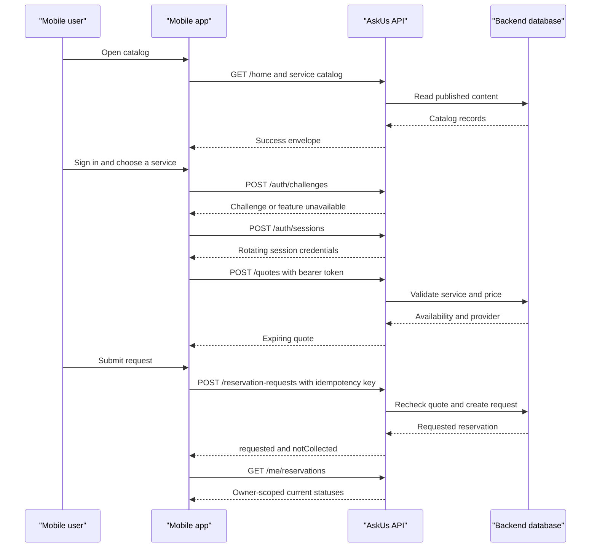

# AskUs Tours Mobile App — Release 1 Backend Integration Brief

Give this complete file to the Codex agent working in the mobile-app repository.

## Assignment for Codex

Connect the existing AskUs Tours mobile application to the operational Release 1 backend described below. Preserve the current UI, navigation, localization (English, Spanish, and Arabic), RTL behavior, validation, and offline-friendly states. Replace local/mock repositories only for the features supported by this contract. Do not invent endpoints, send card details, add hotel booking, or treat a reservation request as a paid/confirmed booking.

First inspect the mobile code and tests. Identify its networking, state-management, model serialization, secure-storage, and environment/configuration conventions. Then implement the API client, DTO/domain mappings, authenticated session lifecycle, repositories, UI loading/empty/error states, and tests. Make focused changes and keep existing local behavior as a fallback only where this document explicitly permits it.

## Backend connection

- Production base URL: `https://api.askustours.com/v1`
- Transport: HTTPS JSON REST.
- JSON keys: camelCase.
- Public content languages: send `Accept-Language: en`, `es`, or `ar` where useful. The current backend stores localized objects and may return them intact; the app must select the current locale, then fall back to Spanish, then the first available translation.
- Authenticated requests: `Authorization: Bearer <accessToken>`.
- JSON writes: `Content-Type: application/json`.
- Reservation and partner-profile submission: add a unique `Idempotency-Key` header. Generate a UUID per user action and retain it while retrying the identical body.
- Store access and refresh tokens only in the platform's secure credential store, never ordinary preferences or logs.
- Access tokens last approximately one hour. Refresh tokens last approximately 30 days and rotate on every refresh.
- Do not hardcode demo IDs, OTP codes, tokens, database values, or production credentials.

For local development, make the base URL compile-time/environment configurable. Android emulators cannot reach a developer machine through `localhost`; use the appropriate emulator host or LAN address. Never disable TLS validation in production.

## Response envelopes

Every successful response has this shape:

```json
{
  "data": {},
  "meta": {
    "requestId": "req_0123456789abcdef"
  }
}
```

List responses place pagination under `meta.pagination`:

```json
{
  "data": { "items": [] },
  "meta": {
    "requestId": "req_0123456789abcdef",
    "pagination": {
      "limit": 20,
      "nextCursor": null,
      "hasMore": false,
      "total": 0
    }
  }
}
```

Every error has this shape. Preserve `code`, field errors, HTTP status, and `requestId` in the client error type:

```json
{
  "error": {
    "code": "VALIDATION_ERROR",
    "message": "The request contains invalid data.",
    "fields": {
      "customer.email": ["Invalid email."]
    }
  },
  "meta": {
    "requestId": "req_0123456789abcdef"
  }
}
```

Do not decode errors as successful DTOs. Recommended UX handling:

| HTTP/code | Mobile behavior |
|---|---|
| `400 MALFORMED_JSON` | Generic request error; log only the request ID in release builds. |
| `401 UNAUTHENTICATED` | Attempt one token refresh, then retry once. If refresh fails, clear the session and show sign-in. |
| `401 REFRESH_EXPIRED_OR_REVOKED` | Clear tokens and owner-scoped caches; return to signed-out state. |
| `403 VERIFICATION_REQUIRED` | Explain that verified sign-in is required. |
| `403 PARTNER_NOT_APPROVED` | Keep the collaborator in the application/review experience. |
| `404 NOT_FOUND` | Show unavailable/removed; never expose another owner's resource. |
| `409` | Do not blindly retry. Reload current data or request a new quote according to the error code. |
| `422 VALIDATION_ERROR` | Map `fields` to the corresponding form controls. |
| `429` | Respect `Retry-After`; disable rapid retry temporarily. |
| `503 FEATURE_NOT_CONFIGURED` | Show that verification is temporarily unavailable; do not pretend a code was sent. |

Use a single-flight refresh mechanism: when several requests receive 401 together, perform one refresh and queue the others. Never recursively refresh the refresh request. Because refresh tokens rotate, atomically replace both tokens returned by a successful refresh.

## Implemented endpoint inventory

### Public catalog and content

| Method | Path | Purpose |
|---|---|---|
| GET | `/home` | Offers, shortcuts, trip ideas, destinations, experiences, and planning-fee display configuration. |
| GET | `/content/{slug}` | Active localized legal/informational document. |
| GET | `/driver-services` | Published driver services (`data.items`). |
| GET | `/driver-services/{serviceId}` | One published driver service. |
| GET | `/driver-services/{serviceId}/calendar` | Dated availability and optional server price. |
| GET | `/driver-services/{serviceId}/reviews` | Active driver reviews. Read-only. |
| GET | `/guide-services` | Published guide services (`data.items`). |
| GET | `/guide-services/{guideServiceId}` | One published guide service. |
| GET | `/travel-packages` | Published packages (`data.items`). |
| GET | `/travel-packages/{packageId}` | One published package. |

The current list implementation returns all matching records and accepts the shared `limit` convention only on private lists. Do not fabricate cursor requests where no cursor is returned. Catalog object bodies come from server-managed JSON and should be decoded defensively: tolerate new fields and unknown read-only enum values without crashing.

Calendar response example:

```json
{
  "data": {
    "serviceId": "service-uuid",
    "days": [
      {
        "date": "2026-12-20",
        "available": 1,
        "priceMinor": 9000,
        "details": { "note": "Daily supplement" }
      }
    ]
  },
  "meta": { "requestId": "req_example" }
}
```

Treat `available` defensively as a boolean-like JSON value. Money is integer minor units (cents) with EUR unless a response explicitly states another ISO currency.

### Authentication and session lifecycle

| Method | Path | Auth | Purpose |
|---|---|---|---|
| POST | `/auth/challenges` | No | Start email or phone verification. |
| POST | `/auth/sessions` | No | Verify the challenge; sign in or register and create a session. |
| POST | `/auth/session-refresh` | Refresh token body | Rotate refresh/access tokens. |
| DELETE | `/auth/session` | Bearer | Revoke the current session. |

Create a challenge:

```json
{
  "channel": "email",
  "destination": "sara@example.com"
}
```

For phone, use `channel: "phone"` and an E.164 value such as `+34600111222`. Success is HTTP 202 and returns `challengeId`, `channel`, `destination`, `expiresAt`, and `resendAfterSeconds`. Production currently returns `503 FEATURE_NOT_CONFIGURED` until a real SMS/email provider is connected. A staging server may expose `developmentCode` only when explicitly configured; never require that field in production DTOs.

Create a session for an existing account:

```json
{
  "challengeId": "challenge-uuid",
  "code": "123456"
}
```

For a new account, include:

```json
{
  "challengeId": "challenge-uuid",
  "code": "123456",
  "firstName": "Sara",
  "lastName": "Ahmed",
  "accountRole": "customer"
}
```

`accountRole` is `customer` or `partner`. Never send `admin`. Session creation returns HTTP 201:

```json
{
  "data": {
    "accessToken": "opaque-access-token",
    "refreshToken": "opaque-refresh-token",
    "tokenType": "Bearer",
    "expiresIn": 3600,
    "user": {
      "id": "user-uuid",
      "firstName": "Sara",
      "lastName": "Ahmed",
      "accountRole": "customer",
      "email": "sara@example.com",
      "phone": null,
      "emailVerified": true,
      "phoneVerified": false,
      "photoUrl": null,
      "photoUploadId": null,
      "avatar": null,
      "address": null,
      "city": null,
      "postalCode": null,
      "country": null,
      "preferences": {}
    }
  },
  "meta": { "requestId": "req_example" }
}
```

Refresh with `{ "refreshToken": "current-refresh-token" }`. The success body has the same session shape and contains a new access token and a new refresh token. Logout returns `{ "data": { "revoked": true }, "meta": ... }`. On logout, clear tokens plus private user/partner caches; do not erase public catalog caches.

### Account, uploads, favorites, basket, and wallets

| Method | Path | Purpose |
|---|---|---|
| GET | `/me` | Current account. |
| PATCH | `/me` | Update allowed account/profile/preference fields. |
| POST | `/uploads` | Upload an owned JPEG/PNG/WebP using a complete base64 data URI. |
| DELETE | `/uploads/{uploadId}` | Delete an owned upload that is not in use. |
| GET | `/me/favorites` | Favorite driver services. |
| PUT | `/me/favorites/{driverServiceId}` | Idempotently add a favorite. |
| DELETE | `/me/favorites/{driverServiceId}` | Idempotently remove a favorite. |
| GET | `/me/basket` | Mixed driver/guide basket. |
| PUT | `/me/basket/items/{itemId}` | Create or replace an owned basket item. |
| DELETE | `/me/basket/items/{itemId}` | Remove an owned basket item. |
| GET | `/me/wallet` | Read-only customer balance and movements. |

Allowed `PATCH /me` fields are `firstName`, `lastName`, `email`, `phone`, `address`, `city`, `postalCode`, `country`, `avatar`, `photoUploadId`, and `preferences`. Send only fields the user changed. Omitted differs from explicit `null`. The response is the complete current user object.

Upload request:

```json
{
  "purpose": "profile-photo",
  "fileName": "portrait.jpg",
  "contentType": "image/jpeg",
  "dataUri": "data:image/jpeg;base64,<complete-base64>"
}
```

Maximum decoded size is 5 MiB. Allowed content types are `image/jpeg`, `image/png`, and `image/webp`; the backend validates the actual signature. Never send a local file path as `dataUri`. Upload first, then attach its returned `id` through `/me`, the partner profile, or a service draft.

Favorite list elements have `{ "id": "driver-service-id", "service": { ... } }`. Favorite mutation returns `driverServiceId` and `favorite`.

Use a stable UUID as basket `itemId`. Driver basket bodies require `type: "driver"` and `driverServiceId`; guide bodies require `type: "guide"` and `guideServiceId`. Include the app's complete editable booking/search object in the same body. The backend preserves that body under `item`, returns a numeric `revision`, and refuses changing an existing item's type. Basket saving does not reserve capacity or hold a price.

### Quotes and customer reservation requests

| Method | Path | Auth | Purpose |
|---|---|---|---|
| POST | `/quotes` | Optional, but sign in before quoting if the quote will be submitted | Server-owned price/availability snapshot. |
| POST | `/reservation-requests` | Verified bearer + `Idempotency-Key` | Create a request from an unexpired quote. |
| GET | `/me/reservations?limit=20` | Bearer | Owner's reservation requests. |
| GET | `/me/reservations/{reservationId}` | Bearer | Owner's request detail. |

Important: a quote created while signed out cannot later be submitted. Ensure the user has a valid session before requesting the final quote.

Driver quote example:

```json
{
  "type": "driver",
  "driverServiceId": "service-uuid",
  "packageOption": "airportHotel",
  "search": {
    "departure": "2026-12-20T10:30:00+01:00",
    "pickup": "Madrid Airport",
    "destination": "Calle Mayor 10, Madrid",
    "passengers": 2,
    "bags": 2
  }
}
```

Guide quote example:

```json
{
  "type": "guide",
  "guideServiceId": "guide-service-uuid",
  "guideSearch": {
    "departure": "2026-12-20T11:00:00+01:00",
    "hours": 2,
    "people": 2,
    "language": "en",
    "meetingPoint": "Plaza Mayor"
  }
}
```

Departure must be at least 12 hours ahead. Guide duration is currently 2 or 4 hours. The server validates capacity, language, availability, package, and price. Success is HTTP 201 and returns an opaque quote `id`, `expiresAt`, selected service IDs/search, `available`, `price`, `commission`, `confirmationMode`, and internal provider assignment. Treat all totals from the response as authoritative and display `pricingStatus`/`taxStatus` honestly. Quotes expire after approximately 15 minutes and are not holds.

Create a reservation request:

```json
{
  "quoteId": "quote-uuid",
  "customer": {
    "firstName": "Sara",
    "lastName": "Ahmed",
    "email": "sara@example.com",
    "phone": "+34600111222"
  }
}
```

At least email or phone is required. Success is HTTP 201. It returns the reservation with `status: "requested"`, `paymentStatus: "notCollected"`, `version`, service/search snapshot, price, commission, and timestamps. Never send card data. Never display this as paid or confirmed. The provider may later change the status to `accepted` or `declined`; history/detail refreshes are the source of truth.

For `QUOTE_EXPIRED`, `QUOTE_CONSUMED`, `SERVICE_UNAVAILABLE`, or changed availability, discard the quote and return the user to refresh/requote. If a reservation POST times out, retry the exact body with the same idempotency key; do not create a new key until the user makes a new submission action.

### Collaborator operations

| Method | Path | Required state | Purpose |
|---|---|---|---|
| GET | `/me/partner-profile` | Partner intent/account | Read draft, pending, approved, or suspended profile. |
| PUT | `/me/partner-profile` | Partner intent/account | Save editable application fields. |
| POST | `/me/partner-profile/submission` | Verified + `Idempotency-Key` | Submit a complete profile for review. |
| GET | `/me/partner-services?type=driver|guide&limit=20` | Partner | List owned service drafts. |
| GET | `/me/partner-services/{partnerServiceId}` | Partner | Read an owned draft. |
| PUT | `/me/partner-services/{partnerServiceId}` | Partner | Create/update an owned draft. |
| GET | `/me/partner-jobs?limit=20` | Verified and approved partner with professional photo | Assigned jobs. |
| PATCH | `/me/partner-jobs/{jobId}` | Same | Accept or decline an assigned requested job. |
| GET | `/me/partner-wallet` | Partner | Read-only earning totals. |
| GET | `/partner-terms` | Bearer | Current commission/economic policy. |

Partner profile fields accepted by PUT are `businessName`, `contactName`, `phone`, `email`, `activity`, `cities`, `citiesText`, and `professionalPhotoUploadId`. The photo must be an upload owned by the user. A submitted/suspended profile is locked. Submission requires all core fields, at least one city, and a professional photo. Map backend `status: "pending"` to the app's under-review state; the client cannot approve itself.

Service draft write:

```json
{
  "type": "driver",
  "expectedRevision": 0,
  "service": {
    "title": "Airport transfer",
    "city": "madrid",
    "seats": 3,
    "bags": 2,
    "languages": ["es", "en"],
    "photoUploadIds": ["upload-uuid"],
    "pricesCents": { "airportHotel": 8500 },
    "currency": "EUR"
  }
}
```

Use a client-generated UUID for a new `{partnerServiceId}` and `expectedRevision: 0`. For edits, send the last server `revision`. On `SERVICE_REVISION_CONFLICT`, reload and let the user reconcile; never overwrite silently. Guide media uses `service.photoUploadId`; driver media uses up to four `service.photoUploadIds`. Saving a draft does not publish it.

Accept or decline a job:

```json
{
  "status": "accepted",
  "expectedVersion": 1,
  "policyVersion": 1
}
```

`status` is only `accepted` or `declined`. Obtain `expectedVersion` from the latest job and `policyVersion` from `/partner-terms`. On any version/policy conflict, reload before presenting the action again.

## Main integration sequence

<!-- mermaid-checked: every participant uses `participant Id as "Label"`, no \n in aliases/messages/notes, every alt/opt/loop closed by end, no `:` inside any alias -->


## Scope boundaries for Release 1

- No payment is collected. There is no card, payment-intent, top-up, payout, refund, or checkout endpoint.
- No hotel catalog or hotel reservation API exists. Keep hotel, flight, train, monument, activity, and notification placeholders unchanged unless the app already handles them locally.
- Reservation creation means a service request awaiting provider action, not confirmed inventory.
- Reviews are read-only. Do not add review creation/reporting.
- Wallets are read-only displays. Never calculate or mutate balances on-device.
- Travel packages are public read-only data. Itinerary draft/submission endpoints are not implemented in this backend release; retain the app's current local/disabled behavior.
- Partner service drafts can be saved, but there is no mobile publish/delete operation.
- All private resources are owner-scoped from the token. Do not send or trust user IDs as authorization.
- Unknown response fields must not break decoding. Unknown enum values should map to a safe `unknown` UI state while preserving the raw value where practical.

## Required implementation work

1. Add environment-specific API base URL configuration without embedding secrets.
2. Add typed success/error envelopes and a shared HTTP client with JSON, language, bearer, timeout, request-ID, and one-time refresh behavior.
3. Add secure session storage, atomic token rotation, startup session restoration, logout cleanup, and multi-account cache isolation.
4. Map public home, driver, guide, calendar, review, and travel-package responses into existing domain models without redesigning the UI.
5. Integrate current account reads/edits and the upload-then-attach photo flow.
6. Replace favorites and mixed basket persistence with owner-scoped repositories after sign-in. If guest local data exists, ask before merging it; never silently attach a previous user's data.
7. Implement final authenticated quote creation and idempotent reservation-request submission. Preserve local form validation, but treat server validation and prices as authoritative.
8. Connect reservation history/detail and status refresh without adding unsupported cancel/modify/payment actions.
9. Connect collaborator profile/application, drafts, terms, assigned jobs, and read-only wallet while enforcing server approval states.
10. Add loading, empty, offline, validation, auth-expired, conflict, and service-unavailable UI states using existing design patterns and all three languages.
11. Add unit tests for envelope/error decoding, token refresh concurrency/rotation, localized fallback, minor-unit money, date/time offsets, idempotent retries, revision conflicts, and owner cache clearing.
12. Add repository or integration tests with a mock HTTP server for the customer catalog-to-request flow and partner job action flow. Do not make automated tests depend on the production API.

## Acceptance checklist

- The app builds and existing tests still pass.
- Base URL is configurable and production uses `https://api.askustours.com/v1`.
- No secret, real OTP, token, or customer data is committed or logged.
- English, Spanish, Arabic, and RTL continue to work.
- Public browsing works without authentication.
- A configured staging environment can complete challenge, session, profile, quote, and reservation-request flows.
- An expired access token performs exactly one coordinated refresh and retries requests once.
- Failed refresh signs out safely and clears only private owner-scoped state.
- Same reservation body plus the same idempotency key is safe to retry.
- Quote expiry and revision conflicts produce recovery UI rather than blind retry.
- Prices come from quote responses and are handled as integer minor units.
- Reservation UI distinguishes `requested`, `accepted`, `declined`, and `paymentStatus: notCollected`.
- No real payment, hotel booking, client-side approval, or client-calculated balance is introduced.
- Document any remaining mismatch between existing mobile models and this implemented contract in the final report.

## Backend limitations to report, not work around

The mobile agent should report these after integration instead of inventing behavior:

- Production OTP delivery still needs an SMS/email provider.
- Tax configuration and real payment processing are intentionally absent.
- Catalog schemas are JSON-managed and may need tighter versioned DTOs after the first integration.
- Pagination currently reports no cursor and is not yet a true multi-page implementation.
- Uploaded URLs are backend-relative; the client may need to resolve them against the API origin.
- No itinerary persistence/submission, hotel booking, notification, cancellation, modification, or review-write endpoint is available in Release 1.

## Mandatory final gap report

After completing and validating the mobile integration, create a separate Markdown file in the mobile-app repository named:

`MOBILE_BACKEND_REMAINING_WORK.md`

This file is a required deliverable. Do not finish the task with only a chat summary. Base the report on the final mobile code, test results, and actual responses/contracts encountered during integration—not assumptions.

Use this structure:

1. **Integration status** — what is fully connected, partially connected, still local/mock, disabled, or not started.
2. **Mobile changes still required** — exact screens, repositories, models, validation, state handling, localization, secure storage, or UX that still need work. Include repository-relative file paths and symbols.
3. **Backend changes still required** — missing endpoints, fields, validation behavior, media handling, pagination, authentication-provider work, or contract changes required from the backend team. For each item, include the affected method/path and explain why the current API is insufficient.
4. **Contract mismatches** — differences between mobile models and backend request/response shapes, including field names, nullability, enums, money units, dates/time zones, localized content, and status meanings. Recommend one concrete resolution for each mismatch.
5. **Production blockers** — security, privacy, OTP delivery, payments, legal content, monitoring, backups, store configuration, deep links, environment configuration, or operational decisions that prevent a safe production release.
6. **Testing still required** — missing unit, widget, integration, device, accessibility, localization/RTL, offline, concurrency, and staging tests. Include failed or skipped tests and their reason.
7. **Recommended priority plan** — group remaining items into `Blocking`, `High`, `Medium`, and `Future`, with a suggested implementation order.
8. **Backend handoff checklist** — a concise checklist the backend/dashboard developer can act on without inspecting the full mobile repository.
9. **Final verification evidence** — commands run, build/test outcomes, staging endpoints exercised, and anything that could not be verified.

Every remaining-work item must include:

- A clear description of the gap.
- Whether the owner is `Mobile`, `Backend`, `Dashboard`, `Infrastructure`, or `Product/Operations`.
- The affected mobile file/symbol or API endpoint.
- User impact and release risk.
- A concrete recommended action.
- Priority: `Blocking`, `High`, `Medium`, or `Future`.

Do not mark an item complete unless it was implemented and verified. Do not hide unsupported features behind generic wording such as “additional work may be needed.” If no work remains in a section, explicitly write `No remaining items found` and state how that conclusion was verified.

In the final chat response, provide:

- A concise integration result.
- Build and test status.
- The path to `MOBILE_BACKEND_REMAINING_WORK.md`.
- The number of remaining items by priority and owner.
- The most important production blocker.
